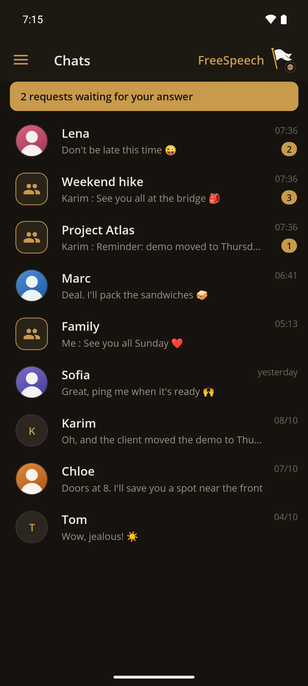
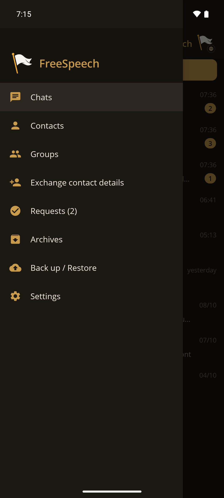
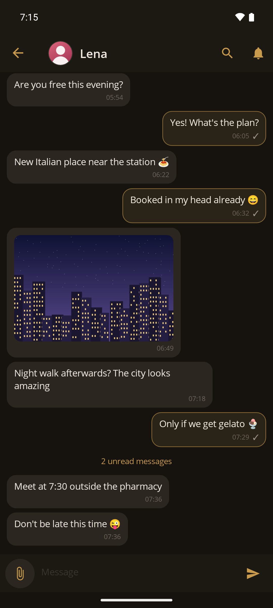

<p>  </p>

# FreeSpeech

**Messagerie chiffrée de bout en bout, sans compte, sur des serveurs qui ne gardent rien.**

  

[Site](https://freespeech.rebisway.com) · [Google Play](https://play.google.com/store/apps/details?id=org.freespeech.mobile) · [Protocole](sources/PROTOCOL.fr.md) · [Architecture](sources/ARCHITECTURE.fr.md) · [English](README.md)

---

FreeSpeech est une messagerie que l'on peut utiliser sans donner de numéro de téléphone ni d'adresse e-mail. Votre identité est calculée sur votre téléphone à partir de trois phrases, et tout ce que vous envoyez y est signé et chiffré avant de quitter l'appareil.

Les serveurs n'ont qu'un rôle : faire passer les messages entre des appareils connectés. Ils ne stockent rien. Quand le destinataire est hors ligne, le message attend sur le téléphone de l'expéditeur et part dès que le destinataire revient.

On peut être sur plusieurs serveurs à la fois, publics ou privés, et chacun peut héberger le sien. Le protocole est décrit dans ce dépôt et ne dépend d'aucun framework en particulier : un client ou un serveur peut s'écrire dans n'importe quel langage.

## Fonctionnalités

FreeSpeech fait ce qu'on attend d'une messagerie : texte, réponses, réactions par emoji, modification et suppression d'un message (pour soi ou pour tout le monde), indicateur « écrit… », accusés de lecture que l'on peut désactiver, groupes, photos, vidéos et fichiers, et un mode silencieux par discussion. Un message dont la première ligne est `md` s'affiche mis en forme (titres, listes, gras, italique, liens).

Un groupe a une seule clé partagée. Elle change à chaque arrivée, départ ou exclusion, ce qui empêche une personne exclue de lire la suite. Un membre resté hors ligne demande aux autres ce qu'il a manqué, et l'auteur de ces messages n'a pas besoin d'être là. Une invitation n'est jamais automatique : la personne invitée doit l'accepter, et elle y choisit le nom et l'image qu'elle montrera dans ce groupe, différents de ceux qu'elle utilise ailleurs : deux groupes ne se relient donc pas par le nom ou l'image. Une coche marque, dans un groupe, les membres qui sont vos contacts (dorée quand vous avez comparé leur numéro de sécurité).

Les fichiers peuvent atteindre 2 Gio ; l'application demande une confirmation avant d'en envoyer un gros (la taille se règle), un fichier reçu affiche sa taille avant qu'on le télécharge, et un relais peut limiter le volume que chacun envoie par jour. Les fichiers sont découpés en morceaux de 48 Kio, chacun contrôlé par une preuve de Merkle, et un transfert interrompu reprend là où il s'est arrêté. Dans un groupe, celui qui possède déjà le fichier peut en envoyer une partie : le téléphone de l'expéditeur n'est donc pas la seule source. Les photos sont réduites et les vidéos recompressées avant de partir.

Deux personnes peuvent comparer un numéro de sécurité pour vérifier que personne n'a falsifié leur échange de clés. La base locale est chiffrée et le code PIN est facultatif. Les trois phrases peuvent être imprimées sur une feuille avec un QR code, ou gardées dans un fichier protégé par un mot de passe.

L'application Android ajoute des contacts par QR code ou par fiche à usage unique, fait tourner la même identité sur plusieurs appareils, accepte le contenu partagé depuis d'autres applications, et existe en français, en anglais et en espagnol. Les notifications se contentent de réveiller l'application. Elles ne contiennent jamais le texte d'un message.

## Fonctionnement

Vos trois phrases passent par Argon2id puis HKDF et donnent deux paires de clés, une pour chiffrer (X25519) et une pour signer (Ed25519). L'empreinte des clés publiques est votre identifiant. Rien n'est enregistré nulle part pour l'obtenir.

Pour devenir contacts, deux personnes échangent une fiche qui contient leurs clés publiques, un pseudo et les serveurs qu'elles utilisent, sous forme de QR code ou avec un code à usage unique.

Le serveur n'intervient qu'à l'envoi. L'application signe le message, le chiffre avec une clé éphémère neuve et le remet à un serveur par WebSocket. Le serveur lit l'enveloppe, c'est-à-dire l'expéditeur et le destinataire, et rien d'autre. Si le destinataire est connecté, il lui livre le message, en passant par un serveur voisin quand c'est là que se trouve le destinataire. Sinon, le message reste dans la file d'envoi de l'expéditeur. Une notification réveille le téléphone du destinataire, l'application se reconnecte et la file se vide. Le destinataire vérifie la signature, puis déchiffre.

```
   Alice                                                  Bob
 (téléphone)                                          (téléphone)
      │ message signé, puis chiffré                        ▲
      ▼                                                    │
 ┌──────────┐   lien accepté par les deux     ┌──────────┐ │
 │ Relais A │◄──────── administrateurs ──────►│ Relais B │─┘
 └──────────┘                                 └──────────┘
   ne garde rien                                ne garde rien
```

Une nouvelle application qui ne connaît encore aucun relais interroge un annuaire une seule fois, à sa toute première connexion, pour savoir quels relais publics acceptent de nouveaux comptes. L’annuaire répond par une liste signée et ne conserve rien sur les clients. Ensuite, il n’intervient plus. Deux serveurs publics deviennent voisins quand leurs deux administrateurs acceptent le lien. Les schémas sont dans [sources/diagrams/](sources/diagrams/) ; les fichiers en `-fr` sont en français.
## Cryptographie

| Usage | Primitive |
|---|---|
| Identité, dérivée des 3 phrases | Argon2id (32 Mio, t = 3), puis HKDF-SHA256 |
| Accord de clé pour chaque message | X25519 éphémère, HKDF-SHA256 |
| Chiffrement | ChaCha20-Poly1305 |
| Signature | Ed25519, liée à l'expéditeur, au destinataire et au type de message |
| Groupes | Une clé partagée par époque, renouvelée à chaque changement de composition |
| Fichiers | Morceaux de 48 Kio, arbre de Merkle SHA-256 |
| Base locale | SQLite, contenu chiffré champ par champ |
| Liaison entre deux serveurs | Une clé ECDSA P-256 par serveur, appels signés, fenêtre de ±2 minutes, protection contre le rejeu |

Les primitives viennent de BouncyCastle, du code managé qui fonctionne sur Android et sur iOS. Des vecteurs de test figés les contrôlent.

## Limites

- Un serveur voit qui écrit à qui, quand, et à quelle heure chaque appareil se connecte. Il ne voit jamais le contenu.
- Il n'y a pas de ratchet. Si quelqu'un a capturé du trafic passé et vole ensuite la clé à long terme d'un destinataire, ce trafic peut être déchiffré.
- Perdre les trois phrases fait perdre l'identité. Il n'y a pas de récupération.
- Supprimer un message pour tout le monde et le modifier se font au mieux : un client modifié peut les ignorer, et le destinataire a pu copier le message avant.
- Un membre de groupe peut transmettre la clé courante à une personne exclue, hors protocole.
- Les fichiers reçus ne sont pas chiffrés par l'application. Sur Android, ils sont dans l'espace privé de l'application, que le système chiffre ; sur le bureau, ce sont de simples fichiers dans le dossier de données de l'application.
- Le code PIN protège l'écran, pas le chiffrement.

Le modèle de sécurité est décrit en détail dans [ARCHITECTURE.fr.md](sources/ARCHITECTURE.fr.md), section « Modèle de sécurité et limites connues ».

## Organisation du dépôt

| Dossier | Contenu |
|---|---|
| `sources/freespeech.relay` | Le relais, en ASP.NET Core 10 |
| `sources/freespeech.client` | La bibliothèque cliente (C#, .NET 10, sans interface) : identité, contacts, serveurs, messages, fichiers, groupes, stockage |
| `sources/freespeech.mobile` | L'application .NET MAUI pour Android, avec une version Windows pour travailler sur l'interface |
| `sources/freespeech.desktop` | Le client de bureau Avalonia (solution `sources/FreeSpeech.Desktop.slnx`) |
| `sources/freespeech.console` | Un client console de test, au-dessus de la bibliothèque (Windows) |
| `sources/freespeech.push` | La passerelle de notifications |
| `sources/freespeech.directory` | L’annuaire de relais, utilisé à la toute première connexion |
| `sources/freespeech.ops` | Le code commun au relais et à la passerelle : ligne de commande d'administration, liaison des serveurs, journaux |
| `sources/freespeech.tests` | Les tests xunit |
| `sources/deploy/` | Fichiers de service, fichiers nginx et exemples de configuration |
| `sources/diagrams/` | Les schémas, en français et en anglais |
| `scripts/` | Des scénarios de bout en bout avec de vrais clients et de vrais serveurs |

## Pour commencer

**Utiliser l'application.** Rejoignez le test ouvert sur [Google Play](https://play.google.com/store/apps/details?id=org.freespeech.mobile). Vous pouvez aussi télécharger l'APK sur [freespeech.rebisway.com/download](https://freespeech.rebisway.com/download/) et comparez l'empreinte SHA-256 affichée sur cette page avec celle de votre fichier. Dans Réglages > Serveurs, `https://fs.rebisway.com` est le serveur de référence, et vous pouvez ajouter le vôtre.

**Héberger un relais.** [INSTALL_RELAY.fr.md](sources/INSTALL_RELAY.fr.md) détaille pas à pas Ubuntu 24, nginx, systemd et le certificat. Les commandes d'administration sont dans [cli-relay.fr.md](sources/cli-relay.fr.md).

**Compiler et tester.** Il faut le SDK .NET 10.

```bash
dotnet build sources/FreeSpeech.slnx
dotnet test sources/freespeech.tests
```

Pour essayer en local, lancez un serveur et deux clients, chacun avec son propre profil :

```bash
dotnet run --project sources/freespeech.relay --no-launch-profile --urls http://localhost:5299
dotnet run --project sources/freespeech.console -- alice http://localhost:5299
dotnet run --project sources/freespeech.console -- bob http://localhost:5299
```

Au premier lancement d'un profil, la console demande trois phrases de récupération d'au moins 75 caractères chacune, toutes différentes. `help` liste les commandes. Sous Windows PowerShell, `scripts\dev-run.ps1` ouvre le serveur et plusieurs clients d'un coup, et `scripts\test-groups.ps1`, `scripts\test-attachments.ps1` et `scripts\test-multiserver.ps1` rejouent des scénarios complets.

L'application mobile a sa propre solution. Elle exige la charge de travail Android de .NET, et le dépôt doit se trouver dans un chemin sans caractères accentués.

```bash
dotnet build sources/FreeSpeech.Mobile.slnx -f net10.0-android36.0
dotnet build sources/FreeSpeech.Mobile.slnx -f net10.0-windows10.0.19041.0   # la lancer sur le PC
```

**Adresses par défaut.** L'application mobile et le client de bureau démarrent avec des serveurs d'exemple (`relay.exemple.org`, `push.exemple.org`). Pour compiler avec les vôtres, copiez `sources/freespeech.defaults.props.example` en `sources/freespeech.defaults.props` et renseignez-y `FsDefaultServer`. L'adresse est enregistrée dans l'assembly à la compilation, aucune n'est écrite dans le code. La passerelle push n'est pas compilée dans l'application : chaque relais utilise celles auxquelles son administrateur l'a lié.

## Documentation

| | Français | English |
|---|---|---|
| Fonctionnement : serveurs, clients, réveil du mobile | [HOW_IT_WORKS.fr.md](sources/HOW_IT_WORKS.fr.md) | [HOW_IT_WORKS.en.md](sources/HOW_IT_WORKS.en.md) |
| Un message dans tous les cas (contact, groupe) | [MESSAGE_FLOWS.fr.md](sources/MESSAGE_FLOWS.fr.md) | [MESSAGE_FLOWS.en.md](sources/MESSAGE_FLOWS.en.md) |
| Fonctionnalités du mobile et du bureau | [FEATURES.fr.md](sources/FEATURES.fr.md) | [FEATURES.en.md](sources/FEATURES.en.md) |
| Protocole | [PROTOCOL.fr.md](sources/PROTOCOL.fr.md) | [PROTOCOL.en.md](sources/PROTOCOL.en.md) |
| Référence de l'API du protocole | [PROTOCOL_API.fr.md](sources/PROTOCOL_API.fr.md) | [PROTOCOL_API.en.md](sources/PROTOCOL_API.en.md) |
| Architecture, chiffrement, stockage | [ARCHITECTURE.fr.md](sources/ARCHITECTURE.fr.md) | [ARCHITECTURE.en.md](sources/ARCHITECTURE.en.md) |
| Installer un relais | [INSTALL_RELAY.fr.md](sources/INSTALL_RELAY.fr.md) | [INSTALL_RELAY.en.md](sources/INSTALL_RELAY.en.md) |
| Administrer ses serveurs | [ADMINISTRATION.fr.md](sources/ADMINISTRATION.fr.md) | [ADMINISTRATION.en.md](sources/ADMINISTRATION.en.md) |
| Ligne de commande du relais | [cli-relay.fr.md](sources/cli-relay.fr.md) | [cli-relay.en.md](sources/cli-relay.en.md) |
| Ligne de commande de la passerelle push | [cli-push.fr.md](sources/cli-push.fr.md) | [cli-push.en.md](sources/cli-push.en.md) |
| Installer la passerelle push | [INSTALL_PUSH.fr.md](sources/INSTALL_PUSH.fr.md) | [INSTALL_PUSH.en.md](sources/INSTALL_PUSH.en.md) |
| Installer un annuaire de relais | [INSTALL_DIRECTORY.fr.md](sources/INSTALL_DIRECTORY.fr.md) | [INSTALL_DIRECTORY.en.md](sources/INSTALL_DIRECTORY.en.md) |
| Plusieurs serveurs sur une machine | [INSTALL_HOST.fr.md](sources/INSTALL_HOST.fr.md) | [INSTALL_HOST.en.md](sources/INSTALL_HOST.en.md) |
| Schémas | [sources/diagrams/](sources/diagrams/) (`-fr`) | [sources/diagrams/](sources/diagrams/) (`-en`) |
| Diagrammes de classes et de base de données | [uml/](sources/diagrams/uml/), [db/](sources/diagrams/db/) | [uml/](sources/diagrams/uml/), [db/](sources/diagrams/db/) |

## Contribuer

Les signalements, les relectures de la cryptographie et du protocole, les tests et les corrections sont les bienvenus. Lisez le [protocole](sources/PROTOCOL.fr.md) et l'[architecture](sources/ARCHITECTURE.fr.md) avant de proposer un changement. Les commentaires de code sont en anglais, chaque fichier source porte l'en-tête de licence, et chaque document est fourni en français et en anglais (un fichier `.fr.md` et un fichier `.en.md`).

Pour signaler une faille, écrivez à <contact@rebisway.com>.

## Licence

FreeSpeech est un logiciel libre sous licence **GNU AGPL v3.0 ou ultérieure** (`AGPL-3.0-or-later`) ; voir [LICENSE](LICENSE). © 2024-2026 Thomas Gourgnier.

Le serveur étant un service réseau, l'AGPL impose à quiconque exploite une version modifiée d'en offrir le code source aux utilisateurs de ce service. Les contributions seront acceptées dans le cadre d'un accord de contribution (CLA) qui permet de proposer une licence commerciale en parallèle.
