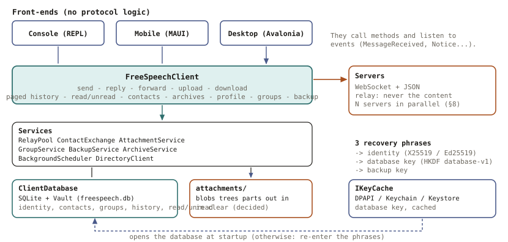
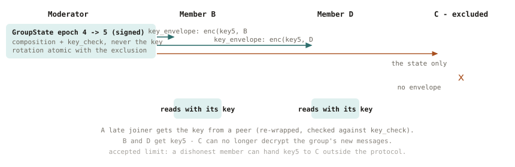
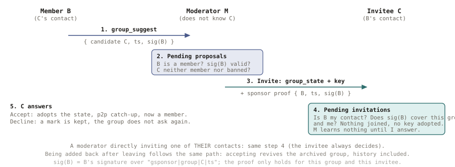
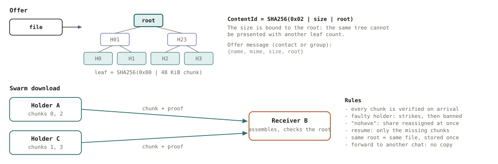
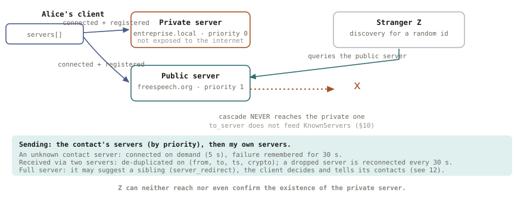
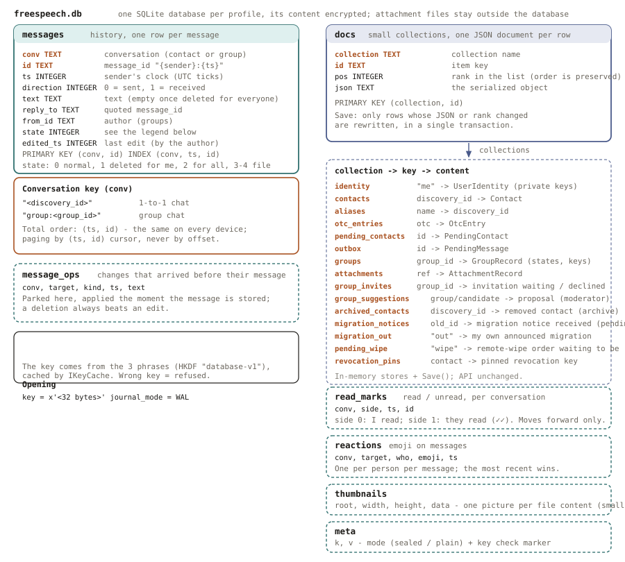

# FreeSpeech architecture

This document explains **how FreeSpeech is built and why**: the components, the
technologies, the cryptography, the local storage and its table schema. The wire
protocol itself (message formats, rules) is specified in
[PROTOCOL.en.md](PROTOCOL.en.md). The role of each component and the path of a message are explained in [HOW_IT_WORKS.en.md](HOW_IT_WORKS.en.md) and [MESSAGE_FLOWS.en.md](MESSAGE_FLOWS.en.md), the features of the applications in [FEATURES.en.md](FEATURES.en.md). Diagrams live in [diagrams/](diagrams/), each in French
(`-fr`) and English (`-en`). French version: [ARCHITECTURE.fr.md](ARCHITECTURE.fr.md).

FreeSpeech is free software (AGPL-3.0-or-later). The design goal is that everything
stays **re-implementable in any language**: no proprietary framework is part of the
protocol, only open standards and well-known primitives.

---

## 1. Overview

```
  Front-ends (console and MAUI mobile today, desktop later)
        │  methods + events, no protocol logic
        ▼
  FreeSpeechClient  ── freespeech.client (class library, .NET 10)
        │  services: relay pool, contacts, attachments, groups, backup
        ▼
  ClientDatabase (SQLite + Vault)          attachments/ (plain files)
        ▲
        └─ key from the 3 recovery phrases, cached by IKeyCache
                                   │ WebSocket + JSON
                                   ▼
                         Servers (stateless relays) ── server-to-server cascade
```



| Project | Role |
|---|---|
| `freespeech.relay` | ASP.NET Core 10 relay. Routes envelopes between connected clients, answers presence and "flag" queries, cascades discovery to sibling servers. **Stores no message, ever.** |
| `freespeech.client` | The client library: identity, contacts, multi-server relay, messages, attachments, groups, backup, local storage. No UI, no console output. Shared by every front-end. |
| `freespeech.console` | A thin REPL on top of the library: parses a command, calls `FreeSpeechClient`, prints the result and the events. Used to test the server and the API. |
| `freespeech.mobile` | **.NET MAUI** mobile app (Android, tried on emulators and a phone; iOS to come; Windows to develop). MVVM, dark background and gold accent: pages that display and call `FreeSpeechClient`, no protocol logic. Side menu (chats, contacts, groups, invite, approve, archives, backup, settings), texts in JSON (FR/EN/ES), contact QR, pictures, read/unread, groups, emoji reactions, videos (compression, playback), camera, sharing from other apps, silent mode, notifications, light/dark theme, language import. Separate solution (`FreeSpeech.Mobile.slnx`). |
| `freespeech.directory` | Directory: relays linked by keys send it signed heartbeats (country, places left, version); it gives a client that knows no relay a signed list of relays, drawn at random weighted by the places left, and checks each relay's address; local `admin` API and command ([cli-directory.en.md](cli-directory.en.md)). |
| `freespeech.push` | Push gateway: sole holder of the FCM/APNs credentials; one key per relay server, limits and maintenance changed at run time, local `admin` API and command (§3.14). |
| `freespeech.ops` | Operations toolkit shared by the relay and the gateway: log levels at run time, in-memory log buffer, per-identity tracing, local admin guard, `admin` command plumbing, atomic file writes (§3.14). |
| `freespeech.tests` | xunit tests (348): library, real servers, a real push gateway and a real console started as processes; end-to-end PowerShell scripts in `scripts/` drive real client processes against real servers. |

### Why a library with an event API
A mobile or desktop app must behave exactly like the console, so every function
lives in `FreeSpeechClient` and nothing else. A front-end calls methods
(`SendAsync`, `UploadAsync`, `GetLatestMessages`, `CreateGroupAsync`, …), shows
their typed results, and listens to events (`MessageReceived`, `ContactRequested`,
`ServerConnectionChanged`, `Notice`, …). User errors are `ClientException`s with a
message meant to be displayed.

---

## 2. Technologies

| Area | Choice | Why |
|---|---|---|
| Language / runtime | C# on .NET 10 | One code base for server and client library. The mobile app is **.NET MAUI** (the same code for Android and iOS); the wire protocol and the SQLite file format stay readable from any language. |
| Mobile | .NET MAUI, MVVM (CommunityToolkit.Mvvm), QRCoder (show a QR) and ZXing.Net.Maui (read it, Android) | One code base, all the logic stays in the library. Texts are one JSON file per language (importable); some gestures (the viewer's pinch) go through native Android code. |
| Server | ASP.NET Core 10, deployed behind nginx on Ubuntu 24 | Standard, well supported. |
| Transport | Raw **WebSocket (RFC 6455)** with a documented JSON framing and `request_id` correlation; plain HTTP for presence and flags | SignalR was dropped on purpose: it is a proprietary protocol that other languages cannot easily implement. |
| Cryptography | **BouncyCastle** (`BouncyCastle.Cryptography`, fully managed code) for X25519, Ed25519 and ChaCha20-Poly1305; HKDF, SHA-256 and randomness come from .NET | Same algorithms and same bytes as libsodium (checked against fixed libsodium vectors), but **no native library**: the libsodium package for .NET ships none for Android or iOS. No hand-rolled crypto: only standard primitives (RFC 7748, 8032, 8439). |
| Local database | **SQLite** through `Microsoft.Data.Sqlite.Core`, its content encrypted field by field by `Vault` (`SQLitePCLRaw.bundle_e_sqlite3`) | Runs on Windows, Android and iOS; atomic writes; queries for paging; no native encryption library. |
| Key protection | `IKeyCache`: DPAPI (Windows console), Keychain (iOS), Keystore (Android) | The OS protects the cached key; the phrases can always regenerate it. |
| Tests | xunit + end-to-end PowerShell scripts (real processes, real servers) | The scripts cover what unit tests cannot: reconnection, interrupted transfers, several servers. |

---

## 3. Cryptography

### 3.1 Identity — derived from three phrases (§1)
No account, no password server. The user types **three different recovery phrases
(≥ 75 characters each)**:

```
seed          = Argon2id(phrase1 ‖ 0 ‖ phrase2 ‖ 0 ‖ phrase3, salt "FreeSpeech-v3-seed", 32 MiB, t=3, p=1)   (32 bytes)
enc_seed      = HKDF-SHA256(seed, salt="FreeSpeech-v2", info="encryption")
sign_seed     = HKDF-SHA256(seed, salt="FreeSpeech-v2", info="signing")
db_key        = HKDF-SHA256(seed, salt="FreeSpeech-v2", info="database-v1")
X25519  key pair  ← enc_seed          Ed25519 key pair  ← sign_seed
discovery_id  = hex(SHA256(X25519_pub ‖ Ed25519_pub))
```

The same phrases give the same identity on any device, with no server involved.
Each key has its own HKDF label, so the identity keys, the database key and the
backup key are **independent**. **There is no recovery if the phrases are lost** —
an accepted property of the design.

### 3.2 Messages — sign-then-encrypt (§5)
A message is a *Letter* `{type, payload, sig, orig_to}` inside an *Envelope*
`{from, to, crypto, msg, ts, reply_to}`; the server only sees the envelope.

1. The sender signs the letter with **Ed25519** — the signature covers a domain tag, `from`, `to`, the type, the content and `ts`: a letter is only valid for its recipient (PROTOCOL §5).
2. It creates a fresh **ephemeral X25519** key pair and computes the shared secret
   with the recipient's static X25519 public key.
3. **HKDF-SHA256** turns the secret into a key; **ChaCha20-Poly1305** encrypts
   signature + letter (AEAD: confidentiality and integrity).
4. The recipient decrypts with its private key and verifies the signature against the
   sender's stored signing key. A message with a bad signature is dropped.

`crypto` tells the receiver how to read `msg`: `0` one-time-code contact exchange,
`1` asymmetric, `2` group. `message_id = "{sender}:{ts}"` is independent of any
server clock and de-duplicates messages that reach us twice.

### 3.3 Contact exchange — one-time codes (§3)
Two people meet out of band (manual string or QR). A **ContactCard** (name, public
keys, servers, optional photo and description; **no photo inside a QR**, which could not hold it) is encrypted with a key derived from
a **one-time code** (HKDF + ChaCha20-Poly1305), so a relay that sees the exchange
learns nothing. Each side confirms; afterwards messages use the keys of the card.
Keys are **immutable**: an `identity_update` that changes them is rejected as a
possible impersonation.

### 3.4 Groups — one shared key, rotated on exclusion (§7)
Groups can exceed 20 members, so a message is encrypted **once** with a shared
**group key** (ChaCha20-Poly1305), prefixed by a tag derived from the key so a
member knows which key to try.



- The composition lives in a **signed `GroupState`** per *epoch*: members, roles,
  and a `key_check` (proof of the key, never the key). History and keys are **not**
  in the state.
- **Every composition change rotates the key atomically** with the new state. The new
  key reaches each remaining member as a `key_envelope` (X25519 ephemeral + HKDF +
  ChaCha20-Poly1305, the §5 scheme) encrypted for that member only. An excluded
  member receives the new state **without** an envelope and cannot read what follows.
- A late joiner gets the key from any peer, who re-wraps it; the receiver checks it
  against `key_check`, so a peer cannot slip in a wrong key.
- Concurrent changes are resolved deterministically: a successor must be signed by a
  moderator of the current state; equal siblings are tie-broken by the smallest
  SHA-256; alternative branches are kept with their keys.
- Operations outside the state are individually signed: the blacklist, group profile
  (name, picture, description; creator only) and member profiles (self-signed).
- **Name and picture per group.** `GroupRecord.MyName` / `MyPhoto`: the name and picture I use in this group (empty = those of
  my profile). They only travel in my `member_profile` of that group, so they cannot link the groups; a change goes out
  `GroupService.ProfileDelay` (30 s) after the last one (`SetMyNameAsync`, `SetMyPhotoAsync`), so successive edits make a single
  send; it shows at once on my screen (`MyNameIn`, `MyPhotoIn`). Chosen when the invitation is accepted
  (`AcceptInvitationAsync(id, name, picture)`, sent at once). How a member is shown (`FreeSpeechClient.MemberNameIn` / `MemberPhotoIn`):
  the name I gave them (`local_name`), then the one they chose for the group, then my contact's, then the signed state's.
- **No server storage, no stored envelopes**: a member who was offline asks other
  online members for what it missed (`group_sync`), in batches.
- **The invitee decides.** An invitation (signed state + key envelope, kept as received) waits in a list; nothing is
  joined or decrypted before the answer. Accepting adopts the state then catches up; declining keeps a mark. Coming
  back to a group one left follows the same path and revives the archived group with its history.
- **Proposing a contact (sponsoring).** An ordinary member does not invite but signs a proposal (`group_suggest`) sent
  to the moderators; one of them may invite the person, attaching the **sponsor's proof**. The invitee, who may not
  know that moderator, accepts the invitation of a non-contact if the proof comes from a member who is **their**
  contact and covers this group and themselves.



### 3.4 bis Read / unread, read receipts
A **read mark** per conversation (position `ts` + `message_id`) gives the unread count and where to open a chat. In
1-to-1 the client sends a best-effort `read_ack { target }` (no queue, not in the history) when the chat is shown; the
receiver honours it only if `target` is one of its own messages, and the "read by the other side" mark only moves
forward (✓ then ✓✓). Sending can be turned off; no receipts in a group. A read receipt also counts as a confirmation of receipt: it removes from the outbox the
messages delivered to that contact up to the message read (`PendingMessageStore.AcknowledgeReadUpTo`), which are not sent again.

### 3.4 ter Archives
A group one left (or was excluded from) and a removed contact do not vanish: the conversation is **archived**,
readable and read-only. It comes back as it was if one joins the group again or adds the contact again (same
identifier, so same history); **permanent deletion** erases messages, files and, for a group, states and keys; a new
conversation then starts empty.

### 3.4 quater "Pending" members
When a moderator invites someone, that person is in the group state at once, without necessarily having answered.
Every device therefore keeps `GroupRecord.Heard`: the members it has had a **sign of life** from (a message, a
`group_sync` catch-up request). `PendingMembers` = the members of the current state, other than me, the creator and
the moderators, that are not in `Heard`; Group info shows them dimmed with "Pending". This is **local** information
(nothing in the protocol). On joining, the members already there are taken as arrived; a group created before this
feature (`Heard` absent) shows nobody as pending.

### 3.5 Attachments — Merkle tree and swarm download (§6)


- A file is cut into **48 KiB chunks**. Leaf = `SHA256(0x00 ‖ chunk)`, node =
  `SHA256(0x01 ‖ left ‖ right)` (an odd node is promoted). The content identity is
  `SHA256(0x02 ‖ size ‖ root)`; binding the **size** removes the ambiguity about the
  number of leaves.
- The offer carries `{name, mime, size, root}`. Each chunk travels as an encrypted
  Letter with its **Merkle proof**, so the receiver verifies it on arrival, from any
  holder — not only from the author.
- In a group, **every member who has the file can serve it** (swarm). A faulty holder
  earns strikes and is banned; a holder that no longer has the file answers
  `attachment_have` (as does a holder on mobile data with the Wi-Fi setting) and its share is reassigned at once; a member still downloading serves the chunks
  it has received (Merkle proof kept with each); chunks are handed out in windows sized by each holder's speed; a stalled transfer resumes with only the missing
  chunks. The "files only on Wi-Fi" setting holds back the chunks asked for and served on mobile data (`TransferPolicy`).
- Identical content is stored **once** (content-addressed `blobs/{root}.ext`), so
  forwarding a file to another conversation copies nothing.
- File type is detected from the **content** (magic bytes), never the extension.
  Limit: 2 GiB per file (protocol ceiling), uploaded file by file; the user's own threshold asks for a confirmation
  before a large file is sent (25 MiB by default), and the relay limits the volume sent per identity.

### 3.6 Backup (§2)
A zip (manifest, history in blocks of 1,000 lines, files) cut into **1 MiB blocks**, each sealed with
ChaCha20-Poly1305 with the block index and a *final* flag as associated data
(reordering or truncation is detected), under a key derived by HKDF from the
identity. Modes: no attachments, last *N* months (default 6), or all. Restoring on a
new device requires re-deriving the same identity from the phrases. The history is read from the database and written block by
block (`HistoryStore.Stream`), then read back the same way on restore: a long history is never loaded whole (the `Digests` are computed
conversation by conversation likewise).

### 3.7 Editing and deleting a message
Four actions on a sent message, in 1-to-1 and in groups: **edit**, **delete for me**, **delete for everyone**,
**remove the attachment** (for me / for everyone). The "for everyone" changes are signed Letters (`message_edit`,
`message_retract`, `attachment_retract`); **every receiver checks that the sender is the author of the targeted
message** (the `message_id` contains the author), so nobody can touch someone else's message. Deleting erases the
content and leaves a "message deleted" line; in a group the sealed copy also leaves the catch-up log, a **gap
marker** keeping the sequence numbers contiguous. Best-effort guarantee: a modified client can ignore it. Detail:
[PROTOCOL.en.md](PROTOCOL.en.md) §5 and §7.

---

### 3.8 Reactions
An emoji reaction to a message or a file is a `message_react { target, text }` Letter (PROTOCOL §5): a single
emoji, empty to take it back. Any participant may react (not only the author); a person has **one** reaction per
message, the most recent wins, and a reaction that arrives before its message is kept. Storage: the `reactions` table
(§5.1 quater). API: `ReactAsync(conversation, index, emoji)` (the same emoji a second time takes it back),
`GetReactions(conversation)`, `MessageChanged` event of kind `Reacted`.

### 3.9 Library texts: codes
The library's "talking" failures (group action refused, message not found, name too long, file too big...) carry a
**stable code** in addition to the English message, which stays the one of the console, the logs and the tests:
`ICodedMessage { Code, Args }`, implemented by `ClientException(message, code, args)` and by
`CodedInvalidOperationException` (derives from `InvalidOperationException`: existing `catch` blocks still work). An app
translates through the `err_<code>` key of its language files (`ErrorText.Of`) and falls back to the English message
when there is no translation. Purely technical errors (inconsistent keys, network) have no code; the console log's
"notices" stay in English, the mobile app relies on structured events.

### 3.10 Mobile app: theme, silent mode, notifications, sharing, video
- **Theme**: `Colors.xaml` is the dark palette; `Palette` gives the light values to the same keys before the styles
  (which read them) are loaded. Read at start: changing theme restarts the app (`RestartActivity`, in a separate
  process). Choice: dark, light, same as the phone.
- **Silent mode** per conversation (🔕 in the bar): no banner and no notification, the unread counter stays (greyed).
- System **notifications** (`INotifier`; Android: `AndroidNotifier`, "messages" channel, Android 13 permission) while
  the app is in the background: messages, contact requests, invitations; a tap opens the conversation or Approve.
  Switchable in Settings. **App closed**: the **fallback of PROTOCOL §9** is coded (`BackgroundPoll`, `PollWorker`: WorkManager, about
  every 15 minutes, network required): the app connects for 45 s, longer than one 30 s tick, because **the servers keep
  no message** (the sender's own client re-sends what it holds when it sees the recipient online), then notifies.
  Structural limit: two phones that each wake every 15 minutes rarely overlap; real push (FCM/APNs, §9) is what wakes
  the recipient right after the send. Not done yet.
- **Camera photo/video** (`MediaPicker`) and **sharing from another app** (`SEND` / `SEND_MULTIPLE` intent filter,
  files copied to the cache, a "Share" screen where the conversations are ticked).
- **Video**: before sending, Media3 Transformer re-encodes it to H.264, 720p at most (the compressed copy is sent only
  if smaller); played inside the app (native `VideoView`, `VideoPlayerHandler`). Android minimum: 7 (API 24).
- **Languages**: import a JSON file (a `_name`, a code), share the English template to translate from the app, remove
  an imported language; the shipped languages cannot be replaced.

### 3.11 Relay security, key verification, push, deployment
- **Proof of identity at registration** (PROTOCOL §11): `register` carries both public keys, the server checks
  `SHA-256(enc ‖ sign) = discovery_id`, then sends a challenge (`nonce`) that the client signs with Ed25519
  (`register_proof`). Without it anyone could register as someone else, see their envelopes and make their
  messages get lost (the sender believes "delivered"). `RegistrationAuth` (server), `RegisterAuth` + `RelayClient`
  (client). A recent client stays compatible with an old server, not the other way round. Development switch
  `Server:AllowAnonymousRegister` (off by default) for raw scripts.
- **Limits**: WebSocket frame at most 512 KiB (`Server:MaxMessageBytes`, close 1009), text at most 8,000
  characters (`msg_too_long`), volume sent per identity (1 GiB per 24 hours, 300 MiB per 10 minutes) and per
  address (5 GiB per 24 hours), refused with `quota_exceeded` / `rate_limited` (`Services/TrafficLimiter.cs`), pictures reduced to 1,600 px / JPEG before sending (mobile), videos 720p; nginx limits
  connections and requests per address, blocks `/api/admin`, keeps no access log.
- **Safety number** (§3): `SafetyNumber` (SHA-512 iterated over the two sorted key pairs, 12 × 5 digits), a
  "Verify security" screen (contact list, shield), the `Contact.VerifiedAt` mark (✔), console command `safety`.
  Identical on Android and the console (checked on an emulator).
- **Push** (§9): relay (`PushRegistry`, `PushNotifier`, gateway allow-list, `peer_online`) and the `freespeech.push`
  gateway (`IPushProvider`: FCM, APNs, log; mandatory secret, limited body). Still to do on mobile: the FCM token,
  an optional `google-services.json`.
- **Profile update**: if the contact is offline, the `identity_update` stays in the outbox (the newest replaces
  the previous ones).
- **Deployment**: `sources/deploy/` (systemd service, nginx sites, update scripts, APK download page),
  `sources/INSTALL_RELAY.en.md`, `scripts/build-apk-release.ps1` (signed APK for phones, arm64; `-AllAbis` for arm64 + x86_64; `-Aab` produces the App Bundle `org.freespeech.mobile-Signed.aab` for Google Play; version, date and build number: `sources/version.props`), `scripts/build-desktop-msi.ps1` (Windows installer) and `scripts/build-apk-debug.ps1` (Debug x86_64 APK for the emulators).
- **One-tap identity creation**: `PhraseGenerator` draws the three phrases (a public-domain book passage + 3 random
  words, ≈ 150 bits; books `fr/en/es.txt.gz` in `Resources/Raw/books`, `scripts/prepare-books.ps1`, `SOURCES.md`,
  ≈ 1.3 MB compressed in the APK). "Advanced" mode: choosing the server. Creation in three steps: name → **saving the
  phrases** (`PhrasesBackupPage`, a single screen with no way back: show and copy, print with a QR code, `.fskey` file
  protected by a password — `Identity/PhraseVault.cs`) → contact details. The phrases stay in an in-memory draft
  (`NewIdentityDraft`); the identity is only created on leaving step 2. **No phrase is stored** (`RecoveryPhrases` is only used
  to purge a copy present in the Keystore); the Backup page only concerns data. Restoration: typing, pasting, key file or scanning the
  printed sheet, plus an optional data backup (with the profile). Nothing relies on the code being secret: the repository is
  public. Details and known weaknesses: `PROTOCOL.en.md` §1, §2, §13.
- **Notifications**: two settings (`ClientService.NotificationsEnabled` for the system alert, `BackgroundWakeEnabled` for push and
  the periodic check); wake-up through `PushService` → `BackgroundPoll` (single lock), fallback `PollWorker` (~15 min);
  `TransferService` (foreground service) holds the process for a file or a waiting message. See `PROTOCOL.en.md` §9.
- **A name given to a contact**: `Contact.LocalName` / `DisplayName`, `RenameContact`, a pencil button in Contacts
  (the original nickname stays as a subtitle); shown everywhere (list, chat, groups, notices), looked up first by
  `FindByNickname`, kept by `identity_update`, included in the backup with `verified_at` (round-trip test).
- **Exchange contact details** (menu "Invite"; the "Approve" page is called "Requests"): two blocks, "Send my contact
  details" (show a code to scan when together; send by text, email or messaging app; copy) and "Receive contact
  details" (scan their code; paste what I received, one tap). Large lines with icon + label + "when to use it"
  (`ActionRow`), designed for older people: no technical text, a fresh card for every share or copy. Backups carry the
  date and time in their name (`freespeech-backup-YYYYMMDD-HHMMSS.enc`).
- **Tests**: `RelayServerTests` starts the real server on a free port with a fake push gateway (proof of identity,
  impersonation refused, size, push, `peer_online`), `SafetyNumberTests`, replay of a deleted message; 348 tests (incl. `PinLockTests`, `TypingTests`, `WipeTests`, `MigrationTests`, `ClientAccessTests`, `OpsTests`, `ClientLogTests`, `PushAdminTests`, `AdminConsoleTests`),
  plus the multi-client scripts (`test-multiserver` 13/13, `test-groups`).

### 3.12 Typing indicator, PIN lock, remote wipe
- **"typing…"** (`FreeSpeechClient.Typing.cs`): an **ephemeral** `typing` letter — never in the history, never in the outbox, never a
  WAITING flag, so it cannot wake a phone; lost if the contact is not connected, on purpose. `SendTypingAsync` (at most one per
  `TypingEvery` = 4 s per conversation), `TypingReceived`, a **reciprocal** switch `SendTypingIndicator` (off: nothing sent, nothing
  shown), groups up to `MaxTypingGroupMembers` = 8. **Unknown letter types are ignored silently** (the final branch of
  `HandleIncomingChatEnvelope`): this is the compatibility rule that lets an old version live with a type added later.
- **Contact cards**: `ContactExchangeService.PurgeExpiredCodes` (at construction and on every export) removes the OTCs whose validity
  (from `created_at`) + 7 days has passed; `ImportCardAsync` refuses a card older than its validity with the code `card_expired`
  (text `err_card_expired`).
- **PIN lock**: `Security/PinLock.cs` (library, testable) — `IsValidPin` (4 to 8 digits), `Create`/`Verify` (16-byte salt + PBKDF2-SHA256,
  200,000 iterations, constant-time comparison), `IsDue` (due date; a clock set back = locked; delay 0 = 15 s grace).
  `Services/AppLock.cs` (mobile): `lock_*` preferences, hash in `SecureStorage`, failure counter, `WipeAndRestart`. `Views/LockPage`: three
  modes (`Unlock` with no way out, `Verify`, `Set`), pushed modally by `App.xaml.cs` (`Activated`, `Deactivated` → `MarkLeft`, `Created`
  for a cold start). It guards the **screen**: the database stays encrypted by the Keystore key (§5.3) and receiving goes on; while the lock is
  up `InForeground` stays false (nothing is marked read). Switching off or changing the code asks for the current code; "forgot the code"
  compares the database key derived from the three phrases with the one in the store.
- **Remote wipe**: `IdentityService.DeriveRevocationKey` (HKDF, info `revocation-v1`); `UserIdentity.RevocationPublicKey` (only the public
  half is kept); `FreeSpeechClient.Wipe.cs`: `EnableRemoteWipe` (earlier identities), `SendWipeAsync` (three phrases → Ed25519 signature of
  `FreeSpeech-wipe-v1|<id>|<ts>`, `pending_wipe` collection, sent to oneself), `HandleWipe` (signature, public key present,
  `OrderAppliesTo`: device installed **before** `ts`, never the sender), offered again every 2 min for 30 days by
  `FlushPendingMessagesAsync`, `WipeRequested` event. Mobile: `Views/WipePage` (enable, order), `ClientService.ObeyWipe` (hooked on **every**
  client, the background check's included) → `AppLock.WipeAndRestart` (vault, preferences, data folder and cache erased, restart). Details,
  limits and the "best effort" delivery: `PROTOCOL.en.md` §1 and §12.

### 3.13 Identity migration (after a theft)
- **Pins**: `Identity/RevocationPinStore.cs` (collection `revocation_pins`, first seen wins, `TryPin` refuses another key); fed by the contact card
  (`ContactCard.RevocationPublicKey`, through `ContactExchangeService.ToContact`), by `identity_update` and by `member_profile` (`MemberProfile.RevocationPublicKey` +
  `RevocationSig`, the member's signature outside `sig`; `GroupService.PinRevocation`). Included in `BackupPayload.RevocationPins`. `UserIdentity.RevocationAnnouncedGroups`
  remembers the groups already informed (`AnnounceRevocationKeyAsync`, called after connecting).
- **`FreeSpeechClient.Migration.cs`**: `RolesToHandOver` / `HandOverRolesAsync` (creator transfer then stepping down); `SendMovedAsync` (new identity derived from the new
  phrases, `MovedOp` signed by the old phrases' revocation key, sent through `IGroupTransport.SendLetterAsync(..., queue: true)`: the outbox resends to absentees);
  `OutgoingMigrationId`, `PendingMigrationLetters`; `SwitchToNewIdentity` (checks the announced identifier, copies profile/servers, archives groups, empties the outbox,
  `ClientDatabase.Rekey`, `IKeyCache.Store`); receiving `HandleMovedAsync` → `MigrationNotice` (collection `migration_notices`), automatic exclusion
  (`GroupService.RemoveMemberAsync` = rotation), `AcceptMigrationAsync` / `DeclineMigration`, `MigrationRequested` event, `AutoAcceptMigration` and `AutoExcludeMigrated` settings.
  `Contact.MovedTo` / `MovedAt`; `SendLetterAsync` refuses (`contact_moved`) to write to a migrated contact. The `identity_moved` type is handled in
  `HandleIncomingChatEnvelope` before the "group member who is not a contact" rule, so a moderator receives it from a member who is not their contact.
- **Mobile**: `Views/MigratePage` (step 1: roles + old phrases; step 2: sending state + new phrases; the step is derived from `OutgoingMigrationId`, so it survives a
  restart), `MigrationDraft` (old phrases in memory only), `PhrasesBackupViewModel` (in migration mode, leaving the screen sends the notice instead of creating the identity),
  `ApproveViewModel` (`ApprovalKind.Migration`), `banner_migration` banner and notification, settings in `SettingsPage`.
- **Tests**: `MigrationTests` (12, real server); an on-screen run on three emulators (local `emu.ps1` / `flows.ps1` scripts, not versioned).

### 3.14 Operations: access, local administration, logs
How-to: `ADMINISTRATION.en.md`, `cli-relay.en.md`, `cli-push.en.md`; protocol: `PROTOCOL.en.md` §10 "Client access control" and "Operations".
- **Why at run time.** Presence, waiting markers and push tokens are in memory: a restart cuts everything. Everything that is administered is therefore changed without a
  restart and written to a JSON file by atomic write (`Ops/AtomicFile.cs`).
- **Access control** (`Services/ClientAccessService.cs`, `IClientAccess`): `open` / `allowlist` mode, allowed, banned (a ban always wins), single-use invitations (token
  `fs-inv-…`, only the SHA-256 hash is kept), `access.json` file, unreadable file = `allowlist`. `RelaySocketHandler` calls `Check` **after** the proof of key possession: a
  token is only spent by the identity that presents it; refusals `private_server` / `access_refused`. Client: `RelayClient.Invitation`,
  `RelayPool.AddOwnAsync(url, invitation)` (token in memory only), `RefusalOf(url)`, `ServerStatus.Refusal`; `FreeSpeechClient.UseInvitationAsync(url, token)`; mobile: *I have an invitation* / *Request access* buttons on a private server in *Settings → Servers* (the server says whether it is private: `registered` and `server_state` carry `access`). Mirroring a restored device: `FreeSpeechClient.DeviceSync.cs` (`RequestDeviceSyncAsync`, `ApproveDeviceSyncAsync` / `RejectDeviceSyncAsync`, events `DeviceSyncRequested` / `DeviceSyncChanged`), digests `HistoryStore.Digests`; mobile: a question at the end of the import (`ClientService.OfferDeviceSyncAsync`), a six-digit code shown on the new device and typed on the other (`EnterSyncCodeAsync`, three tries). Groups of a private server: the server names identities as administration tools (`provisioners`, carried by `registered` and `server_state`, keys checked by `GroupCrypto.MemberIdMatchesKeys`) and keeps the public keys of the allowed people (`clients/keys`); `RelayPool.FindProvisioner` only counts connected servers; a `group_state` invitation from a named tool is accepted from a non-contact, signature checked, and still waits for the user's agreement (`PendingGroupInvite.FromAdministrator`).
- **Push gateways**: `PushNotifier` only calls linked gateways (accepted `push` peers in `PeerStore`), always with a signed call.
- **`freespeech.ops`**: `LogControl` (levels per category, longest prefix, aliases `relay`/`s2s`/…, one dynamic rule applies them), `LogRing` +
  `LogRingProvider` (2000 lines in memory, stream for `tail -f`), `TraceService` (tracing one identity, 60 min, expires by itself), `AdminGuard` (secret **and** local call; the
  address forwarded by nginx counts), `OpsExtensions.AddOps` / `MapOpsAdmin`, `AdminCliKit` / `AdminApi` (`admin` command, exit codes). Logs never carry content, keys or
  device tokens; identifiers are shortened (`TraceService.Short`), "who writes to whom" is only at debug level or in a requested trace.
- **Relay**: `AdminController` (access, clients, invitations, siblings, links), `AdminCli` (`dotnet FreeSpeech.Relay.dll admin …`).
- **Gateway**: `PushState.cs` (`PushSettings`; `PushStats`), allowed relays = accepted peers (`PeerStore`),
  `PushAdmin.cs` (`/admin/…` API and `admin …` command), maintenance (answers `busy`), `UseForwardedHeaders` behind nginx.
- **Client**: `ClientLog` (level + event, off by default, no content or full identifier); console `--log` / `--log-file` / `log` command (`ConsoleLog`); mobile
  `DiagLog` ("diagnostic journal" setting, 256 KiB local file, shared by hand).
- **Tests**: `ClientAccessTests` (13), `OpsTests` (10), `ClientLogTests` (14), `PushAdminTests` (13, real gateway).
  Parallelism is limited to 2 collections (`AssemblyInfo.cs`): the classes that start processes otherwise starve each other.

### 3.15 Trust, per-group profile, presentation
- **Checks** (`FreeSpeechClient.TrustOf`, computed locally, nothing is sent): 0 = not one of my contacts, 1 = a confirmed contact (grey check),
  2 = a contact whose safety number I compared (gold check). They follow a member's name in the group list and on every group message; in a
  direct chat the check is in the bar (grey while the contact is not verified). Touching a check opens the safety number; Group info gives
  the legend. A menu in the bar of a direct chat renames the contact (`local_name`) or verifies it.
- **Group info**: two equal cells, the group on the left (picture, name, member count, description, actions according to my role), me on the right
  (picture, name for this group, the same editing buttons); a line separates them from the member list. Mobile: a "Join the group" page when
  accepting (picture to frame, name); desktop: an equivalent dialog.
- **Avatars**: round for contacts and groups alike; a group with a picture carries a small "people" mark at the bottom right, sticking out of
  the circle a little.
- **Pinned messages** (PROTOCOL §7, `GroupService.PinAsync` / `PinnedIds`, `FreeSpeechClient.PinMessageAsync` / `GetPinned` / `CanPin`): the menu of a message offers "Pin" or "Unpin" to moderators and the creator; a banner under the bar of the chat shows the most recently pinned message (a "1/3" counter when there are several); touching it jumps to the message and moves on to the next. A pinned message that is missing is asked for by the `group_sync` catch-up.
- **Chat bar (mobile)**: a single "⋮" button on the right (search, silent mode, group info or the contact menu) leaves more room for the name; in a group where I use another name or picture they are shown under the title, so identities are not mixed up.
- **"Sending is pending" notification** (mobile): the app only stays alive in the background for letters the relay has not taken yet
  (`SentAt` null), not for those already delivered and waiting for confirmation.

### 3.16 Message formatting
`MessageMarkup` (library, `Markup/MessageMarkup.cs`) reads a subset of Markdown, **only** when the first line of the message is `md`; the text that travels stays raw
(PROTOCOL §5, "Text formatting"). `Parse` returns a list of runs (`MarkupSpan`: text, bold, italic, strike, code, title level, quote, link) where a line break is a run;
`PlainText` gives the text without the signs (previews, notifications, quoted reply). Lists are not blocks: a bullet `•` or the number flush left, the typed indentation kept for the next
levels, on the text itself, which avoids any block layout. Mobile: `MarkupText.Build` dresses the runs as a `FormattedString` (a separate `Label` for formatted messages, the others keep their
simple `Label`); desktop: the `MarkupText` control (a `SelectableTextBlock` with runs). A link opens only after a confirmation that shows the address.

## 4. Multi-server (§8, §10)



- An identity advertises an ordered list of servers (private, public, any number)
  and stays **connected and registered on all of them at once**. A dropped one is
  reconnected every 30 s.
- To reach a contact, the client tries the contact's servers by priority, then its own.
  Unknown contact servers are connected on demand (5 s timeout, failure remembered
  for 30 s). A message seen through two servers is de-duplicated on
  `(from, to, ts, crypto)`.
- **Privacy rule**: a private server never enters a public server's discovery
  cascade, so a stranger cannot learn it exists.
- Servers store nothing. When a recipient is offline the message waits in the
  sender's **outbox**; a `WAITING` flag is set on the servers so the recipient (or its
  push wake-up, on mobile) knows to reconnect.

---

## 5. Local storage

One database per profile: `freespeech.db` (plain SQLite, content encrypted field by field
by `Vault`, WAL journal, transactions). The text, reply and author of a message, parked
changes, reactions, thumbnails and every JSON document are sealed (ChaCha20-Poly1305,
random nonce, context = table, column and row identity as associated data: a sealed value
copied into another row does not open). Identifiers (conversation, message, contact),
timestamps and states stay readable, because queries and indexes need them; the schema
and the WAL journal are not encrypted. A file that is not a SQLite database is set
aside (`freespeech.db.legacy`), a new database is created. Attachment files stay outside the database, not encrypted by the app, in
`attachments/` (a deliberate choice): on Android this folder is in the app's private storage, which the system encrypts. The small pictures of images are the exception: they
are in the database, in table `thumbnails` (section 5.1 quinquies).



### 5.1 Table `messages` — the history
| Column | Type | Meaning |
|---|---|---|
| `conv` | TEXT | Conversation key: a contact's `discovery_id`, or `group:{group_id}` |
| `id` | TEXT | `message_id` (`{sender}:{ts}`) |
| `ts` | INTEGER | Sender's origin timestamp (UTC ticks) |
| `direction` | INTEGER | 0 = sent, 1 = received |
| `text` | TEXT | Text, or `[file] name (size bytes, mime)` for a file offer |
| `reply_to` | TEXT | `message_id` of the quoted message |
| `from_id` | TEXT | Author (set in groups) |
| `state` | INTEGER | 0 normal · 1 deleted for me (hidden) · 2 deleted for everyone · 3 file deleted for me · 4 file removed for everyone |
| `edited_ts` | INTEGER | Time of the author's last edit (NULL if never edited) |

`PRIMARY KEY (conv, id)` makes a re-delivered message a no-op; index
`(conv, ts, id)` serves the paging. The order `(ts, id)` is total and identical on
every device.

**Paging for a chat screen.** Opening a conversation loads the newest messages
(`Latest`); scrolling up loads older ones (`Before(cursor)`), scrolling back down
newer ones (`After(cursor)`); a quote or a search hit opens a window around a
message (`Around(id)`). The cursor is `(ts, id)`, **never an offset**, so messages
arriving while the user scrolls do not shift the page. The mobile screen keeps **at most 150 lines** in memory (pages of 30):
reading far back lets go of the newest end, read again (`After`) if the user scrolls back down; reactions are only read for the lines
loaded (`Reactions(ids)`) and the picture gallery starts from the attachment records (`GetPictures`), not from reading every message.

### 5.1 bis Table `message_ops` — changes that arrived before their message
| Column | Type | Meaning |
|---|---|---|
| `conv`, `target` | TEXT | Conversation and targeted `message_id` |
| `kind` | TEXT | `edit`, `retract` or `file_retract` |
| `ts` | INTEGER | Version (time of the Letter) |
| `text` | TEXT | New text (for `edit`) |

A change can arrive before the message (catch-up, several servers): it waits here and is applied the moment the
message is stored. A deletion always beats an edit. A database made by an earlier version (schema 1) is migrated on
open (`PRAGMA user_version`).

### 5.1 ter Table `read_marks` — read / unread
| Column | Type | Meaning |
|---|---|---|
| `conv` | TEXT | Conversation |
| `side` | INTEGER | 0 = what I have read · 1 = what the other side has read of my messages |
| `ts`, `id` | INTEGER, TEXT | Position (`ts`, `message_id`) up to which everything is read |

The mark only moves forward. Unread = messages received after the "I read" mark.

### 5.1 quater Table `reactions` — emoji on messages
| Column | Type | Meaning |
|---|---|---|
| `conv` | TEXT | Conversation |
| `target` | TEXT | Targeted `message_id` (the message may not be there yet) |
| `who` | TEXT | Author of the reaction |
| `emoji` | TEXT | The emoji; empty = taken back (the row stays for ordering) |
| `ts` | INTEGER | Version: the most recent wins |

Primary key (`conv`, `target`, `who`): one reaction per person per message.

### 5.1 quinquies Table `thumbnails` — the small pictures of images
| Column | Type | Meaning |
|---|---|---|
| `root` | TEXT | Content identity of the file (Merkle root, §6): one thumbnail per content, shared by every conversation that holds the file |
| `width`, `height` | INTEGER | Size in pixels |
| `data` | BLOB | A JPEG, 480 px on its longest side at most, upright, quality 75 (30 to 50 KB) |

A bubble is drawn from this thumbnail, not by decoding the 1,600 px file again each time it scrolls into view;
the full file opens on a tap. The platform makes the thumbnail (`IPictureThumbnailer`; on Android
`AndroidPictureThumbnailer`): when a picture is sent or finishes downloading, in the background for the pictures
already there at start (newest first), and on demand if one is missing. An animated GIF has none. Deleting a file
on this device deletes its thumbnail, unless another conversation holds the same content. The thumbnails are in
the encrypted database, so they take no more protection than the history.

### 5.2 Table `docs` — small collections as JSON documents
| Column | Type | Meaning |
|---|---|---|
| `collection` | TEXT | Collection name |
| `id` | TEXT | Item key |
| `pos` | INTEGER | Rank in the list (the order is preserved) |
| `json` | TEXT | The serialized object |

| Collection | Key → content |
|---|---|
| `identity` | `"me"` → the identity, **private keys included** |
| `contacts` | `discovery_id` → confirmed contact |
| `aliases` | name → `discovery_id` |
| `otc_entries` | one-time code → pending exchange |
| `pending_contacts` | id → contact request not yet delivered |
| `outbox` | id → message waiting for its recipient |
| `groups` | `group_id` → states, keys, serving log |
| `group_invites` | `group_id` → invitation waiting for an answer (or the mark of a refusal) |
| `group_suggestions` | `group/candidate` → a member's proposal, waiting for a moderator |
| `archived_contacts` | `discovery_id` → removed contact whose conversation is archived |
| `attachments` | ref → attachment record (state, holders, strikes) |

A store keeps its objects in memory and calls `Save()`; only the rows whose JSON or
rank changed are written, **in one transaction**, so a process killed mid-write (routine
on mobile) loses nothing.

### 5.3 The database key
The key is `HKDF(seed, "database-v1")` from the three phrases and is given to `Vault` (which derives
the field key from it with a second HKDF). It is cached by `IKeyCache` (DPAPI, Keychain, Keystore) so the phrases
are typed once. If the cache is lost, the profile reports `NeedsPhrases`; typing the
phrases again regenerates the key and unlocks the profile. A wrong key is refused.

---

## 6. Security model and known limits

**What the design protects**
- Message **content** and attachment **chunks** are end-to-end encrypted and signed;
  servers never see them.
- The local database, including the private keys, is encrypted at rest.
- Excluding a group member stops them from reading what follows (key rotation).
- Every chunk and every key is verified against a hash the attacker cannot forge.

**What it does not protect (honest limits)**
- **Metadata**: a server sees `from`, `to`, timestamps and connection times.
- **No ratchet**: a fresh ephemeral key is used per message, but the recipient's
  long-term key decrypts past traffic if it is ever stolen. Losing the phrases loses
  the identity; stealing them steals it.
- "Delete for everyone" and "edit" are **best-effort**: a modified client can ignore them, and the recipient may
  have copied the message beforehand. "Delete for me" in a group keeps the sealed copy in the encrypted log so the
  others can still fetch it.
- Attachment files are stored **in clear** on the device (decision: they are already
  protected by the OS sandbox; revisit if needed).
- The cached database key protects against a copied profile folder, not against an
  attacker running as the same OS user.
- **Stolen phone**: the optional PIN (§3.12) guards the screen, not the encryption (root bypasses it); the remote wipe destroys the
  phone's copy but **does not revoke the identity** (the keys stay valid for whoever read them) and its delivery is "best effort" (the
  relay stores nothing: a device cut off from the network is never reached).

---

## 7. Diagrams

Class diagrams (protocol messages, client library, relay server) and the client database schema, in Mermaid: [diagrams/uml/](diagrams/uml/) and [diagrams/db/](diagrams/db/). The diagrams below are images, in French and in English.

| # | Topic | FR | EN |
|---|---|---|---|
| 1 | Identity, multi-device | [fr](diagrams/01-identity-multidevice-fr.svg) | [en](diagrams/01-identity-multidevice-en.svg) |
| 2 | Multi-device sync | [fr](diagrams/02-multidevice-sync-fr.svg) | [en](diagrams/02-multidevice-sync-en.svg) |
| 3 | Contact exchange (OTC) | [fr](diagrams/03-contact-otc-fr.svg) | [en](diagrams/03-contact-otc-en.svg) |
| 4 | Rendezvous WAITING/READY | [fr](diagrams/04-rendezvous-fr.svg) | [en](diagrams/04-rendezvous-en.svg) |
| 5 | Multi-server | [fr](diagrams/05-multiserver-fr.svg) | [en](diagrams/05-multiserver-en.svg) |
| 6 | Group key rotation | [fr](diagrams/06-group-key-rotation-fr.svg) | [en](diagrams/06-group-key-rotation-en.svg) |
| 7 | Attachments, Merkle tree, swarm | [fr](diagrams/07-attachments-merkle-fr.svg) | [en](diagrams/07-attachments-merkle-en.svg) |
| 8 | Client architecture | [fr](diagrams/08-client-architecture-fr.svg) | [en](diagrams/08-client-architecture-en.svg) |
| 9 | Database schema | [fr](diagrams/09-database-schema-fr.svg) | [en](diagrams/09-database-schema-en.svg) |
| 10 | Group invitation (approval, sponsoring) | [fr](diagrams/10-group-invitation-fr.svg) | [en](diagrams/10-group-invitation-en.svg) |
| 11 | Registration with proof of identity (§11) | [fr](diagrams/11-signed-registration-fr.svg) | [en](diagrams/11-signed-registration-en.svg) |
| 12 | Moving a client to a sibling server | [fr](diagrams/12-server-move-fr.svg) | [en](diagrams/12-server-move-en.svg) |
| 13 | Multi-gateway push and circuit breaker (§9) | [fr](diagrams/13-push-multi-gateway-fr.svg) | [en](diagrams/13-push-multi-gateway-en.svg) |
| 14 | Identity derivation (Argon2id, HKDF) | [fr](diagrams/14-argon2id-derivation-fr.svg) | [en](diagrams/14-argon2id-derivation-en.svg) |
