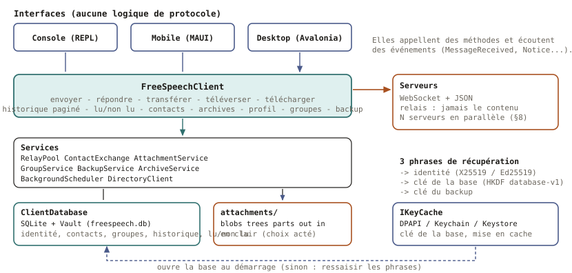
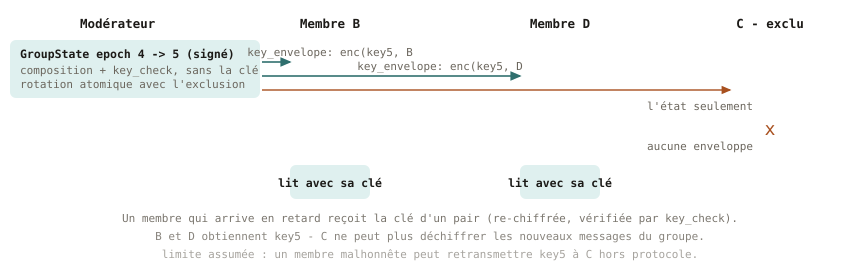
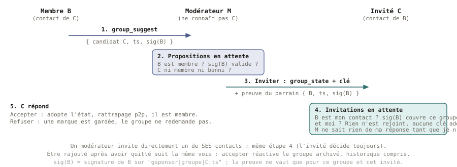
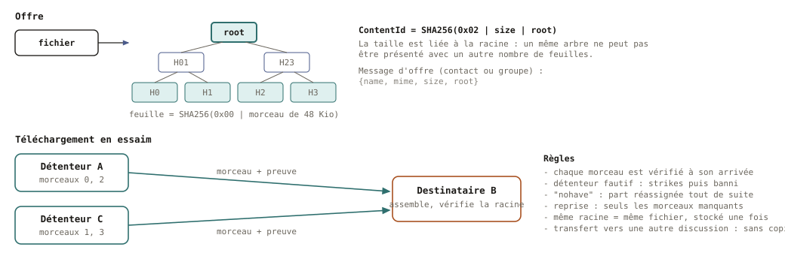
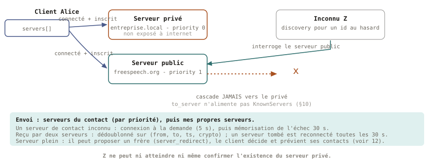
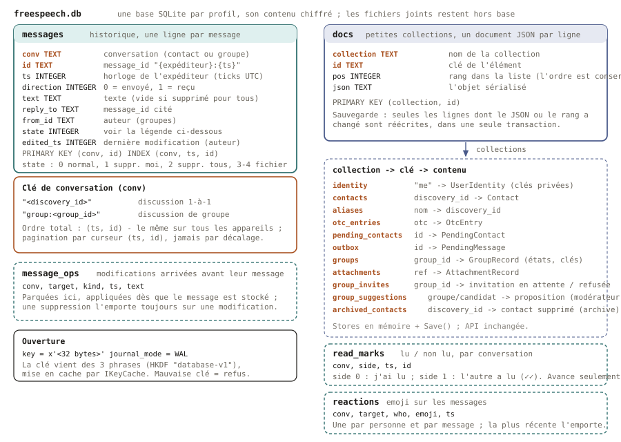

# Architecture de FreeSpeech

*English version: [ARCHITECTURE.en.md](ARCHITECTURE.en.md).*

Ce document explique **comment FreeSpeech est construit et pourquoi** : les
composants, les technologies, la cryptographie, le stockage local et le schéma de
ses tables. Le protocole sur le réseau (formats de messages, règles) est spécifié
dans [PROTOCOL.fr.md](PROTOCOL.fr.md). Les diagrammes sont dans [diagrams/](diagrams/), chacun
en français (`-fr`) et en anglais (`-en`).

FreeSpeech est un logiciel libre (AGPL-3.0 ou ultérieure). L'objectif de conception
est que tout reste **réimplémentable dans n'importe quel langage** : aucun framework
propriétaire ne fait partie du protocole, seulement des standards ouverts et des
primitives connues.

---

## 1. Vue d'ensemble

```
  Interfaces (console et mobile MAUI aujourd'hui, desktop ensuite)
        │  méthodes + événements, aucune logique de protocole
        ▼
  FreeSpeechClient  ── freespeech.client (bibliothèque de classes, .NET 10)
        │  services : pool de relais, contacts, pièces jointes, groupes, backup
        ▼
  ClientDatabase (SQLite + Vault)          attachments/ (fichiers en clair)
        ▲
        └─ clé issue des 3 phrases de récupération, mise en cache par IKeyCache
                                   │ WebSocket + JSON
                                   ▼
                    Serveurs (relais sans état) ── cascade serveur à serveur
```



| Projet | Rôle |
|---|---|
| `freespeech.relay` | Relais ASP.NET Core 10. Achemine les enveloppes entre clients connectés, répond aux requêtes de présence et de « flags », propage la découverte aux serveurs frères. **Ne stocke jamais aucun message.** |
| `freespeech.client` | La bibliothèque cliente : identité, contacts, relais multi-serveurs, messages, pièces jointes, groupes, backup, stockage local. Aucune UI, aucune sortie console. Partagée par toutes les interfaces. |
| `freespeech.console` | Un REPL mince au-dessus de la bibliothèque : analyse une commande, appelle `FreeSpeechClient`, affiche le résultat et les événements. Sert à tester le serveur et l'API. |
| `freespeech.mobile` | Application mobile **.NET MAUI** (Android, essayée sur émulateurs et sur un téléphone ; iOS à venir ; Windows pour développer). MVVM, fond sombre et accent or : des pages qui affichent et appellent `FreeSpeechClient`, aucune logique de protocole. Menu latéral (discussions, contacts, groupes, inviter, approuver, archives, sauvegarde, réglages), textes en JSON (FR/EN/ES), QR de contact, photos, lu/non lu, groupes, réactions emoji, vidéos (compression, lecture), appareil photo, partage depuis d'autres applis, mode silencieux, notifications, thème clair/sombre, import de langue. Solution à part (`FreeSpeech.Mobile.slnx`). |
| `freespeech.directory` | Annuaire : les relais liés par clés lui envoient des battements signés (pays, places restantes, version) ; il donne à un client qui ne connaît aucun relais une liste signée de relais, tirés au hasard et pondérés par les places restantes, et vérifie l'adresse de chacun ; API et commande `admin` locales ([cli-directory.fr.md](cli-directory.fr.md)). |
| `freespeech.push` | Passerelle push : seule détentrice des identifiants FCM/APNs ; une clé par serveur relais, limites et maintenance réglables à chaud, API et commande `admin` locales (§3.14). |
| `freespeech.ops` | Boîte à outils d'exploitation commune au relais et à la passerelle : niveaux de journal à chaud, tampon de journal en mémoire, suivi d'une identité, garde d'administration locale, plomberie de la commande `admin`, écriture atomique (§3.14). |
| `freespeech.tests` | Tests xunit (348) : bibliothèque, vrais serveurs, vraie passerelle push et vraie console lancés en processus ; des scripts PowerShell de bout en bout dans `scripts/` pilotent de vrais processus clients contre de vrais serveurs. |

### Pourquoi une bibliothèque avec une API à événements
Une application mobile ou desktop doit se comporter exactement comme la console :
toutes les fonctions vivent donc dans `FreeSpeechClient`, et nulle part ailleurs. Une
interface appelle des méthodes (`SendAsync`, `UploadAsync`, `GetLatestMessages`,
`CreateGroupAsync`, …), affiche leurs résultats typés et écoute des événements
(`MessageReceived`, `ContactRequested`, `ServerConnectionChanged`, `Notice`, …). Les
erreurs utilisateur sont des `ClientException` dont le message est fait pour être affiché.

---

## 2. Technologies

| Domaine | Choix | Pourquoi |
|---|---|---|
| Langage / runtime | C# sur .NET 10 | Un seul code pour le serveur et la bibliothèque cliente. L'application mobile est en **.NET MAUI** (le même code pour Android et iOS) ; le protocole réseau et le format du fichier SQLite restent lisibles depuis n'importe quel langage. |
| Mobile | .NET MAUI, MVVM (CommunityToolkit.Mvvm), QRCoder (afficher un QR) et ZXing.Net.Maui (le lire, Android) | Une seule base de code, toute la logique reste dans la bibliothèque. Les textes sont des fichiers JSON par langue (importables) ; certains gestes (pincement de la visionneuse) passent par du code natif Android. |
| Serveur | ASP.NET Core 10, déployé derrière nginx sur Ubuntu 24 | Standard, bien supporté. |
| Transport | **WebSocket brut (RFC 6455)** avec un framing JSON documenté et une corrélation par `request_id` ; HTTP simple pour la présence et les flags | SignalR a été abandonné volontairement : c'est un protocole propriétaire que d'autres langages implémentent difficilement. |
| Cryptographie | **BouncyCastle** (`BouncyCastle.Cryptography`, code entièrement managé) pour X25519, Ed25519 et ChaCha20-Poly1305 ; HKDF, SHA-256 et l'aléa viennent de .NET | Mêmes algorithmes et mêmes octets que libsodium (vérifié par des vecteurs libsodium figés), mais **aucune bibliothèque native** : le paquet libsodium pour .NET n'en fournit ni pour Android ni pour iOS. Aucune cryptographie maison : seulement des primitives standard (RFC 7748, 8032, 8439). |
| Base locale | **SQLite** via `Microsoft.Data.Sqlite.Core`, au contenu chiffré champ par champ par `Vault` (`SQLitePCLRaw.bundle_e_sqlite3`) | Fonctionne sur Windows, Android et iOS ; écritures atomiques ; requêtes pour la pagination ; aucune bibliothèque de chiffrement native. |
| Protection de la clé | `IKeyCache` : DPAPI (console Windows), Keychain (iOS), Keystore (Android) | L'OS protège la clé en cache ; les phrases peuvent toujours la régénérer. |
| Tests | xunit + scripts PowerShell de bout en bout (vrais processus, vrais serveurs) | Les scripts couvrent ce que les tests unitaires ne peuvent pas : reconnexion, transferts interrompus, plusieurs serveurs. |

---

## 3. Cryptographie

### 3.1 Identité — dérivée de trois phrases (§1)
Pas de compte, pas de serveur de mots de passe. L'utilisateur saisit **trois phrases de
récupération différentes (≥ 75 caractères chacune)** :

```
seed          = Argon2id(phrase1 ‖ 0 ‖ phrase2 ‖ 0 ‖ phrase3, sel "FreeSpeech-v3-seed", 32 Mio, t=3, p=1)   (32 octets)
enc_seed      = HKDF-SHA256(seed, salt="FreeSpeech-v2", info="encryption")
sign_seed     = HKDF-SHA256(seed, salt="FreeSpeech-v2", info="signing")
db_key        = HKDF-SHA256(seed, salt="FreeSpeech-v2", info="database-v1")
paire X25519  ← enc_seed              paire Ed25519  ← sign_seed
discovery_id  = hex(SHA256(X25519_pub ‖ Ed25519_pub))
```

Les mêmes phrases donnent la même identité sur n'importe quel appareil, sans aucun
serveur. Chaque clé a son propre label HKDF : les clés d'identité, la clé de la base
et la clé de backup sont donc **indépendantes**. **Il n'y a aucune récupération si les
phrases sont perdues** — propriété acceptée de la conception.

### 3.2 Messages — signer puis chiffrer (§5)
Un message est une *Letter* `{type, payload, sig, orig_to}` dans une *Envelope*
`{from, to, crypto, msg, ts, reply_to}` ; le serveur ne voit que l'enveloppe.

1. L'expéditeur signe la lettre avec **Ed25519** — la signature couvre une étiquette de domaine, `from`, `to`, le type, le contenu et `ts` : une lettre ne vaut que pour son destinataire (PROTOCOL §5).
2. Il crée une paire **X25519 éphémère** et calcule le secret partagé avec la clé
   publique X25519 statique du destinataire.
3. **HKDF-SHA256** transforme le secret en clé ; **ChaCha20-Poly1305** chiffre
   signature + lettre (AEAD : confidentialité et intégrité).
4. Le destinataire déchiffre avec sa clé privée et vérifie la signature avec la clé de
   signature mémorisée de l'expéditeur. Un message à la signature invalide est écarté.

`crypto` indique au récepteur comment lire `msg` : `0` échange de contact par code à
usage unique, `1` asymétrique, `2` groupe. `message_id = "{expéditeur}:{ts}"` ne
dépend d'aucune horloge serveur et dédoublonne les messages qui nous parviennent deux fois.

### 3.3 Échange de contact — codes à usage unique (§3)
Deux personnes se rencontrent hors bande (chaîne manuelle ou QR). Une **ContactCard**
(nom, clés publiques, serveurs, photo et description facultatives ; **sans photo dans un QR**, qui ne la contiendrait pas) est chiffrée avec
une clé dérivée d'un **code à usage unique** (HKDF + ChaCha20-Poly1305) : un relais
qui voit l'échange n'apprend rien. Chaque côté confirme ; ensuite les messages
utilisent les clés de la carte. Les clés sont **immuables** : un `identity_update` qui
les change est rejeté comme usurpation possible.

### 3.4 Groupes — une clé partagée, renouvelée à l'exclusion (§7)
Un groupe peut dépasser 20 membres : un message est donc chiffré **une seule fois**
avec une **clé de groupe** partagée (ChaCha20-Poly1305), préfixé d'un tag dérivé de la
clé pour que le membre sache quelle clé essayer.



- La composition vit dans un **`GroupState` signé** par *epoch* : membres, rôles et
  un `key_check` (preuve de la clé, jamais la clé). L'historique et les clés ne sont
  **pas** dans l'état.
- **Chaque changement de composition renouvelle la clé atomiquement** avec le nouvel
  état. La nouvelle clé parvient à chaque membre restant sous forme de `key_envelope`
  (X25519 éphémère + HKDF + ChaCha20-Poly1305, le schéma du §5) chiffrée pour ce seul
  membre. Un membre exclu reçoit le nouvel état **sans** enveloppe et ne peut pas lire
  la suite.
- Un membre arrivé en retard obtient la clé de n'importe quel pair, qui la
  re-chiffre ; le récepteur la vérifie avec `key_check`, donc un pair ne peut pas
  glisser une fausse clé.
- Les changements concurrents se résolvent de façon déterministe : un successeur doit
  être signé par un modérateur de l'état courant ; à égalité, le plus petit SHA-256
  l'emporte ; les branches alternatives sont conservées avec leurs clés.
- Les opérations hors de l'état sont signées individuellement : la liste noire, le
  profil du groupe (nom, image, description ; créateur uniquement) et les profils de
  membres (auto-signés).
- **Nom et image par groupe.** `GroupRecord.MyName` / `MyPhoto` : le nom et l'image que j'utilise dans ce groupe (vides =
  ceux de mon profil). Ils ne partent que dans mon `member_profile` de ce groupe, donc ne permettent pas de relier les
  groupes ; une modification part `GroupService.ProfileDelay` (30 s) après la dernière (`SetMyNameAsync`,
  `SetMyPhotoAsync`), de sorte que plusieurs éditions successives ne produisent qu'un envoi ; elle s'affiche tout de suite chez
  moi (`MyNameIn`, `MyPhotoIn`). Choisis à l'acceptation de l'invitation (`AcceptInvitationAsync(id, nom, image)`, envoi
  immédiat). Affichage d'un membre (`FreeSpeechClient.MemberNameIn` / `MemberPhotoIn`) : le nom que je lui ai donné
  (`local_name`), puis celui qu'il a choisi pour le groupe, puis celui de mon contact, puis celui de l'état signé.
- **Aucun stockage serveur, aucune enveloppe conservée** : un membre qui était hors
  ligne demande aux membres en ligne ce qu'il a manqué (`group_sync`), par lots.
- **L'invité décide.** Une invitation (état signé + enveloppe de clé, gardés tels que reçus) attend dans une liste ;
  rien n'est rejoint ni déchiffré avant la réponse. Accepter adopte l'état puis rattrape ; refuser garde une marque.
  Revenir dans un groupe quitté suit la même voie et réactive le groupe archivé avec son historique.
- **Proposer un contact (parrainage).** Un membre simple n'invite pas, mais signe une proposition
  (`group_suggest`) envoyée aux modérateurs ; l'un d'eux peut inviter la personne en joignant la **preuve du
  parrain**. L'invité, qui ne connaît pas forcément ce modérateur, accepte l'invitation d'un non-contact si la preuve
  vient d'un membre qui est **son** contact et couvre ce groupe et lui-même.



### 3.4 bis Lu / non lu, accusés de lecture
Un **repère de lecture** par conversation (position `ts` + `message_id`) donne le nombre de non lus et l'endroit où
ouvrir une discussion. En 1-à-1, le client envoie un `read_ack { target }` au mieux (ni file d'attente, ni
historique) quand la discussion est affichée ; le récepteur ne l'honore que si `target` est un de ses messages, et le
repère « lu par l'autre » n'avance que vers l'avant (✓ puis ✓✓). Envoi désactivable ; pas d'accusés dans un groupe. Un accusé de lecture vaut aussi confirmation de réception : il retire de la boîte d'envoi les
messages remis à ce contact jusqu'au message lu (`PendingMessageStore.AcknowledgeReadUpTo`), qui ne sont pas renvoyés.

### 3.4 ter Archives
Un groupe quitté (ou dont on est exclu) et un contact supprimé ne disparaissent pas : la conversation est
**archivée**, lisible en lecture seule. Elle revient telle quelle si on rejoint de nouveau le groupe ou si on rajoute
le contact (même identifiant, donc même historique) ; la **suppression définitive** efface messages, fichiers et, pour
un groupe, états et clés ; une nouvelle conversation repart alors vide.

### 3.4 quater Membres « en attente »
Quand un modérateur invite quelqu'un, la personne figure aussitôt dans l'état du groupe, sans avoir forcément répondu.
Chaque appareil garde donc `GroupRecord.Heard` : les membres dont il a eu un **signe de vie** (un message, une demande de
rattrapage `group_sync`). `PendingMembers` = les membres de l'état courant, hors moi, créateur et modérateurs, absents de
`Heard` ; Infos du groupe les affiche estompés avec « En attente ». C'est une information **locale** (rien dans le
protocole). À l'adhésion, les membres déjà présents sont tenus pour arrivés ; un groupe créé avant cette fonction
(`Heard` absent) n'affiche personne en attente.

### 3.5 Pièces jointes — arbre de Merkle et téléchargement en essaim (§6)


- Un fichier est découpé en **morceaux de 48 Kio**. Feuille = `SHA256(0x00 ‖ morceau)`,
  nœud = `SHA256(0x01 ‖ gauche ‖ droite)` (un nœud impair est remonté tel quel).
  L'identité du contenu est `SHA256(0x02 ‖ taille ‖ racine)` ; lier la **taille** lève
  l'ambiguïté sur le nombre de feuilles.
- L'offre porte `{name, mime, size, root}`. Chaque morceau voyage dans une Letter
  chiffrée avec sa **preuve de Merkle** : le récepteur le vérifie à l'arrivée, quel que
  soit le détenteur — pas seulement l'auteur.
- Dans un groupe, **chaque membre qui possède le fichier peut le servir** (essaim). Un
  détenteur fautif cumule des strikes puis est banni ; un détenteur qui n'a plus le
  fichier, ou qui est sur données mobiles avec le réglage « wifi », répond `attachment_have` et sa part est immédiatement réassignée ; un
  membre qui télécharge encore sert les morceaux déjà reçus (preuve de Merkle conservée avec chacun) ; les morceaux sont répartis par fenêtres selon le débit de
  chaque détenteur ; un transfert bloqué reprend avec les seuls morceaux manquants. Le réglage « fichiers seulement en wifi » retient les morceaux demandés et servis
  sur données mobiles (`TransferPolicy`).
- Un contenu identique n'est stocké **qu'une fois** (`blobs/{root}.ext`, adressé par
  contenu) : transférer un fichier vers une autre discussion ne copie rien.
- Le type de fichier est détecté sur le **contenu** (octets magiques), jamais sur
  l'extension. Limite : 2 Gio par fichier (plafond du protocole), envoyé fichier par fichier ; le seuil réglé par
  l'utilisateur demande une confirmation avant d'envoyer un gros fichier (25 Mio par défaut), et le relais limite le
  volume envoyé par identité.

### 3.6 Backup (§2)
Un zip (manifeste, historique par blocs de 1 000 lignes, fichiers) découpé en **blocs de 1 Mio**, chacun scellé avec
ChaCha20-Poly1305 avec l'index du bloc et un indicateur *final* comme données
associées (toute réorganisation ou troncature est détectée), sous une clé dérivée par
HKDF de l'identité. Modes : sans pièces jointes, les *N* derniers mois (6 par défaut),
ou tout. Restaurer sur un nouvel appareil exige de redériver la même identité depuis
les phrases. L'historique est lu dans la base et écrit bloc par bloc (`HistoryStore.Stream`), puis relu de même à la
restauration : un long historique n'est jamais chargé en entier (de même pour les empreintes de `Digests`, calculées conversation par conversation).

### 3.7 Modifier et supprimer un message
Quatre actions sur un message envoyé, en 1-à-1 comme en groupe : **modifier**, **supprimer chez moi**, **supprimer
pour tous**, **retirer la pièce jointe** (chez moi / pour tous). Les changements « pour tous » sont des Letters
signées (`message_edit`, `message_retract`, `attachment_retract`) ; **chaque récepteur vérifie que l'expéditeur est
l'auteur du message visé** (le `message_id` contient l'auteur), donc personne ne peut toucher au message d'autrui.
La suppression efface le contenu et laisse une ligne « message supprimé » ; dans un groupe, la copie scellée quitte
aussi le journal de rattrapage, un **marqueur de trou** gardant les numéros de séquence contigus. Garantie au mieux :
un client modifié peut l'ignorer. Détail : [PROTOCOL.fr.md](PROTOCOL.fr.md) §5 et §7.

---

### 3.8 Réactions
Une réaction emoji à un message ou un fichier est une Letter `message_react { target, text }` (PROTOCOL §5) : un seul
emoji, vide pour la retirer. N'importe quel participant peut réagir (pas seulement l'auteur) ; une personne a **une**
réaction par message, la plus récente l'emporte, et une réaction arrivée avant son message est conservée. Stockage :
table `reactions` (§5.1 quater). API : `ReactAsync(conversation, index, emoji)` (le même emoji une seconde fois la
retire), `GetReactions(conversation)`, événement `MessageChanged` de nature `Reacted`.

### 3.9 Textes de la bibliothèque : des codes
Les échecs « parlants » de la bibliothèque (action de groupe refusée, message introuvable, nom trop long, fichier
trop gros...) portent un **code stable** en plus du message anglais, qui reste celui de la console, des journaux et des
tests : `ICodedMessage { Code, Args }`, implémenté par `ClientException(message, code, args)` et par
`CodedInvalidOperationException` (dérive d'`InvalidOperationException` : les `catch` existants valent toujours).
L'application traduit par la clé `err_<code>` de ses fichiers de langue (`ErrorText.Of`) et retombe sur le message
anglais sans traduction. Les erreurs purement techniques (clés incohérentes, réseau) n'ont pas de code ; les
« notices » du journal de la console restent en anglais, l'appli mobile s'appuie sur des événements structurés.

### 3.10 Application mobile : thème, silence, notifications, partage, vidéo
- **Thème** : `Colors.xaml` est la palette sombre ; `Palette` donne les valeurs claires aux mêmes clés avant que les
  styles (qui les lisent) ne soient chargés. Lu au démarrage : changer de thème redémarre l'appli (`RestartActivity`,
  dans un processus séparé). Choix : sombre, clair, comme le téléphone.
- **Silence** par discussion (🔕 dans la barre) : ni bannière ni notification, le compteur de non lus reste (grisé).
- **Notifications** système (`INotifier` ; Android : `AndroidNotifier`, canal « messages », permission d'Android 13)
  quand l'appli est en arrière-plan : messages, demandes de contact, invitations ; toucher ouvre la discussion ou
  Approuver. Activables dans Réglages. **Appli fermée** : le **repli de PROTOCOL §9** est codé (`BackgroundPoll`, `PollWorker` : WorkManager,
  environ toutes les 15 minutes, réseau requis) : l'appli se connecte 45 s, garde la connexion plus longtemps qu'un tick
  de 30 s car **les serveurs ne stockent aucun message** (c'est le client de l'expéditeur qui renvoie ce qu'il a en
  attente quand il voit le destinataire en ligne), puis notifie. Limite structurelle : deux téléphones qui se réveillent
  chacun toutes les 15 minutes se croisent rarement ; le vrai push (FCM/APNs, §9) est ce qui réveille le destinataire
  juste après l'envoi. Pas encore fait.
- **Appareil photo/vidéo** (`MediaPicker`) et **partage depuis une autre appli** (filtre d'intention `SEND` /
  `SEND_MULTIPLE`, fichiers copiés dans le cache, écran « Partager » où l'on coche les discussions).
- **Vidéo** : avant l'envoi, Media3 Transformer la ré-encode en H.264, 720 p au plus (la copie compressée n'est
  envoyée que si elle est plus petite) ; lecture dans l'appli (`VideoView` natif, `VideoPlayerHandler`). Android
  minimum : 7 (API 24).
- **Langues** : import d'un fichier JSON (un `_name`, un code), modèle anglais à traduire partagé depuis l'appli,
  retrait d'une langue importée ; les langues fournies ne sont pas remplaçables.

### 3.11 Sécurité du relais, vérification des empreintes, push, déploiement
- **Preuve d'identité à l'enregistrement** (PROTOCOL §11) : `register` porte les deux clés publiques, le serveur
  vérifie `SHA-256(enc ‖ sign) = discovery_id` puis envoie un défi (`nonce`) que le client signe en Ed25519
  (`register_proof`). Sans cela on pouvait s'enregistrer sous l'identité d'un autre, voir ses enveloppes et faire
  perdre ses messages (l'expéditeur croit « livré »). `RegistrationAuth` (serveur), `RegisterAuth` + `RelayClient`
  (client). Un client récent reste compatible avec un ancien serveur, pas l'inverse. Commutateur de développement
  `Server:AllowAnonymousRegister` (désactivé par défaut) pour les scripts bruts.
- **Limites** : frame WebSocket au plus 512 Kio (`Server:MaxMessageBytes`, fermeture 1009), texte au plus 8 000
  caractères (`msg_too_long`), volume envoyé par identité (1 Gio par 24 heures, 300 Mio par 10 minutes) et par
  adresse (5 Gio par 24 heures), refusé par `quota_exceeded` / `rate_limited` (`Services/TrafficLimiter.cs`), images réduites à 1 600 px / JPEG avant l'envoi (mobile), vidéos 720 p ; nginx limite
  connexions et requêtes par adresse, bloque `/api/admin`, ne journalise pas les accès.
- **Numéro de sécurité** (§3) : `SafetyNumber` (SHA-512 itéré sur les deux paires de clés triées, 12 × 5 chiffres),
  écran « Vérifier la sécurité » (liste des contacts, bouclier), marque `Contact.VerifiedAt` (✔), commande console
  `safety`. Identique côté Android et console (vérifié sur émulateur).
- **Push** (§9) : relais (`PushRegistry`, `PushNotifier`, liste blanche de passerelles, `peer_online`) et passerelle
  `freespeech.push` (`IPushProvider` : FCM, APNs, journal ; secret obligatoire, corps limité). Reste à faire côté
  mobile : jeton FCM, `google-services.json` optionnel.
- **Mise à jour de profil** : si le contact est hors ligne, l'`identity_update` reste dans l'outbox (seul le plus récent
  est gardé).
- **Déploiement** : `sources/deploy/` (service systemd, sites nginx, scripts de mise à jour, page de téléchargement de
  l'APK), `sources/INSTALL_RELAY.fr.md`, `scripts/build-apk-release.ps1` (APK signé pour les téléphones, arm64 ; `-AllAbis` pour arm64 + x86_64 ; `-Aab` produit l'App Bundle `org.freespeech.mobile-Signed.aab` pour Google Play ; version, date et numéro de build : `sources/version.props`), `scripts/build-desktop-msi.ps1` (installateur Windows) et `scripts/build-apk-debug.ps1` (APK Debug x86_64 pour les émulateurs).
- **Création d'identité en un geste** : `PhraseGenerator` tire les trois phrases (passage d'un livre libre de droits +
  3 mots au hasard, ≈ 150 bits ; livres `fr/en/es.txt.gz` dans `Resources/Raw/books`, `scripts/prepare-books.ps1`,
  `SOURCES.md`, ≈ 1,3 Mo compressés dans l'APK). Mode « Avancé » : choix du serveur. Création en trois étapes : nom →
  **sauvegarde des phrases** (`PhrasesBackupPage`, écran unique sans retour : afficher et copier, imprimer avec QR code,
  fichier `.fskey` protégé par mot de passe — `Identity/PhraseVault.cs`) → coordonnées. Les phrases restent dans un brouillon en
  mémoire (`NewIdentityDraft`) ; l'identité n'est créée qu'en quittant l'étape 2. **Aucune phrase n'est stockée** (`RecoveryPhrases`
  sert seulement à purger une copie présente dans le Keystore) ; la page Sauvegarde ne concerne que les données. Restauration : saisie,
  collage, fichier de clé ou scan de la feuille imprimée, plus sauvegarde de données optionnelle (avec le profil). Rien ne repose sur le
  secret du code : le dépôt est public. Détails et failles connues : `PROTOCOL.fr.md` §1, §2, §13.
- **Notifications** : deux réglages (`ClientService.NotificationsEnabled` pour l'alerte du système, `BackgroundWakeEnabled` pour le
  push et la vérification périodique) ; réveil par `PushService` → `BackgroundPoll` (verrou unique), repli `PollWorker` (~15 min) ;
  `TransferService` (service au premier plan) tient le processus pour un fichier ou un message en attente. Voir `PROTOCOL.fr.md` §9.
- **Nom donné à un contact** : `Contact.LocalName` / `DisplayName`, `RenameContact`, bouton crayon dans Contacts (le
  pseudo d'origine reste en sous-titre) ; affiché partout (liste, discussion, groupes, notices), cherché en premier par
  `FindByNickname`, conservé par `identity_update`, inclus dans la sauvegarde avec `verified_at` (test d'aller-retour).
- **Échanger nos coordonnées** (menu « Inviter » ; la page « Approuver » s'appelle « Demandes ») : deux blocs, « Envoyer mes
  coordonnées » (montrer un code à scanner si on est ensemble ; envoyer par SMS, mail ou messagerie ; copier) et
  « Recevoir des coordonnées » (scanner son code ; coller ce que j'ai reçu, un seul geste). Grandes lignes
  icône + libellé + « quand l'utiliser » (`ActionRow`), pensées pour les personnes âgées : plus de texte technique, une
  fiche neuve à chaque partage ou copie. Les sauvegardes portent la date et l'heure dans leur nom
  (`freespeech-backup-AAAAMMJJ-HHMMSS.enc`).
- **Tests** : `RelayServerTests` lance le vrai serveur sur un port libre avec une fausse passerelle push (preuve
  d'identité, usurpation refusée, taille, push, `peer_online`), `SafetyNumberTests`, rejeu d'un message supprimé ;
  348 tests (dont `PinLockTests`, `TypingTests`, `WipeTests`, `MigrationTests`, `ClientAccessTests`, `OpsTests`, `ClientLogTests`, `PushAdminTests`, `AdminConsoleTests`),
  plus les scripts multi-clients (`test-multiserver` 13/13, `test-groups`).

### 3.12 Indicateur d'écriture, verrouillage par PIN, effacement à distance
- **« écrit… »** (`FreeSpeechClient.Typing.cs`) : lettre `typing` **éphémère** — jamais dans l'historique, jamais dans l'outbox, jamais
  de flag WAITING, donc incapable de réveiller un téléphone ; perdue si le contact n'est pas connecté, c'est voulu. `SendTypingAsync`
  (au plus une par `TypingEvery` = 4 s par discussion), `TypingReceived`, interrupteur **réciproque** `SendTypingIndicator` (éteint : on
  n'envoie ni n'affiche), groupes jusqu'à `MaxTypingGroupMembers` = 8. Les **types de lettre inconnus sont ignorés en silence** (la
  branche finale de `HandleIncomingChatEnvelope`) : c'est la règle de compatibilité qui laisse une version ancienne vivre avec un type
  ajouté plus tard.
- **Fiches de contact** : `ContactExchangeService.PurgeExpiredCodes` (à la construction et à chaque export) supprime les OTC dont la
  validité (depuis `created_at`) + 7 jours est passée ; `ImportCardAsync` refuse une fiche plus vieille que sa validité avec le code
  `card_expired` (texte `err_card_expired`).
- **Verrouillage par PIN** : `Security/PinLock.cs` (bibliothèque, testable) — `IsValidPin` (4 à 8 chiffres), `Create`/`Verify`
  (sel 16 o + PBKDF2-SHA256 200 000 itérations, comparaison à temps constant), `IsDue` (échéance ; horloge reculée = verrouillé ; délai 0 =
  15 s de grâce). `Services/AppLock.cs` (mobile) : préférences `lock_*`, hash dans `SecureStorage`, compteur d'échecs, `WipeAndRestart`.
  `Views/LockPage` : trois modes (`Unlock` sans issue, `Verify`, `Set`), poussée en modale par `App.xaml.cs` (`Activated`,
  `Deactivated` → `MarkLeft`, `Created` pour le démarrage à froid). Il protège **l'écran** : la base reste chiffrée par la clé du
  Keystore (§5.3) et la réception continue ; tant que le verrou est affiché, `InForeground` reste faux (rien n'est marqué lu).
  Désactiver ou changer le code demande le code actuel ; « code oublié » compare la clé de base dérivée des trois phrases à celle du coffre.
- **Effacement à distance** : `IdentityService.DeriveRevocationKey` (HKDF, info `revocation-v1`) ; `UserIdentity.RevocationPublicKey`
  (seule la moitié publique est gardée) ; `FreeSpeechClient.Wipe.cs` : `EnableRemoteWipe` (identités d'avant), `SendWipeAsync` (trois
  phrases → signature Ed25519 de `FreeSpeech-wipe-v1|<id>|<ts>`, collection `pending_wipe`, envoi à soi-même), `HandleWipe`
  (signature, clé publique présente, `OrderAppliesTo` : appareil installé **avant** `ts`, jamais l'émetteur), renvoi toutes les 2 min pendant
  30 jours par `FlushPendingMessagesAsync`, événement `WipeRequested`. Mobile : `Views/WipePage` (activer, ordonner),
  `ClientService.ObeyWipe` (accroché à **chaque** client, celui du contrôle de fond compris) → `AppLock.WipeAndRestart` (coffre,
  préférences, dossier de données et cache effacés, redémarrage). Détails, limites et remise « au mieux » : `PROTOCOL.fr.md` §1 et §12.

### 3.13 Migration d'identité (après un vol)
- **Pins** : `Identity/RevocationPinStore.cs` (collection `revocation_pins`, premier vu gagne, `TryPin` refuse une autre clé) ; alimenté par la fiche de contact
  (`ContactCard.RevocationPublicKey`, via `ContactExchangeService.ToContact`), par `identity_update` et par `member_profile` (`MemberProfile.RevocationPublicKey` +
  `RevocationSig`, signature du membre hors de `sig` ; `GroupService.PinRevocation`). Inclus dans `BackupPayload.RevocationPins`. `UserIdentity.RevocationAnnouncedGroups`
  mémorise les groupes déjà informés (`AnnounceRevocationKeyAsync`, appelé après la connexion).
- **`FreeSpeechClient.Migration.cs`** : `RolesToHandOver` / `HandOverRolesAsync` (transfert de créateur puis retrait du rôle) ; `SendMovedAsync` (nouvelle identité dérivée
  des nouvelles phrases, `MovedOp` signée par la clé de révocation des anciennes, envoi par `IGroupTransport.SendLetterAsync(..., queue: true)` : l'outbox renvoie aux absents) ;
  `OutgoingMigrationId`, `PendingMigrationLetters` ; `SwitchToNewIdentity` (vérifie l'identifiant annoncé, copie profil/serveurs, archive les groupes, vide l'outbox,
  `ClientDatabase.Rekey`, `IKeyCache.Store`) ; réception `HandleMovedAsync` → `MigrationNotice` (collection `migration_notices`), exclusion automatique
  (`GroupService.RemoveMemberAsync` = rotation), `AcceptMigrationAsync` / `DeclineMigration`, événement `MigrationRequested`, réglages `AutoAcceptMigration` et `AutoExcludeMigrated`.
  `Contact.MovedTo` / `MovedAt` ; `SendLetterAsync` refuse (`contact_moved`) d'écrire à un contact migré. Le type `identity_moved` est traité dans
  `HandleIncomingChatEnvelope` avant la règle « membre de groupe non contact », pour qu'un modérateur le reçoive d'un membre qui n'est pas son contact.
- **Mobile** : `Views/MigratePage` (étape 1 : rôles + anciennes phrases ; étape 2 : état de l'envoi + nouvelles phrases ; l'étape se déduit de `OutgoingMigrationId`, donc
  survit à un redémarrage), `MigrationDraft` (anciennes phrases en mémoire seulement), `PhrasesBackupViewModel` (en mode migration, quitter l'écran envoie l'avis au lieu de créer
  l'identité), `ApproveViewModel` (`ApprovalKind.Migration`), bannière et notification `banner_migration`, réglages dans `SettingsPage`.
- **Tests** : `MigrationTests` (12, serveur réel) ; essai à l'écran sur trois émulateurs (`scripts` locaux `emu.ps1` / `flows.ps1`, non versionnés).

### 3.14 Exploitation : accès, administration locale, journaux
Mode d'emploi : `ADMINISTRATION.fr.md`, `cli-relay.fr.md`, `cli-push.fr.md` ; protocole : `PROTOCOL.fr.md` §10 « Contrôle d'accès » et « Exploitation ».
- **Pourquoi à chaud.** Présence, marqueurs d'attente et jetons push sont en mémoire : un redémarrage coupe tout. Tout ce qui s'administre se règle donc sans redémarrer
  et s'écrit dans un fichier JSON par écriture atomique (`Ops/AtomicFile.cs`).
- **Contrôle d'accès** (`Services/ClientAccessService.cs`, `IClientAccess`) : mode `open` / `allowlist`, autorisés, bannis (un ban l'emporte toujours), invitations à usage
  unique (jeton `fs-inv-…`, seule l'empreinte SHA-256 est gardée), fichier `access.json`, fichier illisible = `allowlist`. `RelaySocketHandler` appelle `Check` **après** la preuve de
  possession de la clé : un jeton n'est dépensé que par l'identité qui le présente ; refus `private_server` / `access_refused`. Client : `RelayClient.Invitation`,
  `RelayPool.AddOwnAsync(url, invitation)` (jeton en mémoire seulement), `RefusalOf(url)`, `ServerStatus.Refusal` ; `FreeSpeechClient.UseInvitationAsync(url, jeton)` ; mobile : boutons *J'ai une invitation* / *Demander l'accès* sur un serveur privé dans *Réglages → Serveurs* (le serveur dit s'il est privé : `registered` et `server_state` portent `access`). Miroir d'un appareil restauré : `FreeSpeechClient.DeviceSync.cs` (`RequestDeviceSyncAsync`, `ApproveDeviceSyncAsync` / `RejectDeviceSyncAsync`, événements `DeviceSyncRequested` / `DeviceSyncChanged`), empreintes `HistoryStore.Digests` ; mobile : question à la fin de l'import (`ClientService.OfferDeviceSyncAsync`), code à six chiffres montré sur l'appareil neuf et saisi sur l'autre (`EnterSyncCodeAsync`, trois essais). Groupes d'un serveur privé : le serveur nomme des identités comme outils d'administration (`provisioners`, portés par `registered` et `server_state`, clés vérifiées par `GroupCrypto.MemberIdMatchesKeys`) et retient les clés publiques des personnes autorisées (`clients/keys`) ; `RelayPool.FindProvisioner` ne compte que les serveurs connectés ; une invitation `group_state` d'un outil nommé est acceptée d'un non-contact, signature vérifiée, et reste soumise à l'accord de l'utilisateur (`PendingGroupInvite.FromAdministrator`).
- **Passerelles push** : `PushNotifier` n'appelle que les passerelles liées (pairs `push` acceptés dans `PeerStore`), toujours avec un appel signé.
- **`freespeech.ops`** : `LogControl` (niveaux par catégorie, longueur de préfixe, alias `relay`/`s2s`/…, une règle dynamique les applique), `LogRing` +
  `LogRingProvider` (2000 lignes en mémoire, flux pour `tail -f`), `TraceService` (suivi d'une identité, 60 min, expire seul), `AdminGuard` (secret **et** appel local ; l'adresse
  transmise par nginx compte), `OpsExtensions.AddOps` / `MapOpsAdmin`, `AdminCliKit` / `AdminApi` (commande `admin`, codes de sortie). Les journaux ne portent jamais de contenu,
  de clé ni de jeton d'appareil ; les identifiants y sont raccourcis (`TraceService.Short`), « qui écrit à qui » n'est qu'au niveau debug ou dans un suivi demandé.
- **Relais** : `AdminController` (accès, clients, invitations, voisins, liaisons), `AdminCli` (`dotnet FreeSpeech.Relay.dll admin …`).
- **Passerelle** : `PushState.cs` (`PushSettings` ; `PushStats`), relais autorisés = pairs acceptés (`PeerStore`),
  `PushAdmin.cs` (API `/admin/…` et commande `admin …`), maintenance (répond `busy`), `UseForwardedHeaders` derrière nginx.
- **Client** : `ClientLog` (niveau + événement, éteint par défaut, ni contenu ni identifiant complet) ; console `--log` / `--log-file` / commande `log` (`ConsoleLog`) ; mobile
  `DiagLog` (réglage « journal de diagnostic », fichier local de 256 Kio, partage manuel).
- **Tests** : `ClientAccessTests` (13), `OpsTests` (10), `ClientLogTests` (14), `PushAdminTests` (13, vraie passerelle).
  Le parallélisme est limité à 2 collections (`AssemblyInfo.cs`) : les classes qui lancent des processus se gênent sinon.

### 3.15 Confiance, profil par groupe, présentation
- **Coches** (`FreeSpeechClient.TrustOf`, calcul local, rien n'est envoyé) : 0 = pas un de mes contacts, 1 = contact confirmé (coche grise),
  2 = contact dont j'ai comparé le numéro de sécurité (coche dorée). Elles suivent le nom d'un membre dans la liste du groupe et sur chaque
  message d'un groupe ; en discussion directe, la coche est dans la barre (grise tant que le contact n'est pas vérifié). Toucher une coche
  ouvre le numéro de sécurité ; Infos du groupe en donne la légende. Un menu de la barre d'une discussion directe permet de renommer le contact
  (`local_name`) ou de le vérifier.
- **Infos du groupe** : deux cellules égales, le groupe à gauche (image, nom, effectif, description, actions selon mon rôle), moi à droite (image,
  nom pour ce groupe, mêmes boutons de modification) ; une ligne les sépare de la liste des membres. Mobile : page « Rejoindre le groupe » à
  l'acceptation (image à recadrer, nom) ; desktop : boîte équivalente.
- **Avatars** : ronds pour les contacts comme pour les groupes ; un groupe qui a une image porte une petite pastille « personnes » en bas à droite,
  qui dépasse un peu du cercle.
- **Messages épinglés** (PROTOCOL §7, `GroupService.PinAsync` / `PinnedIds`, `FreeSpeechClient.PinMessageAsync` / `GetPinned` / `CanPin`) : le menu d'un message offre « Épingler » ou « Désépingler » aux modérateurs et au créateur ; un bandeau sous la barre de la discussion montre le message épinglé le plus récent (un compteur « 1/3 » s'il y en a plusieurs) ; le toucher saute au message et passe au suivant. Un message épinglé absent est demandé par le rattrapage de `group_sync`.
- **Barre de la discussion (mobile)** : un seul bouton « ⋮ » à droite (recherche, sourdine, infos du groupe ou menu du contact) laisse plus de place au nom ; dans un groupe où j'utilise un autre nom ou une autre image, ils s'affichent sous le titre, pour ne pas confondre les identités.
- **Notification « envoi en attente »** (mobile) : l'appli ne se maintient en arrière-plan que pour les lettres que le relais n'a pas encore prises
  (`SentAt` nul), pas pour celles déjà remises et en attente de confirmation.

### 3.16 Mise en forme des messages
`MessageMarkup` (bibliothèque, `Markup/MessageMarkup.cs`) lit un sous-ensemble de Markdown, **seulement** quand la première ligne du message est `md` ; le texte transmis reste brut
(PROTOCOL §5, « Mise en forme du texte »). `Parse` rend une liste de segments (`MarkupSpan` : texte, gras, italique, barré, code, niveau de titre, citation, lien) où un saut
de ligne est un segment ; `PlainText` donne le texte sans signes (aperçus, notifications, citation en réponse). Les listes ne sont pas des blocs : une puce `•` ou le chiffre au bord gauche, l'indentation saisie
conservée pour les niveaux suivants, sur le texte même, ce qui évite toute mise en page par blocs. Mobile : `MarkupText.Build` habille les segments en `FormattedString` (un `Label` à part pour les messages
formatés, les autres gardent leur `Label` simple) ; desktop : le contrôle `MarkupText` (un `SelectableTextBlock` à segments). Un lien ne s'ouvre qu'après confirmation montrant l'adresse.

## 4. Multi-serveur (§8, §10)



- Une identité annonce une liste ordonnée de serveurs (privés, publics, en nombre
  quelconque) et reste **connectée et inscrite sur tous à la fois**. Un serveur tombé
  est reconnecté toutes les 30 s.
- Pour joindre un contact, le client essaie les serveurs du contact par priorité, puis
  les siens. Les serveurs inconnus d'un contact sont connectés à la demande (délai de
  5 s, échec mémorisé 30 s). Un message vu par deux serveurs est dédoublonné sur
  `(from, to, ts, crypto)`.
- **Règle de confidentialité** : un serveur privé n'entre jamais dans la cascade de
  découverte d'un serveur public, donc un inconnu ne peut pas savoir qu'il existe.
- Les serveurs ne stockent rien. Quand le destinataire est hors ligne, le message attend
  dans l'**outbox** de l'expéditeur ; un flag `WAITING` est posé sur les serveurs pour que
  le destinataire (ou son réveil push, sur mobile) sache qu'il doit se reconnecter.

---

## 5. Stockage local

Une base par profil : `freespeech.db` (SQLite ordinaire, contenu chiffré champ par champ
par `Vault`, journal WAL, transactions). Le texte, la réponse et l'auteur d'un message,
les changements en attente, les réactions, les miniatures et chaque document JSON sont
scellés (ChaCha20-Poly1305, nonce aléatoire, contexte = table, colonne et identité de la
ligne en données associées : un chiffré recopié dans une autre ligne ne s'ouvre pas).
Restent lisibles les identifiants (conversation, message, correspondant), horodatages et
états, dont les requêtes et les index ont besoin ; le schéma et le journal WAL ne sont pas
chiffrés. Un fichier qui n'est pas une base SQLite est mis de côté (`freespeech.db.legacy`), une base neuve est créée. Les fichiers joints restent hors de la base, en clair, dans
`attachments/` (choix délibéré). Les petites images des photos font exception : elles sont
dans la base, table `thumbnails` (section 5.1 quinquies).



### 5.1 Table `messages` — l'historique
| Colonne | Type | Signification |
|---|---|---|
| `conv` | TEXT | Clé de conversation : le `discovery_id` d'un contact, ou `group:{group_id}` |
| `id` | TEXT | `message_id` (`{expéditeur}:{ts}`) |
| `ts` | INTEGER | Horodatage d'origine de l'expéditeur (ticks UTC) |
| `direction` | INTEGER | 0 = envoyé, 1 = reçu |
| `text` | TEXT | Texte, ou `[file] nom (taille bytes, mime)` pour une offre de fichier |
| `reply_to` | TEXT | `message_id` du message cité |
| `from_id` | TEXT | Auteur (renseigné dans les groupes) |
| `state` | INTEGER | 0 normal · 1 supprimé chez moi (caché) · 2 supprimé pour tous · 3 fichier supprimé chez moi · 4 fichier retiré pour tous |
| `edited_ts` | INTEGER | Date de la dernière modification par l'auteur (NULL si jamais modifié) |

`PRIMARY KEY (conv, id)` rend sans effet un message livré deux fois ; l'index
`(conv, ts, id)` sert la pagination. L'ordre `(ts, id)` est total et identique sur
tous les appareils.

**Pagination pour un écran de discussion.** Ouvrir une conversation charge les
derniers messages (`Latest`) ; glisser vers le haut charge les plus anciens
(`Before(curseur)`), redescendre les plus récents (`After(curseur)`) ; une citation ou
un résultat de recherche ouvre une fenêtre autour d'un message (`Around(id)`). Le
curseur est `(ts, id)`, **jamais un décalage** : les messages qui arrivent pendant le
défilement ne déplacent donc pas la page. L'écran mobile garde **au plus 150 lignes** en mémoire (pages de 30) :
en remontant loin, la fin la plus récente est lâchée puis relue (`After`) si on redescend ; les réactions ne sont lues que pour les lignes
chargées (`Reactions(ids)`) et la galerie d'images part des fiches de pièces jointes (`GetPictures`), pas d'une lecture de tous les messages.

### 5.1 bis Table `message_ops` — changements arrivés avant leur message
| Colonne | Type | Signification |
|---|---|---|
| `conv`, `target` | TEXT | Conversation et `message_id` visé |
| `kind` | TEXT | `edit`, `retract` ou `file_retract` |
| `ts` | INTEGER | Version (date de la Letter) |
| `text` | TEXT | Nouveau texte (pour `edit`) |

Un changement peut arriver avant le message (rattrapage, plusieurs serveurs) : il attend ici et est appliqué dès
que le message est stocké. Une suppression l'emporte toujours sur une modification. Une base créée par une version
antérieure (schéma 1) est migrée à l'ouverture (`PRAGMA user_version`).

### 5.1 ter Table `read_marks` — lu / non lu
| Colonne | Type | Signification |
|---|---|---|
| `conv` | TEXT | Conversation |
| `side` | INTEGER | 0 = ce que j'ai lu · 1 = ce que l'autre a lu de mes messages |
| `ts`, `id` | INTEGER, TEXT | Position (`ts`, `message_id`) jusqu'à laquelle tout est lu |

Le repère n'avance que vers l'avant. Non lus = messages reçus après le repère « j'ai lu ».

### 5.1 quater Table `reactions` — emoji sur les messages
| Colonne | Type | Signification |
|---|---|---|
| `conv` | TEXT | Conversation |
| `target` | TEXT | `message_id` visé (le message peut ne pas être encore là) |
| `who` | TEXT | Auteur de la réaction |
| `emoji` | TEXT | L'emoji ; vide = retirée (la ligne reste pour l'ordre) |
| `ts` | INTEGER | Version : la plus récente l'emporte |

Clé primaire (`conv`, `target`, `who`) : une réaction par personne et par message.

### 5.1 quinquies Table `thumbnails` — les petites images des photos
| Colonne | Type | Signification |
|---|---|---|
| `root` | TEXT | Identité du contenu du fichier (racine de Merkle, §6) : une miniature par contenu, partagée par toutes les discussions qui détiennent le fichier |
| `width`, `height` | INTEGER | Taille en pixels |
| `data` | BLOB | Un JPEG, 480 px au plus sur le grand côté, à l'endroit, qualité 75 (30 à 50 Ko) |

Une bulle est dessinée à partir de cette miniature, sans décoder à nouveau le fichier de 1 600 px chaque fois
qu'elle entre à l'écran ; le fichier entier s'ouvre au toucher. La plateforme fabrique la miniature
(`IPictureThumbnailer` ; sur Android `AndroidPictureThumbnailer`) : à l'envoi d'une photo ou à la fin de son
téléchargement, en arrière-plan pour les photos déjà là au démarrage (les plus récentes d'abord), et à la demande
s'il en manque une. Un GIF animé n'en a pas. Supprimer un fichier sur cet appareil supprime sa miniature, sauf si
une autre discussion détient le même contenu. Les miniatures sont dans la base chiffrée : elles ne demandent pas
plus de protection que l'historique.

### 5.2 Table `docs` — petites collections en documents JSON
| Colonne | Type | Signification |
|---|---|---|
| `collection` | TEXT | Nom de la collection |
| `id` | TEXT | Clé de l'élément |
| `pos` | INTEGER | Rang dans la liste (l'ordre est conservé) |
| `json` | TEXT | L'objet sérialisé |

| Collection | Clé → contenu |
|---|---|
| `identity` | `"me"` → l'identité, **clés privées comprises** |
| `contacts` | `discovery_id` → contact confirmé |
| `aliases` | nom → `discovery_id` |
| `otc_entries` | code à usage unique → échange en attente |
| `pending_contacts` | id → demande de contact non encore livrée |
| `outbox` | id → message qui attend son destinataire |
| `groups` | `group_id` → états, clés, journal de service |
| `group_invites` | `group_id` → invitation en attente de réponse (ou marque d'un refus) |
| `group_suggestions` | `groupe/candidat` → proposition d'un membre, en attente d'un modérateur |
| `archived_contacts` | `discovery_id` → contact supprimé dont la conversation est archivée |
| `attachments` | ref → enregistrement de pièce jointe (état, détenteurs, strikes) |

Un store garde ses objets en mémoire et appelle `Save()` ; seules les lignes dont le
JSON ou le rang a changé sont écrites, **dans une seule transaction** : un processus tué
en plein écrit (courant sur mobile) ne perd rien.

### 5.3 La clé de la base
La clé est `HKDF(seed, "database-v1")` issue des trois phrases, donnée à `Vault` (qui en dérive la clé
des champs par un second HKDF). Elle est mise en cache par `IKeyCache` (DPAPI, Keychain, Keystore) pour que
les phrases ne soient saisies qu'une fois. Si le cache est perdu, le profil signale
`NeedsPhrases` ; ressaisir les phrases régénère la clé et déverrouille le profil. Une
mauvaise clé est refusée.

---

## 6. Modèle de sécurité et limites connues

**Ce que la conception protège**
- Le **contenu** des messages et les **morceaux** de pièces jointes sont chiffrés de bout
  en bout et signés ; les serveurs ne les voient jamais.
- La base locale, clés privées comprises, est chiffrée au repos.
- Exclure un membre d'un groupe l'empêche de lire la suite (renouvellement de clé).
- Chaque morceau et chaque clé est vérifié contre un hash qu'un attaquant ne peut pas forger.

**Ce qu'elle ne protège pas (limites assumées)**
- **Métadonnées** : un serveur voit `from`, `to`, les horodatages et les heures de connexion.
- **Pas de ratchet** : une clé éphémère neuve est utilisée par message, mais la clé à
  long terme du destinataire déchiffre tout le trafic passé si elle est volée. Perdre les
  phrases fait perdre l'identité ; les voler la vole.
- Un membre de groupe malhonnête peut transmettre la clé de groupe courante à un exclu
  hors protocole.
- « Supprimer pour tous » et « modifier » sont **au mieux** : un client modifié peut les ignorer, et le
  destinataire a pu copier le message avant. « Supprimer chez moi » dans un groupe garde la copie scellée dans le
  journal chiffré pour que les autres puissent encore la récupérer.
- Les fichiers joints sont stockés **en clair** sur l'appareil (décision : ils sont déjà
  protégés par le bac à sable de l'OS ; à revoir si besoin).
- La clé de base en cache protège contre la copie du dossier du profil, pas contre un
  attaquant qui s'exécute sous le même utilisateur de l'OS.
- **Téléphone volé** : le PIN optionnel (§3.12) ne garde que l'écran, pas le chiffrement (root le contourne) ; l'effacement à distance
  détruit la copie du téléphone mais **ne révoque pas l'identité** (les clés restent valides pour qui les a lues) et sa remise est « au
  mieux » (le relais ne stocke rien : un appareil coupé du réseau n'est jamais atteint).

---

## 7. Diagrammes

Diagrammes de classes (messages du protocole, bibliothèque cliente, serveur relais) et schéma de la base du client, en Mermaid : [diagrams/uml/](diagrams/uml/) et [diagrams/db/](diagrams/db/). Les schémas ci-dessous sont des images, en français et en anglais.

| # | Sujet | FR | EN |
|---|---|---|---|
| 1 | Identité, multi-device | [fr](diagrams/01-identity-multidevice-fr.svg) | [en](diagrams/01-identity-multidevice-en.svg) |
| 2 | Synchro multi-device | [fr](diagrams/02-multidevice-sync-fr.svg) | [en](diagrams/02-multidevice-sync-en.svg) |
| 3 | Échange de contact (OTC) | [fr](diagrams/03-contact-otc-fr.svg) | [en](diagrams/03-contact-otc-en.svg) |
| 4 | Rendez-vous WAITING/READY | [fr](diagrams/04-rendezvous-fr.svg) | [en](diagrams/04-rendezvous-en.svg) |
| 5 | Multi-serveur | [fr](diagrams/05-multiserver-fr.svg) | [en](diagrams/05-multiserver-en.svg) |
| 6 | Rotation de clé de groupe | [fr](diagrams/06-group-key-rotation-fr.svg) | [en](diagrams/06-group-key-rotation-en.svg) |
| 7 | Pièces jointes, arbre de Merkle, essaim | [fr](diagrams/07-attachments-merkle-fr.svg) | [en](diagrams/07-attachments-merkle-en.svg) |
| 8 | Architecture du client | [fr](diagrams/08-client-architecture-fr.svg) | [en](diagrams/08-client-architecture-en.svg) |
| 9 | Schéma de la base | [fr](diagrams/09-database-schema-fr.svg) | [en](diagrams/09-database-schema-en.svg) |
| 10 | Invitation de groupe (approbation, parrainage) | [fr](diagrams/10-group-invitation-fr.svg) | [en](diagrams/10-group-invitation-en.svg) |
| 11 | Inscription avec preuve d'identité (§11) | [fr](diagrams/11-signed-registration-fr.svg) | [en](diagrams/11-signed-registration-en.svg) |
| 12 | Déplacement d'un client vers un serveur frère | [fr](diagrams/12-server-move-fr.svg) | [en](diagrams/12-server-move-en.svg) |
| 13 | Push multi-passerelles et disjoncteur (§9) | [fr](diagrams/13-push-multi-gateway-fr.svg) | [en](diagrams/13-push-multi-gateway-en.svg) |
| 14 | Dérivation de l'identité (Argon2id, HKDF) | [fr](diagrams/14-argon2id-derivation-fr.svg) | [en](diagrams/14-argon2id-derivation-en.svg) |
