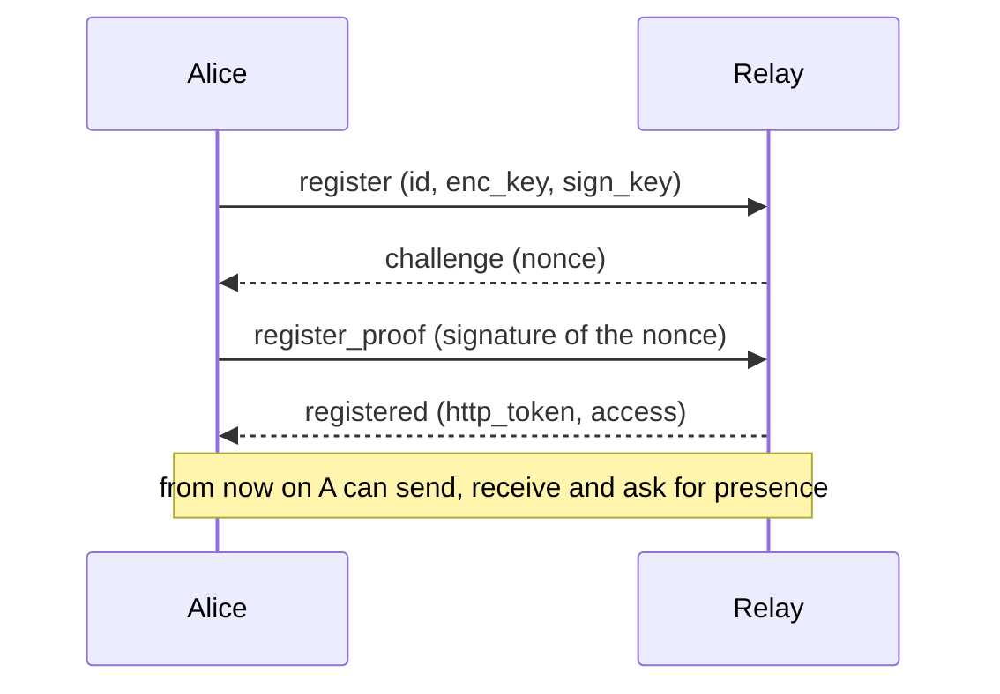
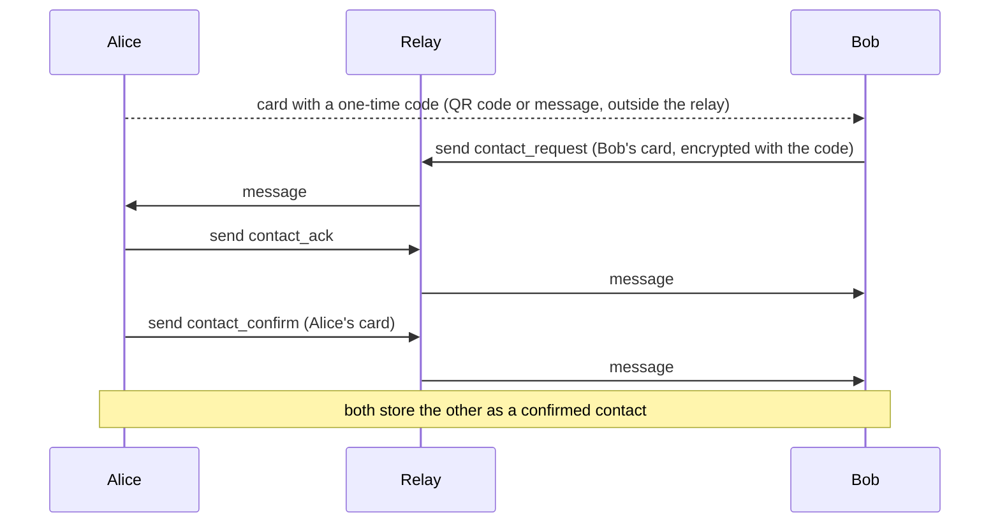
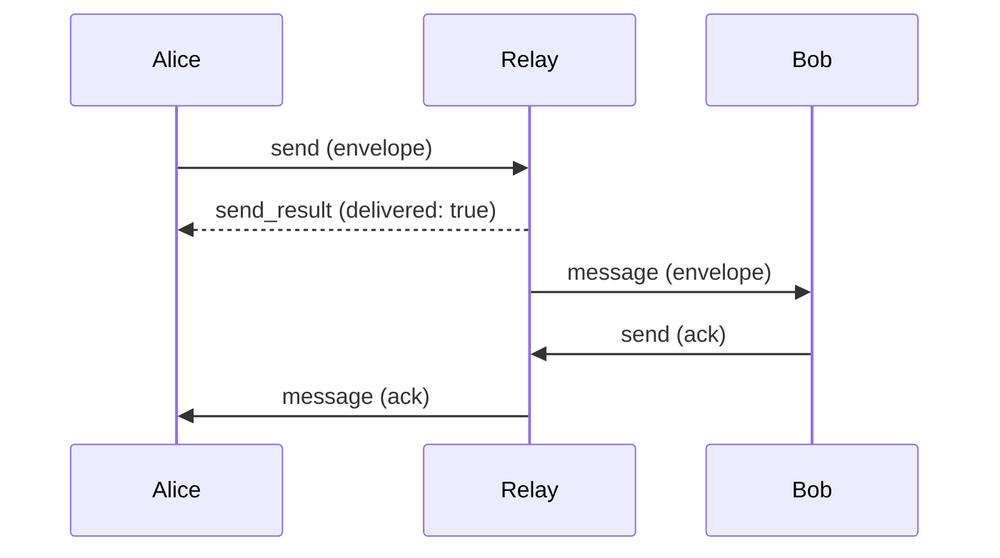
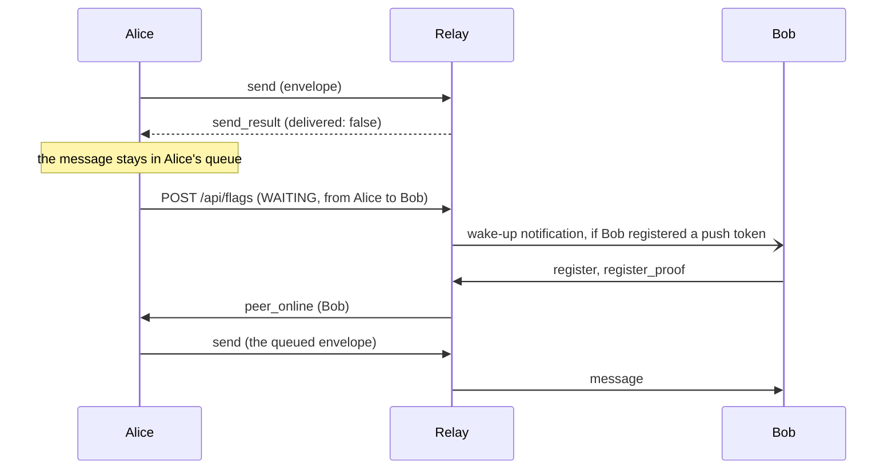
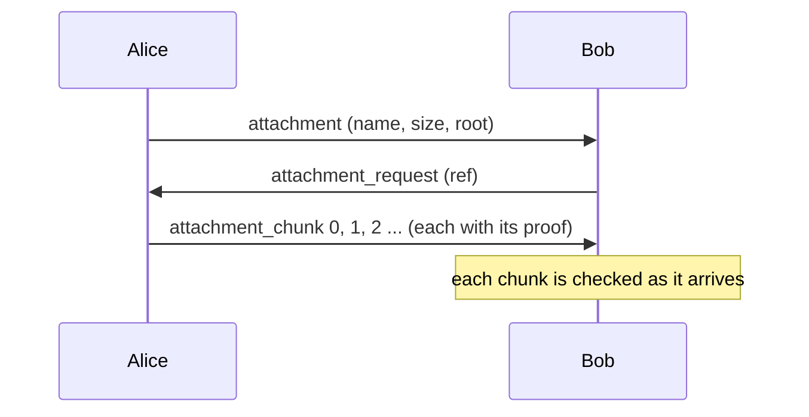
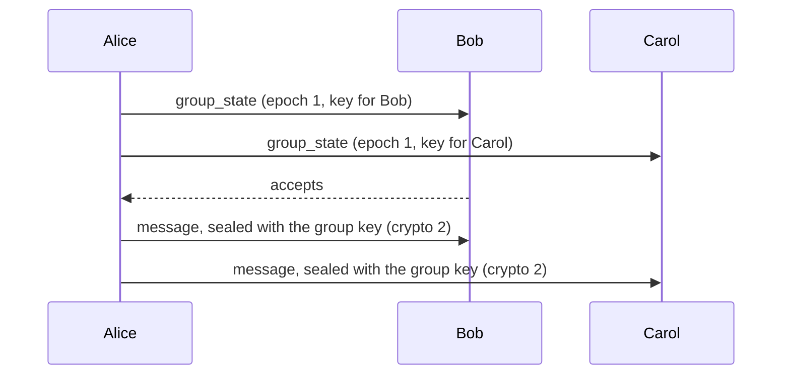

# Protocol API reference

*Version française : [PROTOCOL_API.fr.md](PROTOCOL_API.fr.md).*

This is the reference for anyone who writes a client or a server. It lists every call, grouped by what it is for, with its fields, what it does and an example. The rules and the reasons behind them are in [PROTOCOL.en.md](PROTOCOL.en.md); each section below points to the part that explains it. The class diagrams are in [diagrams/uml/](diagrams/uml/).

Covered here: the connection to a relay, contact exchange, one-to-one messages, presence and offline delivery, files, groups, push registration and several devices. Administration and the calls between servers are in [PROTOCOL.en.md](PROTOCOL.en.md) §10.

## 0. Conventions

### The cast

Every example uses the same three people and one relay. Keys and identifiers are consistent with each other (each identifier is the SHA-256 of its two public keys); ciphertexts and signatures are opaque values of the right length.

| | Name | `discovery_id` |
|---|---|---|
| A | Alice | `8daebb1512cfecf8dae4e5fd5909dcaacbb18c2e654f4a7e164f93b94dca1b17` |
| B | Bob | `009f0fa2bee493ea2e792e0e1a605790a77eac63ec464ce463471529ca89d8d8` |
| C | Carol | `3769e43e04f3e8643bd49e26c3cb7ea239a1bbb301e240bb59df048b2757d94e` |

The relay is `https://relay.exemple.org`. Alice's public keys:

- encryption key (X25519): `6sRBqtczloZ2ymIxEQaxzi0obTPRQYrK9FCaZuKuYhw=`
- signing key (Ed25519): `WekRmGfOa9q9pQKBSy/i4V4hLNatlwfQTAtE10gQRwY=`

Bob's: `AuSe/EZ0jafQjMyR0qGVph8qIVIaZPx889PcnpYyFcA=` and `OkN1XMdBaORM8FnzUaEtGEWYEsXPzeCMjtEtkHPdiLo=`.

### The four layers

| Layer | What it is | Where it travels |
|---|---|---|
| Frame | A JSON object with a `type`, sent as one WebSocket text message | `wss://host/ws/relay` |
| Envelope | Who a message is from and for, plus an encrypted payload | inside a `send` frame, and inside a `message` frame |
| Letter | The decrypted content of an envelope: a `type`, a `payload` and a signature | inside the encrypted `msg` of an envelope |
| HTTP call | Presence flags, the server clock, server information; calls between servers (section 9) | `https://host/api/...`, `/s2s/...`, `/peer/...` |

The relay reads frames and the `from` and `to` of envelopes. It never reads a Letter.

### Encodings

- JSON in UTF-8. Field names are in `snake_case`. A field that is not used is left out.
- `discovery_id`: 64 lowercase hexadecimal characters, the SHA-256 of `encryption public key ‖ signing public key` (32 bytes each).
- Keys, signatures, nonces and ciphertexts: standard base64.
- `ts`: the sender's clock in .NET ticks (100 ns since 0001-01-01 UTC), strictly increasing on one installation. The 12 low bits are a random tag drawn once per run. `message_id` is `"{from}:{ts}"`.
- `created_at` of a contact card: Unix time in milliseconds.
- A WebSocket message is at most 512 KiB. A larger one closes the connection with code 1009.

### Request and answer

A client may put a `request_id` of its choice in a frame; the answer carries the same value. Frames pushed by the server (`message`, `peer_online`, `server_state`, `server_redirect`) have none. A frame the server cannot handle is answered by an `error` frame:

<!-- schema: WsMessage -->
```json
{ "type": "error", "request_id": "r-9", "message": "Register first" }
```

The text of an error is meant for people, except five stable codes: `private_server`, `access_pending` and `access_refused` (section 1), and `quota_exceeded` and `rate_limited` (section 3, "Volume limits"). The last two also come in the `code` field, with `retry_after`.

### Encryption of a Letter (`crypto` = 1)

To send a Letter of type `T` with payload `P` from A to B at time `ts`:

1. Sign, with A's Ed25519 signing key, the UTF-8 text `freespeech-letter-v1|{from}|{to}|{T}|{P}|{ts}`. `from` and `to` are the identifiers of the envelope.
2. Build the JSON `{ "type": T, "payload": P, "sig": <signature in base64> }`.
3. Generate a fresh X25519 key pair. Compute the shared secret with B's encryption key, then derive a 32-byte key with HKDF-SHA256 (salt `FreeSpeech-ECDH`, info `msg-key`).
4. Encrypt the JSON with ChaCha20-Poly1305 and a random 12-byte nonce.
5. `msg` = base64( ephemeral public key (32 bytes) ‖ nonce (12 bytes) ‖ ciphertext and tag ).

The receiver does the reverse and checks the signature with the sender's signing key, which it knows from the contact card. A Letter whose signature is wrong is dropped. A Letter of a type the receiver does not know is ignored without any message.

### A Letter, decrypted

<!-- schema: LetterPayload -->
```json
{
  "type": "message",
  "payload": "Hi Bob, are you coming tonight?",
  "sig": "ZFdh7wy2aeTJh5uy27ZMX92N4QIR8wf9DQNmtrls7uXH70Wv1klLyLtEtSdM4uRtkeulrYtxNqaTgpvqS71aWQ=="
}
```

In the sections below, an example shows the Letter in this form, then the envelope that carries it where that matters.

## 1. Connection



Registration takes two frames, so that nobody can register as an identity without holding its signing key.

### `register`

Layer: frame, client to server. Answered by `challenge`, or `error`.

| Field | Type | Required | Meaning |
|---|---|---|---|
| `type` | string | yes | `"register"` |
| `request_id` | string | no | echoed in the answer |
| `discovery_id` | string | yes | the identity to register |
| `enc_key` | string | yes | X25519 public key, base64, 32 bytes |
| `sign_key` | string | yes | Ed25519 public key, base64, 32 bytes |
| `invitation` | string | no | single-use token given by the administrator of a private server |
| `request_access` | boolean | no | asks the administrator of a private server to allow this identity; send it only after the user agreed |
| `name` | string | no | with `request_access`: the name shown to the administrator, 64 characters at most |
| `note` | string | no | with `request_access`: a few words, 200 characters at most |

The server checks that the two keys hash to `discovery_id`. Nothing is registered yet.

<!-- schema: WsMessage -->
```json
{
  "type": "register",
  "request_id": "r-1",
  "discovery_id": "8daebb1512cfecf8dae4e5fd5909dcaacbb18c2e654f4a7e164f93b94dca1b17",
  "enc_key": "6sRBqtczloZ2ymIxEQaxzi0obTPRQYrK9FCaZuKuYhw=",
  "sign_key": "WekRmGfOa9q9pQKBSy/i4V4hLNatlwfQTAtE10gQRwY="
}
```

### `challenge`

Layer: frame, server to client.

| Field | Type | Meaning |
|---|---|---|
| `type` | string | `"challenge"` |
| `request_id` | string | the one of `register` |
| `discovery_id` | string | the identity being registered |
| `nonce` | string | 32 random bytes, base64, valid for one proof |

<!-- schema: WsMessage -->
```json
{
  "type": "challenge",
  "request_id": "r-1",
  "discovery_id": "8daebb1512cfecf8dae4e5fd5909dcaacbb18c2e654f4a7e164f93b94dca1b17",
  "nonce": "u5hYX07opkjx0II5F6cqe3rgD2FT9VaM4oqefS/rFSk="
}
```

### `register_proof`

Layer: frame, client to server. Answered by `registered`, or `error`.

| Field | Type | Required | Meaning |
|---|---|---|---|
| `type` | string | yes | `"register_proof"` |
| `request_id` | string | no | echoed in the answer |
| `signature` | string | yes | Ed25519 signature, base64, of the UTF-8 text `freespeech-register-v1|{nonce}|{discovery_id}` |

A nonce is used once. If the proof fails, the client starts again with `register`.

<!-- schema: WsMessage -->
```json
{
  "type": "register_proof",
  "request_id": "r-2",
  "signature": "ZFdh7wy2aeTJh5uy27ZMX92N4QIR8wf9DQNmtrls7uXH70Wv1klLyLtEtSdM4uRtkeulrYtxNqaTgpvqS71aWQ=="
}
```

### `registered`

Layer: frame, server to client. The connection is now registered under the identity.

| Field | Type | Meaning |
|---|---|---|
| `type` | string | `"registered"` |
| `request_id` | string | the one of `register_proof` |
| `http_token` | string | to present in the `X-Flag-Token` header of the HTTP calls of section 4; valid while this connection lives |
| `access` | string | `"open"` or `"allowlist"`: who may register on this server |
| `provisioners` | list | identities that the administrator of a private server names as its administration tools, each `{ id, enc_key, sign_key }`; left out when there are none |
| `daily_quota` | number | bytes an identity may send per 24 hours on this server (see "Volume limits"); left out when there is no quota |

<!-- schema: WsMessage -->
```json
{
  "type": "registered",
  "request_id": "r-2",
  "http_token": "b7c2e9d41f6a4c58a3d0e57f19c84b26",
  "access": "open",
  "daily_quota": 1073741824
}
```

An identity may have several connections at once, from several devices. Each one registers on its own.

### Refusals on a private server

When the server restricts access, `register_proof` can be answered by an `error` whose `message` is one of these stable codes:

| `message` | Meaning |
|---|---|
| `private_server` | the identity is unknown here: ask the administrator for an invitation, or send `request_access` |
| `access_pending` | a request for this identity is waiting for the administrator |
| `access_refused` | the identity is banned |

An invitation (`invitation` in `register`) is spent only after the proof succeeds.

### `server_state` and `server_redirect`

Layer: frame, server to client, without `request_id`. The server may send them at any time on a registered connection.

`server_state` says that the sign-up rule changed while the client is connected: `access` and `provisioners` as in `registered`.

`server_redirect` suggests other servers: `servers` is a list of addresses, best first, and `reason` is `"load"` (this server is full) or `"admin"` (its administrator is draining it).

<!-- schema: WsMessage -->
```json
{
  "type": "server_redirect",
  "servers": [ "https://relay2.exemple.org" ],
  "reason": "load"
}
```

### HTTP: `GET /api/time` and `GET /api/info`

`GET /api/time` returns the server's UTC clock, `{ "utc": "2026-10-10T09:00:00Z" }`. It is used to set the time of a rendezvous without depending on the device's clock.

`GET /api/info` returns `{ "software", "license", "version", "source" }`. `source` is the address of the source code of the program the server runs.

See [PROTOCOL.en.md](PROTOCOL.en.md) §11 for the transport and §10 for access control.

### HTTP: `GET /directory/servers` and `POST /directory/heartbeat`

Calls of a directory (see [PROTOCOL.en.md](PROTOCOL.en.md) §10 "Directory"). The client asks for relays; a relay says how it is.

`GET /directory/servers?country=FR&count=3` → 200, signed by the directory's key (`sig` over `directory-list`, a line break, `ts`, a line break, then one `url|country` line per server, in order):

```json
{ "ts": 1790000000, "servers": [ { "url": "https://r1.example.org", "country": "FR" } ], "sig": "MEUCIQ…" }
```

`POST /directory/heartbeat` (signed call of a relay, headers `X-Peer-Id`, `X-Peer-Ts`, `X-Peer-Sig`) → 200; 401 when the signature is missing or the relay is not accepted, 403 when banned. `free` is -1 when the relay states no limit:

```json
{ "country": "FR", "free": 90, "accepts_new": true, "version": "1.2.0", "date": "2026-10-17" }
```

## 2. Contacts

Two people become contacts by exchanging a card. The card travels outside the relay (a QR code, a pasted message); the answer travels through the relay, encrypted with a one-time code (OTC) written in the card.



### The contact card

A card is a JSON object. Alice exports hers with a one-time code; the relay never sees this form.

| Field | Type | Required | Meaning |
|---|---|---|---|
| `version` | string | no | `"2.0"` |
| `nickname` | string | yes | the name the person goes by |
| `photo` | string | no | JPEG, base64, under 100 KiB |
| `description` | string | no | free text, 300 characters at most |
| `discovery_id` | string | yes | the identifier |
| `encryption_public_key` | string | yes | X25519, base64 |
| `signing_public_key` | string | yes | Ed25519, base64 |
| `servers` | list | no | the relays the person is on, best first, each `{ url, priority }` plus `restricted: true` for a server that restricts who signs up (the open ones are listed before the restricted ones) |
| `revocation_public_key` | string | no | Ed25519 key used to check a migration notice (section 3, `identity_moved`) |
| `enable_push` | boolean | no | the person can be woken by a notification |
| `otc` | string | first card only | the one-time code, 16 characters |
| `flag` | string | first card only | `"qr"` (valid 10 minutes) or `"manual"` (valid 30 days) |
| `created_at` | number | no | Unix time in milliseconds; the validity runs from there |

<!-- schema: ContactCard -->
```json
{
  "version": "2.0",
  "nickname": "Alice",
  "discovery_id": "8daebb1512cfecf8dae4e5fd5909dcaacbb18c2e654f4a7e164f93b94dca1b17",
  "encryption_public_key": "6sRBqtczloZ2ymIxEQaxzi0obTPRQYrK9FCaZuKuYhw=",
  "signing_public_key": "WekRmGfOa9q9pQKBSy/i4V4hLNatlwfQTAtE10gQRwY=",
  "servers": [ { "url": "https://relay.exemple.org", "priority": 0 } ],
  "revocation_public_key": "/yrGwdrknq34Vg4riGB68kGGR9UhaclLuAEenrcglTg=",
  "enable_push": true,
  "otc": "K7M2QX9HDF4WT6RP",
  "flag": "qr",
  "created_at": 1791622800000
}
```

What is shared is this JSON in base64. A client that reads a card refuses it when `otc` is missing, when `servers` is empty, or when it is older than its validity (plus two minutes of clock difference).

### Encryption with the one-time code (`crypto` = 0)

The messages of the exchange are encrypted with a key derived from the code:

1. Key = HKDF-SHA256 of the UTF-8 bytes of the code, salt `FreeSpeech-OTC`, info `sym-key`, 32 bytes.
2. Encrypt with ChaCha20-Poly1305 and a random 12-byte nonce.
3. `msg` = base64( nonce (12 bytes) ‖ ciphertext and tag ).

These messages are carried in an envelope with `crypto` set to `0`, and carry no signature: the code is the proof.

### `contact_request`

Layer: envelope with `crypto` 0, from the person who read the card (Bob) to the person who issued it (Alice). Bob sends it with a `send` frame (section 3). It contains a wrapper `{ type, payload }`, where `payload` is Bob's own card as a string, without `otc`.

<!-- schema: OtcEnvelope -->
```json
{
  "type": "contact_request",
  "payload": "{\"version\":\"2.0\",\"nickname\":\"Bob\",\"discovery_id\":\"009f0fa2bee493ea2e792e0e1a605790a77eac63ec464ce463471529ca89d8d8\",\"encryption_public_key\":\"AuSe/EZ0jafQjMyR0qGVph8qIVIaZPx889PcnpYyFcA=\",\"signing_public_key\":\"OkN1XMdBaORM8FnzUaEtGEWYEsXPzeCMjtEtkHPdiLo=\",\"servers\":[{\"url\":\"https://relay.exemple.org\",\"priority\":0}],\"enable_push\":true,\"created_at\":1791622860000}"
}
```

The envelope that carries it, as it passes through the relay:

<!-- schema: Envelope -->
```json
{
  "from": "009f0fa2bee493ea2e792e0e1a605790a77eac63ec464ce463471529ca89d8d8",
  "to": "8daebb1512cfecf8dae4e5fd5909dcaacbb18c2e654f4a7e164f93b94dca1b17",
  "crypto": 0,
  "msg": "5H8A3Io4IW0s0ms9GCzNnjKwxlN5Tk6fkelgEy/Meezn6TZrcrR1hrQc9KuYs8L8kRVBLAzhFPnZryeHe0LSxCkR/VF6f9UuC/29+KoG4vE=",
  "ts": 639272197203456789
}
```

Alice tries each one-time code she issued until one decrypts the message. If the code has expired, she ignores the request without a reply. If the relay cannot reach Alice, Bob keeps the request and sends it again later.

### `contact_ack`

Layer: envelope with `crypto` 0, from Alice to Bob, sent at once when Alice has accepted the request as valid. The wrapper has no payload. It tells Bob to stop sending again.

<!-- schema: OtcEnvelope -->
```json
{ "type": "contact_ack" }
```

### `contact_confirm`

Layer: envelope with `crypto` 0, from Alice to Bob. `payload` is Alice's own card as a string, without `otc`. With a code of kind `"qr"` Alice confirms by herself; with `"manual"` she waits for her user to accept. When Bob receives it, he stores Alice as a confirmed contact. Alice has stored Bob when she sent it.

<!-- schema: OtcEnvelope -->
```json
{
  "type": "contact_confirm",
  "payload": "{\"version\":\"2.0\",\"nickname\":\"Alice\",\"discovery_id\":\"8daebb1512cfecf8dae4e5fd5909dcaacbb18c2e654f4a7e164f93b94dca1b17\",\"encryption_public_key\":\"6sRBqtczloZ2ymIxEQaxzi0obTPRQYrK9FCaZuKuYhw=\",\"signing_public_key\":\"WekRmGfOa9q9pQKBSy/i4V4hLNatlwfQTAtE10gQRwY=\",\"servers\":[{\"url\":\"https://relay.exemple.org\",\"priority\":0}],\"enable_push\":true,\"created_at\":1791622800000}"
}
```

### `identity_update`

Layer: Letter (`crypto` 1), from a contact to each of their contacts. `payload` is the person's new card as a string, without `otc`. It is sent when the nickname, the picture, the description or the list of servers changes. A receiver rejects an update whose `encryption_public_key` or `signing_public_key` differs from the ones it holds; the other fields change freely.

<!-- schema: LetterPayload -->
```json
{
  "type": "identity_update",
  "payload": "{\"version\":\"2.0\",\"nickname\":\"Alice B.\",\"discovery_id\":\"8daebb1512cfecf8dae4e5fd5909dcaacbb18c2e654f4a7e164f93b94dca1b17\",\"encryption_public_key\":\"6sRBqtczloZ2ymIxEQaxzi0obTPRQYrK9FCaZuKuYhw=\",\"signing_public_key\":\"WekRmGfOa9q9pQKBSy/i4V4hLNatlwfQTAtE10gQRwY=\",\"servers\":[{\"url\":\"https://relay.exemple.org\",\"priority\":0}],\"enable_push\":true,\"created_at\":1791622800000}",
  "sig": "ZFdh7wy2aeTJh5uy27ZMX92N4QIR8wf9DQNmtrls7uXH70Wv1klLyLtEtSdM4uRtkeulrYtxNqaTgpvqS71aWQ=="
}
```

### `route_policy`

Layer: Letter (`crypto` 1), from a contact to a contact. It says whether the sender allows an open server for their messages with the receiver while the restricted servers they share do not answer (see [PROTOCOL.en.md](PROTOCOL.en.md) § 8, "Restricted servers"). It is sent when the sender changes the setting for that contact. Both sides must allow it for an open server to be used. The receiver keeps the last value it got from each contact.

| Field of `payload` | Type | Meaning |
|---|---|---|
| `open_fallback` | boolean | true when the sender asks to be asked or allows it by themselves (settings `Ask` and `Auto`), false for `Never` |

<!-- schema: LetterPayload -->
```json
{
  "type": "route_policy",
  "payload": "{\"open_fallback\":true}",
  "sig": "ZFdh7wy2aeTJh5uy27ZMX92N4QIR8wf9DQNmtrls7uXH70Wv1klLyLtEtSdM4uRtkeulrYtxNqaTgpvqS71aWQ=="
}
```

### `identity_moved`

Layer: Letter (`crypto` 1), from a person's old identifier to their contacts and group moderators. It announces a move to a new identity.

| Field | Type | Meaning |
|---|---|---|
| `old_id` | string | the identifier the person leaves |
| `new_card` | card | the card of the new identity |
| `ts` | number | Unix time in milliseconds |
| `sig` | string | Ed25519 signature, base64, by the old identity's revocation key, of the UTF-8 text `FreeSpeech-moved-v1|{old_id}|{new_id}|{ts}` |

A receiver counts the notice only if the signature matches the revocation key it pinned from the old card. The person then accepts or refuses; nothing is sent to the old identifier once the move is accepted. See [PROTOCOL.en.md](PROTOCOL.en.md) §1.

<!-- schema: MovedOp -->
```json
{
  "old_id": "8daebb1512cfecf8dae4e5fd5909dcaacbb18c2e654f4a7e164f93b94dca1b17",
  "new_card": {
    "nickname": "Alice",
    "discovery_id": "16e14a1ff97deefd4c04ba165386c5ca09b9b9dc819a5473e0c03ba7c03eb5e3",
    "encryption_public_key": "MK0ZnImzjIKuixgVSX7Ch6YJIJvLLC40V18ihVXVWsg=",
    "signing_public_key": "B3nWNOGrDKHKpAPeRAvbUHl9UoRRXIcMpZ/q1Z6moWk=",
    "servers": [ { "url": "https://relay.exemple.org", "priority": 0 } ]
  },
  "ts": 1791626400000,
  "sig": "ZFdh7wy2aeTJh5uy27ZMX92N4QIR8wf9DQNmtrls7uXH70Wv1klLyLtEtSdM4uRtkeulrYtxNqaTgpvqS71aWQ=="
}
```

The safety number is not a call: both sides compute it from the two pairs of public keys to check, outside the relay, that nobody replaced a key during the exchange. See [PROTOCOL.en.md](PROTOCOL.en.md) §3.

## 3. One-to-one messages



### `send`

Layer: frame, client to server. Answered by `send_result`, or `error`.

| Field | Type | Required | Meaning |
|---|---|---|---|
| `type` | string | yes | `"send"` |
| `request_id` | string | no | echoed in the answer |
| `envelope` | object | yes | the envelope, see below |

The envelope:

| Field | Type | Required | Meaning |
|---|---|---|---|
| `from` | string | yes | the sender; it must be the identity this connection registered with |
| `to` | string | yes | the recipient |
| `crypto` | number | no | `0` for the contact exchange, `1` for a Letter (default) |
| `msg` | string | yes | the encrypted payload, base64 |
| `ts` | number | yes | the sender's timestamp; with `from` it makes the `message_id` |
| `reply_to` | string | no | the `message_id` of the message this one answers |
| `to_server` | string | no | the recipient's relay, used by the sender to choose a server |

The relay delivers the envelope to every active connection of the recipient. If the recipient has none and the relay is linked to others, it asks its neighbours once. It never changes the envelope.

Alice sends Bob a message:

<!-- schema: WsMessage -->
```json
{
  "type": "send",
  "request_id": "r-3",
  "envelope": {
    "from": "8daebb1512cfecf8dae4e5fd5909dcaacbb18c2e654f4a7e164f93b94dca1b17",
    "to": "009f0fa2bee493ea2e792e0e1a605790a77eac63ec464ce463471529ca89d8d8",
    "crypto": 1,
    "msg": "5H8A3Io4IW0s0ms9GCzNnjKwxlN5Tk6fkelgEy/Meezn6TZrcrR1hrQc9KuYs8L8kRVBLAzhFPnZryeHe0LSxCkR/VF6f9UuC/29+KoG4vE=",
    "ts": 639272197203456789
  }
}
```

The relay refuses with an `error` when the sender is not registered (`Register first`), when `to` or `msg` is missing, or when `from` is not the registered identity (`Sender identity mismatch`). It also refuses when the sender has used up its volume (`quota_exceeded`, `rate_limited`; see "Volume limits" below).

### `send_result`

Layer: frame, server to client.

| Field | Type | Meaning |
|---|---|---|
| `type` | string | `"send_result"` |
| `request_id` | string | the one of `send` |
| `delivered` | boolean | the envelope was written to at least one connection of the recipient (here or on a neighbour) |
| `self_multi_device` | boolean | the sender has another active connection; see "A copy for the sender's other devices" |
| `quota_left` | number | bytes the sender may still send in the current 24 hours; left out when there is no quota |

`delivered` does not mean the recipient kept the message: the connection may be dead. The recipient confirms with an `ack`.

<!-- schema: WsMessage -->
```json
{ "type": "send_result", "request_id": "r-3", "delivered": true, "self_multi_device": false, "quota_left": 1073000000 }
```

### Volume limits

The relay sees opaque envelopes: it cannot tell a file chunk from a message, so it counts bytes sent, not files. Three limits apply to `send`, each switched off by `0`:

| Setting | Default | Meaning |
|---|---|---|
| `Server:MaxBytesPerIdentityPerDay` | 1 GiB | bytes one identity may send in any 24 hours (rolling window, counted by the hour) |
| `Server:MaxBytesPerIdentityPer10Minutes` | 300 MiB | throughput of one identity: the bucket holds this much and refills over 10 minutes |
| `Server:MaxBytesPerAddressPerDay` | 5 GiB | bytes all the identities behind one network address may send in any 24 hours |

An identity going faster than its throughput is slowed down: the relay holds its next frames back, up to 20 seconds, then answers as usual. A frame that would wait longer, or that exceeds a daily quota, is refused with an `error` that carries a stable `code`. A refused frame is not counted, and the connection stays open.

| `code` | Meaning |
|---|---|
| `quota_exceeded` | the 24-hour volume of the identity or of its address is used up |
| `rate_limited` | the identity sends faster than its allowed throughput |

<!-- schema: WsMessage -->
```json
{ "type": "error", "request_id": "r-4", "message": "quota_exceeded", "code": "quota_exceeded", "retry_after": 3600, "quota_left": 0 }
```

`retry_after` is the number of seconds before sending may resume. The client holds back its sends to that server until then; letters waiting in its outbox go out afterwards.

### `message` (frame)

Layer: frame, server to client, without `request_id`. It brings an envelope to a connected recipient.

<!-- schema: WsMessage -->
```json
{
  "type": "message",
  "envelope": {
    "from": "8daebb1512cfecf8dae4e5fd5909dcaacbb18c2e654f4a7e164f93b94dca1b17",
    "to": "009f0fa2bee493ea2e792e0e1a605790a77eac63ec464ce463471529ca89d8d8",
    "crypto": 1,
    "msg": "5H8A3Io4IW0s0ms9GCzNnjKwxlN5Tk6fkelgEy/Meezn6TZrcrR1hrQc9KuYs8L8kRVBLAzhFPnZryeHe0LSxCkR/VF6f9UuC/29+KoG4vE=",
    "ts": 639272197203456789
  }
}
```

An envelope with `crypto` 0 belongs to the contact exchange (section 2). With `crypto` 1, Bob decrypts and checks the Letter, then acts on its `type`. A Letter already seen (same sender, recipient, `ts` and `crypto`) is not handled twice, but it is confirmed again.

### The Letters of a conversation

Every Letter below goes in the `msg` of an envelope with `crypto` 1, and is encrypted as shown in section 0. In these sections, "the target" is a `message_id`, `"{author}:{ts}"`.

#### `message`

The text of a message. `payload` is the text itself, not JSON. If it answers another message, the envelope has `reply_to`.

<!-- schema: LetterPayload -->
```json
{
  "type": "message",
  "payload": "Hi Bob, are you coming tonight?",
  "sig": "ZFdh7wy2aeTJh5uy27ZMX92N4QIR8wf9DQNmtrls7uXH70Wv1klLyLtEtSdM4uRtkeulrYtxNqaTgpvqS71aWQ=="
}
```

Bob's answer, in an envelope that carries `reply_to`:

<!-- schema: Envelope -->
```json
{
  "from": "009f0fa2bee493ea2e792e0e1a605790a77eac63ec464ce463471529ca89d8d8",
  "to": "8daebb1512cfecf8dae4e5fd5909dcaacbb18c2e654f4a7e164f93b94dca1b17",
  "crypto": 1,
  "msg": "5H8A3Io4IW0s0ms9GCzNnjKwxlN5Tk6fkelgEy/Meezn6TZrcrR1hrQc9KuYs8L8kRVBLAzhFPnZryeHe0LSxCkR/VF6f9UuC/29+KoG4vE=",
  "ts": 639272197893412345,
  "reply_to": "8daebb1512cfecf8dae4e5fd5909dcaacbb18c2e654f4a7e164f93b94dca1b17:639272197203456789"
}
```

#### `message_edit`

The author replaces the text of one of their messages. `payload` is a JSON string `{ target, text }`. The `ts` of the envelope is the version: the latest wins. Only the author may edit: a receiver ignores an edit whose sender is not the author named in `target`.

<!-- schema: MessageOp -->
```json
{
  "target": "8daebb1512cfecf8dae4e5fd5909dcaacbb18c2e654f4a7e164f93b94dca1b17:639272197203456789",
  "text": "Hi Bob, are you coming tonight at eight?"
}
```

#### `message_retract`

The author deletes one of their messages for everyone. `payload` is a JSON string `{ target }`. The content is erased and a line "message deleted" stays. A deletion beats any edit, whatever the order of arrival.

<!-- schema: MessageOp -->
```json
{ "target": "8daebb1512cfecf8dae4e5fd5909dcaacbb18c2e654f4a7e164f93b94dca1b17:639272197203456789" }
```

In a group, `seq` is added (see [PROTOCOL.en.md](PROTOCOL.en.md) §7); in a one-to-one chat, it is left out or `0`.

#### `message_react`

An emoji reaction to a message, from anyone in the conversation. `payload` is a JSON string `{ target, text }`, where `text` is one emoji; an empty `text` takes the reaction back. A person has one reaction per message: the latest `ts` wins.

<!-- schema: MessageOp -->
```json
{
  "target": "8daebb1512cfecf8dae4e5fd5909dcaacbb18c2e654f4a7e164f93b94dca1b17:639272197203456789",
  "text": "👍"
}
```

#### `read_ack`

"I have read up to this message, included." `payload` is a JSON string `{ target }`, where `target` is the last message received from the sender of the receipt. One receipt covers all earlier messages. It is sent when the user looks at the conversation and new messages arrived since the last receipt; it is not queued, and the user can switch it off. The receiver honours it only if `target` is a message it wrote.

<!-- schema: MessageOp -->
```json
{ "target": "8daebb1512cfecf8dae4e5fd5909dcaacbb18c2e654f4a7e164f93b94dca1b17:639272197203456789" }
```

#### `typing`

"I am typing." `payload` is `{}` in a one-to-one chat. It is never stored, never queued and never sets a flag, so it cannot wake a phone, and it is lost if the recipient is not connected. A client sends at most one every 4 seconds per conversation. The receiver shows the indicator for 6 seconds after the last one.

<!-- schema: TypingOp -->
```json
{}
```

#### `ack`

Confirms that Letters were kept. `payload` is a JSON string `{ ids }`, the `message_id`s of the Letters kept, gathered over 300 ms. It is sent by the recipient to the sender, is not queued and is not itself confirmed.

<!-- schema: AckOp -->
```json
{
  "ids": [
    "8daebb1512cfecf8dae4e5fd5909dcaacbb18c2e654f4a7e164f93b94dca1b17:639272197203456789"
  ]
}
```

Which Letters are confirmed: `message`, `attachment`, `message_edit`, `message_retract`, `attachment_retract`, `message_react`, `identity_update` and `route_policy`. A Letter that was delivered stays in the sender's queue, marked as delivered and not confirmed, until its `ack` arrives. Without one it is sent again as it was (same `ts`, so same `message_id`) after 30 seconds, 2 minutes, 10 minutes, 1 hour and 6 hours, then dropped. It also goes out at once when the relay announces the receiver's return (`peer_online`). For that return to be announced to it, the sender sets a `WAITING` flag towards the receiver three seconds after a Letter was delivered and stayed without `ack`, and removes it (`DELETE /api/flags/{from}/{to}`) when none of its Letters waits for that receiver any more. See [PROTOCOL.en.md](PROTOCOL.en.md) §5.

### A copy for the sender's other devices

When `send_result` has `self_multi_device` true, the sender has another active connection. The envelope for the recipient is unreadable by that device, so the sender sends a second envelope to itself: `to` equals `from`, and the Letter has an extra field `orig_to`, the real recipient. The signature then covers `orig_to` in place of `to`, and the relay does not return the envelope to the connection that sent it. Only chat messages are copied this way.

<!-- schema: LetterPayload -->
```json
{
  "type": "message",
  "payload": "Hi Bob, are you coming tonight?",
  "sig": "ZFdh7wy2aeTJh5uy27ZMX92N4QIR8wf9DQNmtrls7uXH70Wv1klLyLtEtSdM4uRtkeulrYtxNqaTgpvqS71aWQ==",
  "orig_to": "009f0fa2bee493ea2e792e0e1a605790a77eac63ec464ce463471529ca89d8d8"
}
```

## 4. Presence and offline delivery

The relay keeps nothing. When Bob is not connected, Alice's message waits in Alice's own queue. Two things bring it to Bob: a flag that tells the relay Alice is waiting, and Bob's next connection.



### `is_online`

Layer: frame, client to server. Answered by `is_online_result`. It asks whether an identity has an active connection on this relay or on a neighbour.

<!-- schema: WsMessage -->
```json
{
  "type": "is_online",
  "request_id": "r-5",
  "discovery_id": "009f0fa2bee493ea2e792e0e1a605790a77eac63ec464ce463471529ca89d8d8"
}
```

### `is_online_result`

Layer: frame, server to client.

<!-- schema: WsMessage -->
```json
{
  "type": "is_online_result",
  "request_id": "r-5",
  "discovery_id": "009f0fa2bee493ea2e792e0e1a605790a77eac63ec464ce463471529ca89d8d8",
  "online": false
}
```

### `peer_online`

Layer: frame, server to client, without `request_id`. When an identity connects, the relay sends this frame to the connections of each identity that set a `WAITING` flag towards it (if that identity is not connected either, the relay wakes it by push notification). The receiver sends its queue again at once, including the Letters the relay said it delivered to that identity and that it did not confirm with an `ack`: a dead connection accepts the write without the Letter arriving.

<!-- schema: WsMessage -->
```json
{
  "type": "peer_online",
  "discovery_id": "009f0fa2bee493ea2e792e0e1a605790a77eac63ec464ce463471529ca89d8d8"
}
```

### The flag calls

Layer: HTTP. Every call carries two headers: `X-Discovery-Id`, the identity of the caller, and `X-Flag-Token`, the `http_token` of its current connection. The caller must also be connected under that identity. Without both, the answer is `401` with `{ "error": "Not connected as this identity" }`. A flag is kept in the relay's memory. A `WAITING` flag expires 30 days after it was set; a `READY` flag, 2 minutes after its `next_connect_at`.

A flag has these fields:

| Field | Type | Meaning |
|---|---|---|
| `from` | string | the party that set it |
| `to` | string | the party it is addressed to |
| `state` | string | `"WAITING"` or `"READY"` |
| `next_connect_at` | string | `READY` only: UTC time at which the party will be connected, in the future |
| `updated_at` | string | set by the server |

**`POST /api/flags`** sets or updates a flag. The caller is `from`. A `WAITING` flag also triggers a wake-up notification for `to`, if it registered a push token. A `READY` flag must have a `next_connect_at` in the future.

```json
{
  "from": "8daebb1512cfecf8dae4e5fd5909dcaacbb18c2e654f4a7e164f93b94dca1b17",
  "to": "009f0fa2bee493ea2e792e0e1a605790a77eac63ec464ce463471529ca89d8d8",
  "state": "WAITING"
}
```

Answers: `200` with `{ "updated_at": "..." }`; `400` with `{ "error": "State must be WAITING or READY" }`, or with an error about `next_connect_at`; `401` as above.

**`GET /api/flags/{discovery_id}`** returns the flags addressed to that identity, as a list. The caller must be that identity.

```json
[
  {
    "from": "8daebb1512cfecf8dae4e5fd5909dcaacbb18c2e654f4a7e164f93b94dca1b17",
    "to": "009f0fa2bee493ea2e792e0e1a605790a77eac63ec464ce463471529ca89d8d8",
    "state": "WAITING",
    "updated_at": "2026-10-10T09:03:12Z"
  }
]
```

**`DELETE /api/flags/{from}/{to}`** removes a flag once the rendezvous is over, or when the last waiting Letter for `to` has been confirmed. Either party may call it. Answer: `200`.

The app sets `WAITING` flags and relies on `peer_online`: when the relay could not deliver a Letter to anyone, and three seconds after a Letter was delivered that the receiver did not confirm. At every connection it sends its queue at once, without waiting for the scheduler's first pass. `READY`, with a time to meet at, is available to clients that prefer to agree on a moment; the console client exposes it.

See [PROTOCOL.en.md](PROTOCOL.en.md) §9 for the wake-up sequence.

## 5. Files

A file travels in three steps: Alice offers it, Bob asks for it, Alice sends it in chunks. The offer is a Letter like a message, so Bob sees it, with a name and a size, before deciding to download.



(All the messages go through the relay, as in section 3. Only the Letters are shown here.)

### The identity of a file

- A file is cut in chunks of 48 KiB (49,152 bytes); the last one is shorter. The number of chunks is `ceil(size / 49152)` and is never sent: the receiver derives it from `size`. The largest file is 2 GiB: an offer above it is ignored.
- Leaf: `SHA-256(0x00 ‖ chunk)`. Node: `SHA-256(0x01 ‖ left ‖ right)`. A node without a sibling is promoted as it is, never duplicated. The result is the tree root.
- `root`, in the offer, is `SHA-256(0x02 ‖ size ‖ tree root)` in lowercase hexadecimal, where `size` is 8 bytes, little endian. It identifies the content: two files with the same `root` are the same file.
- The proof of a chunk is the list of the sibling hashes from its leaf up to, but not including, the root, in base64. A level where the node has no sibling adds nothing.

### `attachment`

Letter (`crypto` 1) from the sender to the recipient. `payload` is a JSON string. Its `message_id` is the `ref` that the next calls use. It goes through the sender's queue and is confirmed with an `ack`, like a message.

| Field | Type | Required | Meaning |
|---|---|---|---|
| `name` | string | yes | file name |
| `mime` | string | yes | media type |
| `size` | number | yes | size in bytes, at most 2 GiB (2,147,483,648); an offer with a size of 0 or above that is ignored |
| `root` | string | yes | content identity, 64 hexadecimal characters |
| `thumbnail` | string | no | small JPEG preview, base64 |

<!-- schema: AttachmentOffer -->
```json
{
  "name": "holiday.jpg",
  "mime": "image/jpeg",
  "size": 2457600,
  "root": "6879574f649d69f74bfce58bce91c4b24f242c878fbd95720e037f62cb29ca23"
}
```

### `attachment_request`

Letter from the person who wants the file to the one who has it. It is not queued: if there is no progress for 20 seconds, the receiver asks again, for the missing chunks only. If the sender cannot be reached, the receiver sets a `WAITING` flag (section 4).

| Field | Type | Required | Meaning |
|---|---|---|---|
| `ref` | string | yes | the `message_id` of the `attachment` Letter |
| `missing` | list | no | the chunk numbers to send; left out means all of them |

<!-- schema: AttachmentRequest -->
```json
{
  "ref": "8daebb1512cfecf8dae4e5fd5909dcaacbb18c2e654f4a7e164f93b94dca1b17:639272198203456789",
  "missing": [12, 13]
}
```

### `attachment_chunk`

Letter from the holder to the requester. Each chunk travels in its own envelope, with a `ts` that increases from one to the next. The data is shortened below.

| Field | Type | Meaning |
|---|---|---|
| `ref` | string | the `message_id` of the offer |
| `chunk_id` | number | position of the chunk, from 0 |
| `total_chunks` | number | number of chunks of the file |
| `data` | string | the chunk, base64 |
| `proof` | list | the sibling hashes, base64, from the leaf to the root |

The receiver ignores a chunk when `ref` is unknown, when `total_chunks` is not the number derived from `size`, or when the length of the data is wrong. It checks the proof against `root`. A chunk whose proof fails counts as a strike against the person who sent it, and after three the download is abandoned (in a group, only that member is set aside).

A holder sends the chunks one after the other and stops at the first one the relay does not deliver or refuses (`quota_exceeded`, `rate_limited`, section 3 "Volume limits"). The receiver, after 20 seconds without a chunk, asks again for the missing ones.

<!-- schema: AttachmentChunk -->
```json
{
  "ref": "8daebb1512cfecf8dae4e5fd5909dcaacbb18c2e654f4a7e164f93b94dca1b17:639272198203456789",
  "chunk_id": 12,
  "total_chunks": 50,
  "data": "/9j/4AAQSkZJRgABAQEASABIAAD/2wBDAAMCAgMCAgMDAwMEAwMEBQgFBQQEBQoHBwYIDAoMDAsKCwsNDhIQDQ4RDgsLEBYQERMUFRUVDA8XGBYUGBIUFRT...",
  "proof": [
    "SIerB3hlGumc2e5qNuz91N8irblc1V7Fs5dkr9KUA64=",
    "Uw+uatjYxL8woldRBaCf58XI9V3v4+vc31zCn0ivf8E=",
    "K7bZlt1a53RmOtjeUFVFcvZ6l9ngy+ug0Zp3/s8qGjw=",
    "hGCEgvx01855sy24rOPRnqnGL/cC8djEYlK+VyQSToI=",
    "3541Sod1UZlNcIt9uLt0j1g79Fv2P8VpBX5mrz81xQo=",
    "/olt/nFd/3ODGebpNHGlEXbvDPX16ASVRsehTjKiM60="
  ]
}
```

### `attachment_retract`

The author removes the file of one of their messages for everyone. `payload` is a JSON string `{ target }`, where `target` is the `ref`. The line stays in the conversation, and the receivers delete the file. Only the author may do it.

<!-- schema: MessageOp -->
```json
{ "target": "8daebb1512cfecf8dae4e5fd5909dcaacbb18c2e654f4a7e164f93b94dca1b17:639272198203456789" }
```

In a one-to-one chat, only the recipient of a file may ask for it. In a group, any member may, and the answers can come from any member who has the whole file (section 6). See [PROTOCOL.en.md](PROTOCOL.en.md) §6.

## 6. Groups

A group has no server. Its members hold the same description of it, the *state*, and the same secret key. Alice, the creator, makes a group with Bob and Carol:



- **Group identifier**: `group_id`, 16 random bytes in lowercase hexadecimal, chosen by the creator.
- **Epoch**: a number that starts at 1. Every change of the members or of their roles (an addition, a removal, a departure, a promotion, a demotion, a transfer of the creator's role) produces a new state with the next epoch and a new group key.
- **Group key**: 32 random bytes for each epoch. It is never in the state: each member receives it separately, encrypted for them.
- **State hash**: the lowercase hexadecimal SHA-256 of the exact `state` string. The next state quotes it in `prev_hash`.
- **Members** do not have to be contacts of each other: the state carries each member's public keys and servers, and a member whose `discovery_id` is not the hash of its keys is forged.

### The state

The state is a JSON object, written once as a string. The signature covers those exact characters, so nothing has to be put in a canonical form.

| Field | Type | Required | Meaning |
|---|---|---|---|
| `group_id` | string | yes | the group |
| `epoch` | number | no | the epoch |
| `prev_hash` | string | no | hash of the previous state; absent at epoch 1 |
| `created_at` | number | no | Unix time in milliseconds |
| `name` | string | yes | the name the group had when this state was made |
| `created_by` | string | yes | the creator's `discovery_id` |
| `moderators` | list | no | the moderators' identifiers |
| `members` | list | no | the members: `discovery_id`, `nickname`, `encryption_public_key`, `signing_public_key`, `servers` |
| `key_check` | string | yes | `HKDF-SHA256` of the group key (salt `FreeSpeech-Group`, info `grp-check`, 32 bytes), base64 |

<!-- schema: GroupStateData -->
```json
{
  "group_id": "5d1e7c3a9b204f68a1c0e3d7f2b48a96",
  "epoch": 1,
  "created_at": 1791625200000,
  "name": "Friends",
  "created_by": "8daebb1512cfecf8dae4e5fd5909dcaacbb18c2e654f4a7e164f93b94dca1b17",
  "moderators": [ "8daebb1512cfecf8dae4e5fd5909dcaacbb18c2e654f4a7e164f93b94dca1b17" ],
  "members": [
    {
      "discovery_id": "8daebb1512cfecf8dae4e5fd5909dcaacbb18c2e654f4a7e164f93b94dca1b17",
      "nickname": "Alice",
      "encryption_public_key": "6sRBqtczloZ2ymIxEQaxzi0obTPRQYrK9FCaZuKuYhw=",
      "signing_public_key": "WekRmGfOa9q9pQKBSy/i4V4hLNatlwfQTAtE10gQRwY=",
      "servers": [ { "url": "https://relay.exemple.org", "priority": 0 } ]
    },
    {
      "discovery_id": "009f0fa2bee493ea2e792e0e1a605790a77eac63ec464ce463471529ca89d8d8",
      "nickname": "Bob",
      "encryption_public_key": "AuSe/EZ0jafQjMyR0qGVph8qIVIaZPx889PcnpYyFcA=",
      "signing_public_key": "OkN1XMdBaORM8FnzUaEtGEWYEsXPzeCMjtEtkHPdiLo=",
      "servers": [ { "url": "https://relay.exemple.org", "priority": 0 } ]
    },
    {
      "discovery_id": "3769e43e04f3e8643bd49e26c3cb7ea239a1bbb301e240bb59df048b2757d94e",
      "nickname": "Carol",
      "encryption_public_key": "dW76uGagmxri6PngOxZPlb/wCS56y+J5oZwg1+c3GFY=",
      "signing_public_key": "PMzJ5rgOgzbJ6BDGeGuWG0ZRVikx8TkW9f8dFuI4drs=",
      "servers": [ { "url": "https://relay.exemple.org", "priority": 0 } ]
    }
  ],
  "key_check": "bksratIeJiWrP4qaRWqckLYRbRofygvzjnNMU25UpbA="
}
```

### `group_state`

Letter (`crypto` 1) from a moderator to a member. It is how a person is invited and how every change is announced.

| Field | Type | Required | Meaning |
|---|---|---|---|
| `state` | string | yes | the state, as a string |
| `signer` | string | yes | the moderator who signed it |
| `sig` | string | yes | Ed25519 signature of the `state` string, base64, by `signer` |
| `key_envelope` | string | no | the group key for this recipient (see below); absent when the recipient is no longer a member, so that it learns it left without receiving the key |
| `sponsor` | object | no | `{ id, ts, sig }`: when the recipient is not the moderator's contact, a member vouches for them; `sig` signs `gsponsor|{group_id}|{candidate}|{ts}` |

The key envelope is the group key, written in base64, encrypted for the recipient with steps 3 to 5 of section 0 (ephemeral X25519 key, HKDF, ChaCha20-Poly1305), with no Letter around it. The recipient checks that the key gives `key_check`; a peer therefore cannot slip in a wrong key.

<!-- schema: GroupStateLetter -->
```json
{
  "state": "{\"group_id\":\"5d1e7c3a9b204f68a1c0e3d7f2b48a96\",\"epoch\":1,\"created_at\":1791625200000,\"name\":\"Friends\",\"created_by\":\"8daebb1512cfecf8dae4e5fd5909dcaacbb18c2e654f4a7e164f93b94dca1b17\",\"moderators\":[\"8daebb1512cfecf8dae4e5fd5909dcaacbb18c2e654f4a7e164f93b94dca1b17\"],\"members\":[{\"discovery_id\":\"8daebb1512cfecf8dae4e5fd5909dcaacbb18c2e654f4a7e164f93b94dca1b17\",\"nickname\":\"Alice\",\"encryption_public_key\":\"6sRBqtczloZ2ymIxEQaxzi0obTPRQYrK9FCaZuKuYhw=\",\"signing_public_key\":\"WekRmGfOa9q9pQKBSy/i4V4hLNatlwfQTAtE10gQRwY=\",\"servers\":[{\"url\":\"https://relay.exemple.org\",\"priority\":0}]},{\"discovery_id\":\"009f0fa2bee493ea2e792e0e1a605790a77eac63ec464ce463471529ca89d8d8\",\"nickname\":\"Bob\",\"encryption_public_key\":\"AuSe/EZ0jafQjMyR0qGVph8qIVIaZPx889PcnpYyFcA=\",\"signing_public_key\":\"OkN1XMdBaORM8FnzUaEtGEWYEsXPzeCMjtEtkHPdiLo=\",\"servers\":[{\"url\":\"https://relay.exemple.org\",\"priority\":0}]},{\"discovery_id\":\"3769e43e04f3e8643bd49e26c3cb7ea239a1bbb301e240bb59df048b2757d94e\",\"nickname\":\"Carol\",\"encryption_public_key\":\"dW76uGagmxri6PngOxZPlb/wCS56y+J5oZwg1+c3GFY=\",\"signing_public_key\":\"PMzJ5rgOgzbJ6BDGeGuWG0ZRVikx8TkW9f8dFuI4drs=\",\"servers\":[{\"url\":\"https://relay.exemple.org\",\"priority\":0}]}],\"key_check\":\"bksratIeJiWrP4qaRWqckLYRbRofygvzjnNMU25UpbA=\"}",
  "signer": "8daebb1512cfecf8dae4e5fd5909dcaacbb18c2e654f4a7e164f93b94dca1b17",
  "sig": "ZFdh7wy2aeTJh5uy27ZMX92N4QIR8wf9DQNmtrls7uXH70Wv1klLyLtEtSdM4uRtkeulrYtxNqaTgpvqS71aWQ==",
  "key_envelope": "5H8A3Io4IW0s0ms9GCzNnjKwxlN5Tk6fkelgEy/Meezn6TZrcrR1hrQc9KuYs8L8kRVBLAzhFPnZryeHe0LSxCkR/VF6f9UuC/29+KoG4vE="
}
```

An invitation waits for the answer of the person invited: nothing is joined, and no key is adopted, until they accept. A person who declines leaves a mark so that the same group does not ask again. A later state is adopted when its epoch follows the current one, its `prev_hash` is the hash of the current state, and it is signed by a moderator of the current state; the rules for a state that arrives early or at the same time as another are in [PROTOCOL.en.md](PROTOCOL.en.md) §7.

### A message to the group

A group message is an envelope with `crypto` 2, sent to each member in turn (there is no group server). Alice writes to the group:

1. Build the Letter `{ type, payload, group_id, epoch, seq, reply_to, sig }`. `type` and `payload` are those of the chat Letters of sections 3 and 5: `message`, `message_edit`, `message_retract`, `message_react`, `attachment`, `attachment_retract`. `seq` counts the messages of one sender in one group, from 1; it lets the others see a gap. `reply_to` is a `message_id`, or absent.
2. `sig` is the Ed25519 signature, by the sender, of the text `{type}|{payload}|{ts}|{group_id}|{epoch}|{seq}|{reply_to}`, with `ts` the one of the envelope and an empty `reply_to` when there is none.
3. Seal the Letter: `msg` = base64( `tag` (8 bytes) ‖ nonce (12 bytes) ‖ ChaCha20-Poly1305 with the group key ), with the tag as associated data. The tag is `HKDF-SHA256` of the group key (salt `FreeSpeech-Group`, info `grp-tag`, 8 bytes). It tells the receiver which key to use, whatever the epoch, and does not reveal `group_id` to the relay.

<!-- schema: GroupMessageLetter -->
```json
{
  "type": "message",
  "payload": "Dinner at eight?",
  "group_id": "5d1e7c3a9b204f68a1c0e3d7f2b48a96",
  "epoch": 1,
  "seq": 1,
  "sig": "ZFdh7wy2aeTJh5uy27ZMX92N4QIR8wf9DQNmtrls7uXH70Wv1klLyLtEtSdM4uRtkeulrYtxNqaTgpvqS71aWQ=="
}
```

The envelope, for Bob; `msg` starts with the tag `40127c9c5755b5d6`:

<!-- schema: Envelope -->
```json
{
  "from": "8daebb1512cfecf8dae4e5fd5909dcaacbb18c2e654f4a7e164f93b94dca1b17",
  "to": "009f0fa2bee493ea2e792e0e1a605790a77eac63ec464ce463471529ca89d8d8",
  "crypto": 2,
  "msg": "QBJ8nFdVtdY5H8A3Io4IW0s0ms9GCzNnjKwxlN5Tk6fkelgEy/Meezn6TZrcrR1hrQc9KuYs8L8kRVBLAzhFPnZryeHe0LSxCkR/VF6f9UuC/29+KoG4vE=",
  "ts": 639272199203456789
}
```

The receiver finds the key from the tag, opens the Letter, and checks the signature with the sender's signing key as it is in the state of that epoch. A message from a member who has been removed is refused if it arrives directly; it is accepted only when another member relays it, and only if the sender was a member at the epoch of the message.

### `group_sync`

Letter from a member to up to three connected members. It asks for what the sender missed. `have` gives, for each author, the highest `seq` such that the sender holds all the messages from 1 up to it.

<!-- schema: GroupSyncLetter -->
```json
{
  "group_id": "5d1e7c3a9b204f68a1c0e3d7f2b48a96",
  "epoch": 1,
  "have": { "8daebb1512cfecf8dae4e5fd5909dcaacbb18c2e654f4a7e164f93b94dca1b17": 0 }
}
```

### `group_relay`

The answer to `group_sync`, from a member who has more. Messages are handed over still sealed: the author's signature is inside, so the member who relays them cannot forge one. Messages come in batches of 50, and `more` says to ask again. A member who left, or was excluded, does not receive the states and messages of the epochs that came after.

| Field | Type | Meaning |
|---|---|---|
| `group_id` | string | the group |
| `states` | list | the states the asker lacks, each a `group_state` payload, in order |
| `keys` | list | for each epoch, the group key re-encrypted by the sender for the asker: `{ epoch, state_hash, envelope }` |
| `messages` | list | `{ from, ts, msg }`, the sealed messages; an entry with an empty `msg` and a `seq` marks a message deleted for everyone |
| `bans` | list | the whole blacklist |
| `profile` | object | the latest `group_profile` |
| `member_profiles` | list | the latest `member_profile` of each member |
| `pins` | list | the pin operations (`group_pin`) |
| `more` | boolean | more messages are available |

<!-- schema: GroupRelayLetter -->
```json
{
  "group_id": "5d1e7c3a9b204f68a1c0e3d7f2b48a96",
  "messages": [
    {
      "from": "8daebb1512cfecf8dae4e5fd5909dcaacbb18c2e654f4a7e164f93b94dca1b17",
      "ts": 639272199203456789,
      "msg": "QBJ8nFdVtdY5H8A3Io4IW0s0ms9GCzNnjKwxlN5Tk6fkelgEy/Meezn6TZrcrR1hrQc9KuYs8L8kRVBLAzhFPnZryeHe0LSxCkR/VF6f9UuC/29+KoG4vE="
    }
  ],
  "more": false
}
```

### `group_leave`

A member asks the moderators to take them out of the group. A moderator produces the next state without them. A moderator who leaves produces that state themselves.

<!-- schema: GroupLeaveLetter -->
```json
{ "group_id": "5d1e7c3a9b204f68a1c0e3d7f2b48a96" }
```

### `blacklist_update`

Operations on the blacklist of the group. A ban is signed by a moderator and lifted by the creator. Banning does not change the key: the person stays a member and keeps the key, and the others stop showing and relaying their messages.

| Field of an operation | Meaning |
|---|---|
| `group_id` | the group |
| `kind` | `"add"` or `"remove"` |
| `id` | the person's `discovery_id` |
| `ts` | Unix time in milliseconds; the latest operation on an identity decides, and `add` wins on a tie |
| `signer` | who signed |
| `sig` | Ed25519 signature, base64, of `ban|{group_id}|{kind}|{id}|{ts}` |

<!-- schema: BanUpdateLetter -->
```json
{
  "group_id": "5d1e7c3a9b204f68a1c0e3d7f2b48a96",
  "ops": [
    {
      "group_id": "5d1e7c3a9b204f68a1c0e3d7f2b48a96",
      "kind": "add",
      "id": "3769e43e04f3e8643bd49e26c3cb7ea239a1bbb301e240bb59df048b2757d94e",
      "ts": 1791625500000,
      "signer": "8daebb1512cfecf8dae4e5fd5909dcaacbb18c2e654f4a7e164f93b94dca1b17",
      "sig": "ZFdh7wy2aeTJh5uy27ZMX92N4QIR8wf9DQNmtrls7uXH70Wv1klLyLtEtSdM4uRtkeulrYtxNqaTgpvqS71aWQ=="
    }
  ]
}
```

### `group_pin`

Messages pinned or released in the group, signed by a moderator (the creator included), for any message. Pinning does not change the key. At most three messages are pinned: the most recently pinned ones.

| Field of an operation | Meaning |
|---|---|
| `group_id` | the group |
| `kind` | `"pin"` or `"unpin"` |
| `target` | the message id, `{author}:{ts}` |
| `ts` | Unix time in milliseconds; the latest operation on a message decides |
| `signer` | who signed (a moderator) |
| `sig` | Ed25519 signature, base64, of `pin|{group_id}|{kind}|{target}|{ts}` |

<!-- schema: PinUpdateLetter -->
```json
{
  "group_id": "5d1e7c3a9b204f68a1c0e3d7f2b48a96",
  "ops": [
    {
      "group_id": "5d1e7c3a9b204f68a1c0e3d7f2b48a96",
      "kind": "pin",
      "target": "3769e43e04f3e8643bd49e26c3cb7ea239a1bbb301e240bb59df048b2757d94e:1791625400000",
      "ts": 1791625500000,
      "signer": "8daebb1512cfecf8dae4e5fd5909dcaacbb18c2e654f4a7e164f93b94dca1b17",
      "sig": "ZFdh7wy2aeTJh5uy27ZMX92N4QIR8wf9DQNmtrls7uXH70Wv1klLyLtEtSdM4uRtkeulrYtxNqaTgpvqS71aWQ=="
    }
  ]
}
```

### `group_profile`

The name, picture and description of the group, set by the creator. It is outside the state, so changing it never changes the key. The latest `ts` wins. A name has 1 to 100 characters, a description at most 300, a picture at most 100 KiB once decoded.

`sig` is the Ed25519 signature, base64, by the creator, of `gprofile|{group_id}|{name}|{photo hash}|{ts}|{description}`. The photo hash is the lowercase hexadecimal SHA-256 of the photo text, or `-` when there is no picture; the description is empty when there is none.

<!-- schema: GroupProfileOp -->
```json
{
  "group_id": "5d1e7c3a9b204f68a1c0e3d7f2b48a96",
  "name": "Friends",
  "description": "Weekend plans",
  "ts": 1791625300000,
  "signer": "8daebb1512cfecf8dae4e5fd5909dcaacbb18c2e654f4a7e164f93b94dca1b17",
  "sig": "ZFdh7wy2aeTJh5uy27ZMX92N4QIR8wf9DQNmtrls7uXH70Wv1klLyLtEtSdM4uRtkeulrYtxNqaTgpvqS71aWQ=="
}
```

### `member_profile`

A member's own name, picture and description inside one group, signed by that member, so that any peer can relay it. `nickname` is the name the member chose for this group, or their global name when they chose none. `sig` signs `mprofile|{group_id}|{id}|{nickname}|{photo hash}|{ts}|{description}`. `revocation_public_key` and `revocation_sig` are optional: the key a member announces for migration notices, and the member's own signature of `revpin|{id}|{key}`.

<!-- schema: MemberProfile -->
```json
{
  "group_id": "5d1e7c3a9b204f68a1c0e3d7f2b48a96",
  "id": "009f0fa2bee493ea2e792e0e1a605790a77eac63ec464ce463471529ca89d8d8",
  "nickname": "Bob",
  "ts": 1791625400000,
  "sig": "ZFdh7wy2aeTJh5uy27ZMX92N4QIR8wf9DQNmtrls7uXH70Wv1klLyLtEtSdM4uRtkeulrYtxNqaTgpvqS71aWQ=="
}
```

### `group_suggest`

A member who is not a moderator proposes one of their contacts to the moderators. A moderator who invites the candidate adds the sponsor's proof to the invitation, and the invitee accepts it if that member is their contact. `sig` signs `gsponsor|{group_id}|{candidate id}|{ts}`.

<!-- schema: GroupSuggestLetter -->
```json
{
  "group_id": "5d1e7c3a9b204f68a1c0e3d7f2b48a96",
  "candidate": {
    "discovery_id": "9c91a7339bff3580fc80cdc7c80f89d45f0533b6c4071e3330064052c7f5a4e1",
    "nickname": "Dave",
    "encryption_public_key": "NMNnXa0m0nEvbL8J6b/KfKw5FSKOSyvEbVsFO2G++zM=",
    "signing_public_key": "idz2NPux54Fmx2FcH/kDmLmQUCEy/Jk4PYyf27fMLOE=",
    "servers": [ { "url": "https://relay.exemple.org", "priority": 0 } ]
  },
  "ts": 1791625600000,
  "sig": "ZFdh7wy2aeTJh5uy27ZMX92N4QIR8wf9DQNmtrls7uXH70Wv1klLyLtEtSdM4uRtkeulrYtxNqaTgpvqS71aWQ=="
}
```

### `attachment_have`

Between members, about a file offered to the group. A member who holds only part of the file answers a request with this, and serves the chunks it has. The requester gives the other chunks to other members at once.

| Field | Type | Meaning |
|---|---|---|
| `ref` | string | the `message_id` of the offer |
| `have` | string | the chunks held, as a base64 bitmap: bit `i % 8` of byte `i / 8` set means chunk `i` is held; empty when `complete` is true or when nothing is held |
| `complete` | boolean | the member holds the whole file |
| `busy` | boolean | the member serves nobody now; the other fields then mean nothing |

<!-- schema: AttachmentHave -->
```json
{
  "ref": "8daebb1512cfecf8dae4e5fd5909dcaacbb18c2e654f4a7e164f93b94dca1b17:639272198203456789",
  "have": "/wD/AP8AAw==",
  "complete": false,
  "busy": false
}
```

See [PROTOCOL.en.md](PROTOCOL.en.md) §7 for the rules of adoption, the rotation of the key and the deletion of messages in a group.

## 7. Push notifications

A phone whose app is closed cannot keep a connection. It registers a token with each relay it uses, and the relay can then ask a push gateway to wake the app when someone waits for it (section 4). The wake-up carries no message and no name: the app connects to the relay itself and fetches what waits.

### `push_register`

Frame, client to server. Answered by `push_result`. The client names no gateway: the relay wakes the device through one of the gateways it has accepted, and refuses the request when it has none.

| Field | Type | Required | Meaning |
|---|---|---|---|
| `type` | string | yes | `"push_register"` |
| `request_id` | string | no | echoed |
| `platform` | string | yes | `"fcm"` or `"apns"` |
| `token` | string | yes | the device token from the push network, 4096 characters at most |

<!-- schema: WsMessage -->
```json
{
  "type": "push_register",
  "request_id": "r-7",
  "platform": "fcm",
  "token": "e8aafa18cde1a3f8472c4780e8e6a7512427e749:APA91bzB5-zeAQaIULcHkW2jc877uRxcfIhexrnNDypFJMqi0"
}
```

### `push_refresh`

Frame, client to server. The push network gave the device a new token: the client sends it. Same fields and same effect as `push_register`. A client registers again after every reconnection.

<!-- schema: WsMessage -->
```json
{
  "type": "push_refresh",
  "request_id": "r-8",
  "platform": "fcm",
  "token": "e8aafa18cde1a3f8472c4780e8e6a7512427e749:APA91bzB5-zeAQaIULcHkW2jc877uRxcfIhexrnNDypFJMqi0"
}
```

### `push_unregister`

Frame, client to server. The relay forgets the token of this identity.

<!-- schema: WsMessage -->
```json
{ "type": "push_unregister", "request_id": "r-9" }
```

### `push_result`

Frame, server to client. `ok` tells whether the request was accepted; when it is not, `message` says why (`Register first`, `platform must be fcm or apns`, `invalid token`, `no push gateway linked on this server`).

<!-- schema: WsMessage -->
```json
{ "type": "push_result", "request_id": "r-7", "ok": true }
```

See [PROTOCOL.en.md](PROTOCOL.en.md) §9 for the wake-up sequence, the gateway and the settings of the app.

## 8. Several devices

The same identity can run on several devices. These Letters go from an identity to itself, from one of its devices to another: `to` equals `from`, and the relay delivers them to the other connections of that identity.

### `device_sync_request`

A device that has just been restored asks another device to send it what happened. The other device answers only after its owner types the code shown on the asking device (six digits); wrong codes are tolerated three times, then the request is cancelled and the asking device is told. A request is valid for 5 minutes.

| Field | Type | Meaning |
|---|---|---|
| `id` | string | identifier of the request |
| `device` | string | the asking device, random for each run; the answer is addressed to it |
| `have` | object | for each conversation, a digest of what the asking device holds |
| `contacts` | object | for each contact, a digest of the card it holds |
| `ts` | number | time of the request |
| `code` | string | six digits, shown on the asking device only |

<!-- schema: DeviceSyncRequest -->
```json
{
  "id": "e1c4a07d",
  "device": "5f9b0c2e7a3d4186",
  "have": {},
  "contacts": {},
  "ts": 1791626000000,
  "code": "482915"
}
```

### `device_sync_data`

A part of the answer, or a refusal. Several parts follow one another, the last one with `last` true. A part is at most about 150,000 bytes, which stays well below the limit of the relay.

| Field | Type | Meaning |
|---|---|---|
| `request` | string | the `id` of the request |
| `to_device` | string | the asking device |
| `refused` | boolean | the owner refused, or the request was cancelled |
| `last` | boolean | this is the last part |
| `contacts` | list | contacts to store |
| `replace` | list | conversations sent whole: the asking device replaces what it holds of them |
| `remove` | list | conversations the asking device holds and the other one does not: removed |
| `history` | object | for each conversation, its messages |
| `attachments` | list | the records of the files of those messages, without the files |

<!-- schema: DeviceSyncData -->
```json
{
  "request": "e1c4a07d",
  "to_device": "5f9b0c2e7a3d4186",
  "last": true
}
```

### `wipe`

The order to erase a stolen phone. It is sent by the owner from a device that knows the three phrases, to the identity itself; a device that has the revocation key's public half obeys it if it is older than the order. It does not revoke the identity.

| Field | Type | Meaning |
|---|---|---|
| `ts` | number | Unix time in milliseconds |
| `sig` | string | Ed25519 signature, base64, by the revocation key, of the text `FreeSpeech-wipe-v1|{discovery_id}|{ts}` |

<!-- schema: WipeOp -->
```json
{
  "ts": 1791626400000,
  "sig": "ZFdh7wy2aeTJh5uy27ZMX92N4QIR8wf9DQNmtrls7uXH70Wv1klLyLtEtSdM4uRtkeulrYtxNqaTgpvqS71aWQ=="
}
```

See [PROTOCOL.en.md](PROTOCOL.en.md) §1 for the mirroring of a restored device and for the stolen-phone procedures.

## 9. Calls between servers

Layer: HTTP, from one server to another. A client never makes these calls.

### Signed calls

Servers know one another by a key pair (ECDSA, curve P-256, SHA-256), exchanged when the two administrators accept the link (see "Linking two servers" below). A signed call carries three headers:

| Header | Meaning |
|---|---|
| `X-Peer-Id` | the fingerprint of the caller: SHA-256 of its public key, in lowercase hexadecimal |
| `X-Peer-Ts` | the caller's clock, in Unix seconds; it must be within 2 minutes of the receiver's |
| `X-Peer-Sig` | the signature, in base64, of the text `METHOD\nPATH\nTS\nBODYHASH`, where `METHOD` is in capitals, `PATH` is the path as the receiver sees it (`/s2s/relay`), `TS` is the value of `X-Peer-Ts` and `BODYHASH` is the SHA-256 of the body in lowercase hexadecimal |

The receiver accepts the call only if the caller is a linked, not banned server of the right kind, the time is right, the signature is good for the key it holds and it has not seen that signature before. Nothing else travels: there is no shared secret.

### Between two relays

A relay answers these calls only when it is public. Any refusal (unsigned, unknown or banned caller, bad signature, old time, repeated signature, a private relay, a body above `Server:MaxMessageBytes` plus 16 KiB) is a plain `404`, the same as a route that does not exist. A linked relay that sends more than `Server:S2SRatePerMinute` calls a minute gets `429` with `Retry-After: 60`. The volume limits of section 3 apply to what a client sends to its own relay, not to these calls: a forwarded envelope was counted where it came in.

| Call | Body | Answer |
|---|---|---|
| `POST /s2s/lookup` | `{ "discovery_id": "…" }` | `{ "online": true }`: is that identity connected here. It never asks further. |
| `POST /s2s/relay` | `{ "envelope": { … } }` | `{ "delivered": true }`: the envelope was written to a connection of its recipient here. |
| `POST /s2s/flag` | a flag, as in section 4; `state` is `WAITING` or `READY` | `200`. A `WAITING` flag also wakes the recipient if its push token is registered here. |
| `POST /s2s/capacity` | empty | `{ "free_slots": 12 }`: how many more clients it can take (`-1` no limit, `0` full). |
| `POST /s2s/siblings/sync` | `{ "siblings": ["https://…"] }` | `200`. The addresses are suggestions for the administrator, never links. |

### Linking two servers

Two servers, or a relay and a push gateway, link when both administrators accept. These three calls are public and not signed, except the last:

**`GET /peer/identity`** returns `{ "software": "FreeSpeech", "kind": "relay", "name": "…", "contact": "…", "public_key": "…", "fingerprint": "…" }`, `kind` being `relay` or `push`. The public key is SubjectPublicKeyInfo in base64.

**`POST /peer/request`** asks for a link. The body is `{ "kind", "name", "url", "contact", "public_key", "ts", "sig" }`, where `ts` is within 5 minutes of the receiver's clock and `sig` is the signature, with the key in `public_key`, of the text `peer-request\nKIND\nNAME\nURL\nTS` followed by `\nCONTACT` when a contact is given. The key that signs is the key that asks.

| Answer | `state` | Meaning |
|---|---|---|
| `202` | `pending` | the request waits for the administrator |
| `200` | `accepted` | already linked |
| `400` | `refused` | with `error`: `kind_not_accepted`, `bad_key`, `bad_url`, `bad_time` or `bad_signature` |
| `403` | `banned` or `closed` | banned, or the queue is closed |
| `429` | `full` or `throttled` | too many requests waiting, or too many calls |

**`POST /peer/status`** (signed, empty body) says where the caller's request stands: `200` with `accepted` or `pending`, `403` `banned`, `401` `refused` (bad signature, time or repeat), `404` `unknown`.

### From a relay to a push gateway

**`POST /push`** on the gateway, signed like the calls above, wakes a phone. The body is `{ "platform": "fcm", "token": "…", "kind": "wake" }`, `platform` being `fcm` or `apns`; the gateway sends a notification that carries no content.

| Answer | Meaning |
|---|---|
| `200` | the notification was handed to the push network |
| `400` | the body is wrong (`kind` is not `wake`, or the token is empty or too long) |
| `401`, `403` | the call is not signed by a linked relay, or that relay is banned |
| `410` | the push network no longer knows the token: the relay forgets it |
| `429` | `X-Push-Reason: busy` with `Retry-After`: try another gateway; `X-Push-Reason: token`: that token was woken a moment ago |
| `502`, `503` | the push network failed, or the gateway has no credentials for that platform: try another gateway |

`GET /health` on the gateway answers `{ "ok": true }` and says nothing about its configuration.

## Index of frames and Letters

| Frame | Section |
|---|---|
| `error` | 0 |
| `register`, `challenge`, `register_proof`, `registered`, `server_state`, `server_redirect` | 1 |
| `send`, `send_result`, `message` | 3 |
| `is_online`, `is_online_result`, `peer_online` | 4 |
| `push_register`, `push_refresh`, `push_unregister`, `push_result` | 7 |

| HTTP call | Section |
|---|---|
| `GET /api/time`, `GET /api/info`, `GET /directory/servers`, `POST /directory/heartbeat` | 1 |
| `POST /api/flags`, `GET /api/flags/{discovery_id}`, `DELETE /api/flags/{from}/{to}` | 4 |
| `POST /s2s/lookup`, `/s2s/relay`, `/s2s/flag`, `/s2s/capacity`, `/s2s/siblings/sync`; `GET /peer/identity`, `POST /peer/request`, `POST /peer/status`; `POST /push` (gateway), `GET /health` (gateway) | 9 |

| Letter | Section |
|---|---|
| `contact_request`, `contact_ack`, `contact_confirm` (wrappers encrypted with the one-time code), `identity_update`, `identity_moved` | 2 |
| `message`, `message_edit`, `message_retract`, `message_react`, `read_ack`, `typing`, `ack` | 3 |
| `attachment`, `attachment_request`, `attachment_chunk`, `attachment_retract` | 5 |
| `group_state`, `group_sync`, `group_relay`, `group_leave`, `blacklist_update`, `group_pin`, `group_profile`, `member_profile`, `group_suggest`, `attachment_have` | 6 |
| `device_sync_request`, `device_sync_data`, `wipe` | 8 |
| `device_sync_request`, `device_sync_data`, `wipe` | 8 |