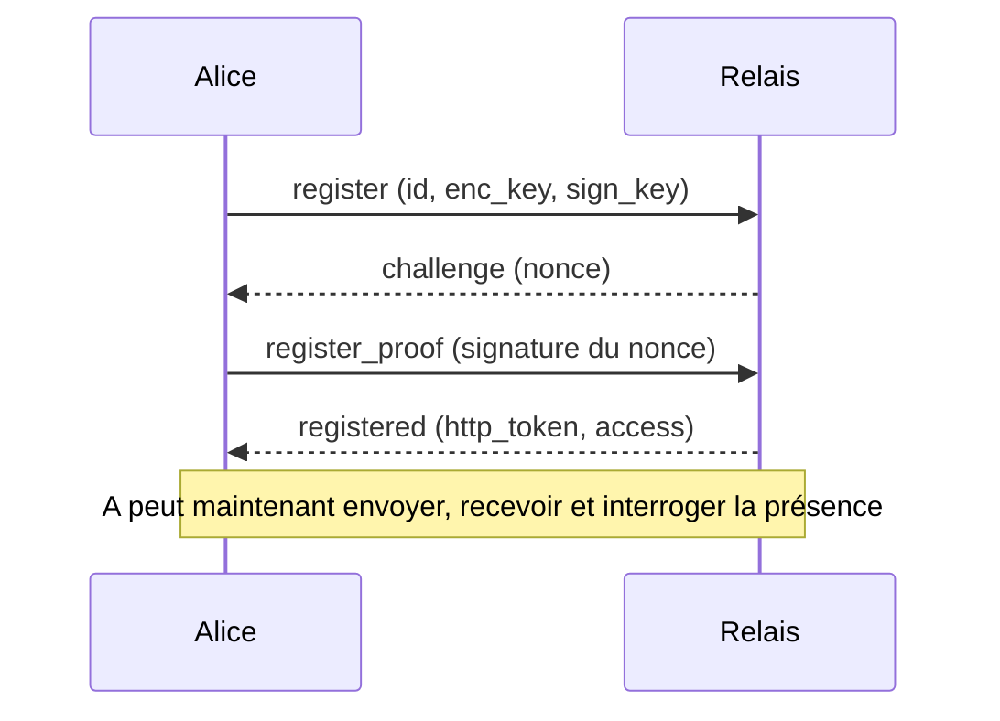
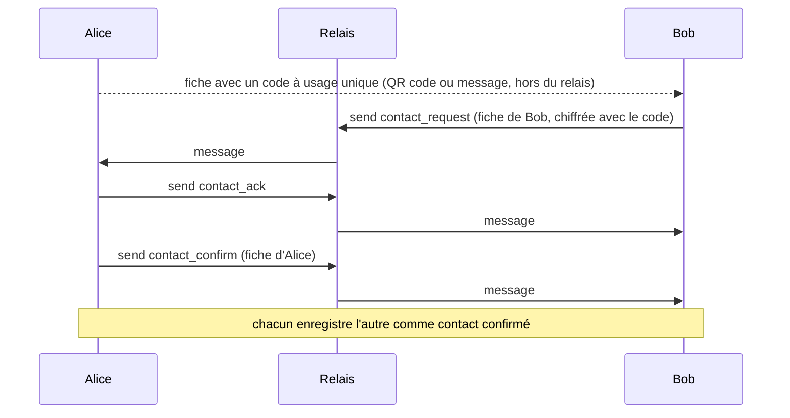
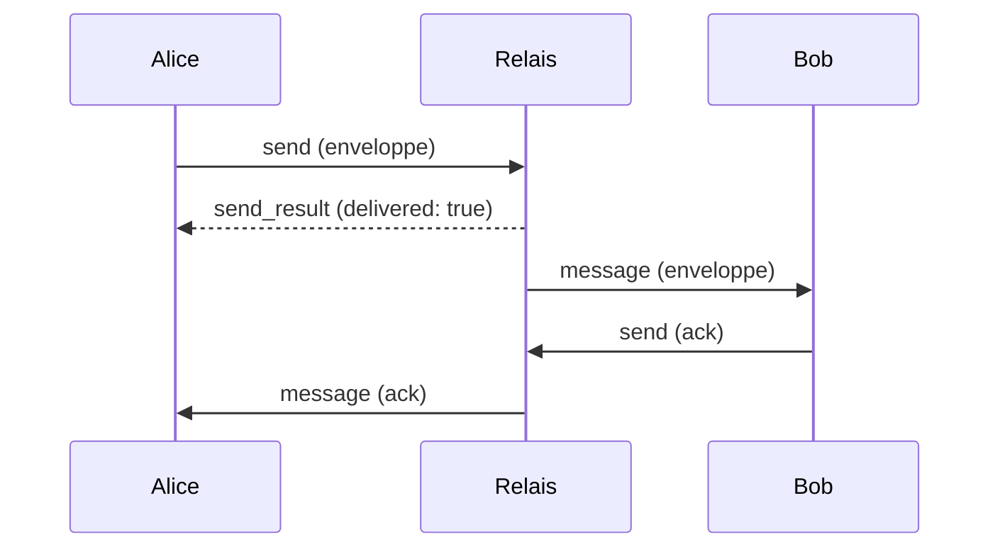
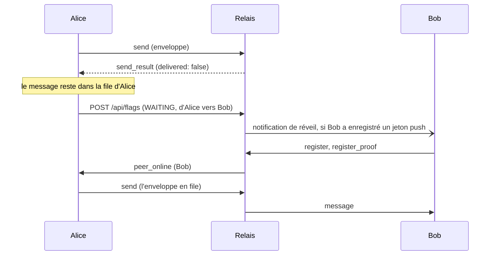
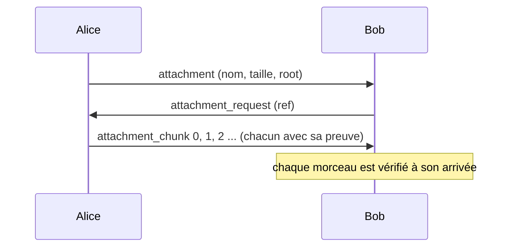
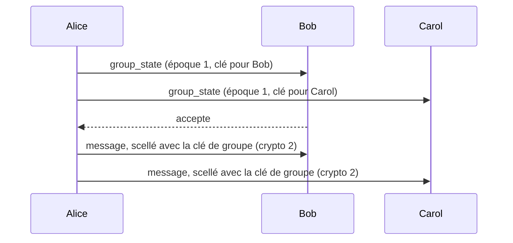

# Référence de l'API du protocole

*English version: [PROTOCOL_API.en.md](PROTOCOL_API.en.md).*

Cette référence s'adresse à qui écrit un client ou un serveur. Elle liste chaque appel, regroupé selon son usage, avec ses champs, ce qu'il fait et un exemple. Les règles et leurs raisons sont dans [PROTOCOL.fr.md](PROTOCOL.fr.md) ; chaque section renvoie à la partie qui l'explique. Les diagrammes de classes sont dans [diagrams/uml/](diagrams/uml/).

Sont couverts ici : la connexion à un relais, l'échange de contact, les messages 1-à-1, la présence et la livraison hors ligne, les fichiers, les groupes, l'enregistrement push et les appareils multiples. L'administration et les appels entre serveurs sont décrits dans [PROTOCOL.fr.md](PROTOCOL.fr.md) §10.

## 0. Conventions

### La distribution

Tous les exemples utilisent les mêmes trois personnes et un relais. Les clés et les identifiants sont cohérents entre eux (chaque identifiant est le SHA-256 de ses deux clés publiques) ; les chiffrés et les signatures sont des valeurs opaques de la bonne longueur.

| | Nom | `discovery_id` |
|---|---|---|
| A | Alice | `8daebb1512cfecf8dae4e5fd5909dcaacbb18c2e654f4a7e164f93b94dca1b17` |
| B | Bob | `009f0fa2bee493ea2e792e0e1a605790a77eac63ec464ce463471529ca89d8d8` |
| C | Carol | `3769e43e04f3e8643bd49e26c3cb7ea239a1bbb301e240bb59df048b2757d94e` |

Le relais est `https://relay.exemple.org`. Les clés publiques d'Alice :

- clé de chiffrement (X25519) : `6sRBqtczloZ2ymIxEQaxzi0obTPRQYrK9FCaZuKuYhw=`
- clé de signature (Ed25519) : `WekRmGfOa9q9pQKBSy/i4V4hLNatlwfQTAtE10gQRwY=`

Celles de Bob : `AuSe/EZ0jafQjMyR0qGVph8qIVIaZPx889PcnpYyFcA=` et `OkN1XMdBaORM8FnzUaEtGEWYEsXPzeCMjtEtkHPdiLo=`.

### Les quatre couches

| Couche | Ce que c'est | Où elle circule |
|---|---|---|
| Trame | Un objet JSON avec un `type`, envoyé comme un message texte WebSocket | `wss://hôte/ws/relay` |
| Enveloppe | De qui et pour qui est un message, avec une charge chiffrée | dans une trame `send`, et dans une trame `message` |
| Lettre | Le contenu déchiffré d'une enveloppe : un `type`, un `payload` et une signature | dans le `msg` chiffré d'une enveloppe |
| Appel HTTP | Drapeaux de présence, horloge du serveur, informations sur le serveur ; appels entre serveurs (section 9) | `https://hôte/api/...`, `/s2s/...`, `/peer/...` |

Le relais lit les trames, et le `from` et le `to` des enveloppes. Il ne lit jamais une lettre.

### Encodages

- JSON en UTF-8. Les noms de champs sont en `snake_case`. Un champ inutilisé est omis.
- `discovery_id` : 64 caractères hexadécimaux en minuscules, le SHA-256 de `clé de chiffrement ‖ clé de signature` (32 octets chacune).
- Clés, signatures, nonces et chiffrés : base64 standard.
- `ts` : l'horloge de l'expéditeur en ticks .NET (100 ns depuis le 1er janvier de l'an 1, UTC), strictement croissante sur une installation. Les 12 bits de poids faible sont une étiquette tirée au hasard à chaque exécution. `message_id` vaut `"{from}:{ts}"`.
- `created_at` d'une fiche de contact : heure Unix en millisecondes.
- Un message WebSocket fait 512 Kio au plus. Un message plus grand ferme la connexion avec le code 1009.

### Requête et réponse

Un client peut mettre un `request_id` de son choix dans une trame ; la réponse porte la même valeur. Les trames poussées par le serveur (`message`, `peer_online`, `server_state`, `server_redirect`) n'en ont pas. Une trame que le serveur ne sait pas traiter reçoit une trame `error` :

<!-- schema: WsMessage -->
```json
{ "type": "error", "request_id": "r-9", "message": "Register first" }
```

Le texte d'une erreur est destiné aux personnes, sauf cinq codes stables : `private_server`, `access_pending` et `access_refused` (section 1), et `quota_exceeded` et `rate_limited` (section 3, « Limites de volume »). Les deux derniers viennent aussi dans le champ `code`, avec `retry_after`.

### Chiffrement d'une lettre (`crypto` = 1)

Pour envoyer une lettre de type `T` avec la charge `P` de A à B à l'instant `ts` :

1. Signer, avec la clé de signature Ed25519 de A, le texte UTF-8 `freespeech-letter-v1|{from}|{to}|{T}|{P}|{ts}`. `from` et `to` sont les identifiants de l'enveloppe.
2. Construire le JSON `{ "type": T, "payload": P, "sig": <signature en base64> }`.
3. Générer une paire X25519 neuve. Calculer le secret partagé avec la clé de chiffrement de B, puis en dériver une clé de 32 octets avec HKDF-SHA256 (sel `FreeSpeech-ECDH`, info `msg-key`).
4. Chiffrer le JSON avec ChaCha20-Poly1305 et un nonce aléatoire de 12 octets.
5. `msg` = base64( clé publique éphémère (32 octets) ‖ nonce (12 octets) ‖ chiffré et étiquette ).

Le destinataire fait l'inverse et vérifie la signature avec la clé de signature de l'expéditeur, qu'il connaît par sa fiche de contact. Une lettre dont la signature est fausse est écartée. Une lettre d'un type que le destinataire ne connaît pas est ignorée sans message.

### Une lettre, déchiffrée

<!-- schema: LetterPayload -->
```json
{
  "type": "message",
  "payload": "Hi Bob, are you coming tonight?",
  "sig": "ZFdh7wy2aeTJh5uy27ZMX92N4QIR8wf9DQNmtrls7uXH70Wv1klLyLtEtSdM4uRtkeulrYtxNqaTgpvqS71aWQ=="
}
```

Dans les sections suivantes, un exemple montre la lettre sous cette forme, puis l'enveloppe qui la porte quand c'est utile.

## 1. Connexion



L'inscription demande deux trames, pour que personne ne puisse s'inscrire sous une identité sans détenir sa clé de signature.

### `register`

Couche : trame, du client vers le serveur. Réponse : `challenge`, ou `error`.

| Champ | Type | Obligatoire | Rôle |
|---|---|---|---|
| `type` | chaîne | oui | `"register"` |
| `request_id` | chaîne | non | repris dans la réponse |
| `discovery_id` | chaîne | oui | l'identité à inscrire |
| `enc_key` | chaîne | oui | clé publique X25519, base64, 32 octets |
| `sign_key` | chaîne | oui | clé publique Ed25519, base64, 32 octets |
| `invitation` | chaîne | non | jeton à usage unique remis par l'administrateur d'un serveur privé |
| `request_access` | booléen | non | demande à l'administrateur d'un serveur privé d'autoriser cette identité ; à n'envoyer qu'après l'accord de l'utilisateur |
| `name` | chaîne | non | avec `request_access` : le nom montré à l'administrateur, 64 caractères au plus |
| `note` | chaîne | non | avec `request_access` : quelques mots, 200 caractères au plus |

Le serveur vérifie que les deux clés donnent bien `discovery_id` par hachage. Rien n'est encore inscrit.

<!-- schema: WsMessage -->
```json
{
  "type": "register",
  "request_id": "r-1",
  "discovery_id": "8daebb1512cfecf8dae4e5fd5909dcaacbb18c2e654f4a7e164f93b94dca1b17",
  "enc_key": "6sRBqtczloZ2ymIxEQaxzi0obTPRQYrK9FCaZuKuYhw=",
  "sign_key": "WekRmGfOa9q9pQKBSy/i4V4hLNatlwfQTAtE10gQRwY="
}
```

### `challenge`

Couche : trame, du serveur vers le client.

| Champ | Type | Rôle |
|---|---|---|
| `type` | chaîne | `"challenge"` |
| `request_id` | chaîne | celui de `register` |
| `discovery_id` | chaîne | l'identité en cours d'inscription |
| `nonce` | chaîne | 32 octets aléatoires, base64, valable pour une seule preuve |

<!-- schema: WsMessage -->
```json
{
  "type": "challenge",
  "request_id": "r-1",
  "discovery_id": "8daebb1512cfecf8dae4e5fd5909dcaacbb18c2e654f4a7e164f93b94dca1b17",
  "nonce": "u5hYX07opkjx0II5F6cqe3rgD2FT9VaM4oqefS/rFSk="
}
```

### `register_proof`

Couche : trame, du client vers le serveur. Réponse : `registered`, ou `error`.

| Champ | Type | Obligatoire | Rôle |
|---|---|---|---|
| `type` | chaîne | oui | `"register_proof"` |
| `request_id` | chaîne | non | repris dans la réponse |
| `signature` | chaîne | oui | signature Ed25519, base64, du texte UTF-8 `freespeech-register-v1|{nonce}|{discovery_id}` |

Un nonce ne sert qu'une fois. Si la preuve échoue, le client recommence par `register`.

<!-- schema: WsMessage -->
```json
{
  "type": "register_proof",
  "request_id": "r-2",
  "signature": "ZFdh7wy2aeTJh5uy27ZMX92N4QIR8wf9DQNmtrls7uXH70Wv1klLyLtEtSdM4uRtkeulrYtxNqaTgpvqS71aWQ=="
}
```

### `registered`

Couche : trame, du serveur vers le client. La connexion est maintenant inscrite sous l'identité.

| Champ | Type | Rôle |
|---|---|---|
| `type` | chaîne | `"registered"` |
| `request_id` | chaîne | celui de `register_proof` |
| `http_token` | chaîne | à présenter dans l'en-tête `X-Flag-Token` des appels HTTP de la section 4 ; valable tant que cette connexion vit |
| `access` | chaîne | `"open"` ou `"allowlist"` : qui peut s'inscrire sur ce serveur |
| `provisioners` | liste | identités que l'administrateur d'un serveur privé désigne comme ses outils d'administration, chacune `{ id, enc_key, sign_key }` ; omise quand il n'y en a pas |
| `daily_quota` | nombre | octets qu'une identité peut envoyer par période de 24 heures sur ce serveur (voir « Limites de volume ») ; omis quand il n'y a pas de quota |

<!-- schema: WsMessage -->
```json
{
  "type": "registered",
  "request_id": "r-2",
  "http_token": "b7c2e9d41f6a4c58a3d0e57f19c84b26",
  "access": "open",
  "daily_quota": 1073741824
}
```

Une identité peut avoir plusieurs connexions à la fois, depuis plusieurs appareils. Chacune s'inscrit séparément.

### Refus sur un serveur privé

Quand le serveur restreint l'accès, `register_proof` peut recevoir une trame `error` dont le `message` est l'un de ces codes stables :

| `message` | Sens |
|---|---|
| `private_server` | l'identité est inconnue ici : demander une invitation à l'administrateur, ou envoyer `request_access` |
| `access_pending` | une demande pour cette identité attend l'administrateur |
| `access_refused` | l'identité est bannie |

Une invitation (`invitation` dans `register`) n'est consommée qu'une fois la preuve réussie.

### `server_state` et `server_redirect`

Couche : trame, du serveur vers le client, sans `request_id`. Le serveur peut les envoyer à tout moment sur une connexion inscrite.

`server_state` signale que la règle d'inscription a changé pendant que le client est connecté : `access` et `provisioners` comme dans `registered`.

`server_redirect` propose d'autres serveurs : `servers` est une liste d'adresses, la meilleure d'abord, et `reason` vaut `"load"` (ce serveur est plein) ou `"admin"` (son administrateur le vide).

<!-- schema: WsMessage -->
```json
{
  "type": "server_redirect",
  "servers": [ "https://relay2.exemple.org" ],
  "reason": "load"
}
```

### HTTP : `GET /api/time` et `GET /api/info`

`GET /api/time` renvoie l'horloge UTC du serveur, `{ "utc": "2026-10-10T09:00:00Z" }`. Elle sert à fixer l'heure d'un rendez-vous sans dépendre de l'horloge de l'appareil.

`GET /api/info` renvoie `{ "software", "license", "version", "source" }`. `source` est l'adresse du code source du programme que le serveur exécute.

Voir [PROTOCOL.fr.md](PROTOCOL.fr.md) §11 pour le transport et §10 pour le contrôle d'accès.

### HTTP : `GET /directory/servers` et `POST /directory/heartbeat`

Appels d'un annuaire (voir [PROTOCOL.fr.md](PROTOCOL.fr.md) §10 « Annuaire »). Le client demande des relais ; un relais dit comment il va.

`GET /directory/servers?country=FR&count=3` → 200, signé par la clé de l'annuaire (`sig` sur `directory-list`, un saut de ligne, `ts`, un saut de ligne, puis une ligne `url|country` par serveur, dans l'ordre) :

```json
{ "ts": 1790000000, "servers": [ { "url": "https://r1.exemple.org", "country": "FR" } ], "sig": "MEUCIQ…" }
```

`POST /directory/heartbeat` (appel signé d'un relais, en-têtes `X-Peer-Id`, `X-Peer-Ts`, `X-Peer-Sig`) → 200 ; 401 si la signature manque ou si le relais n'est pas accepté, 403 s'il est banni. `free` vaut -1 quand le relais n'indique aucune limite :

```json
{ "country": "FR", "free": 90, "accepts_new": true, "version": "1.2.0", "date": "2026-10-17" }
```

## 2. Contacts

Deux personnes deviennent contacts en échangeant une fiche. La fiche circule hors du relais (un QR code, un message collé) ; la réponse passe par le relais, chiffrée avec un code à usage unique (OTC) écrit dans la fiche.



### La fiche de contact

Une fiche est un objet JSON. Alice exporte la sienne avec un code à usage unique ; le relais ne voit jamais cette forme.

| Champ | Type | Obligatoire | Rôle |
|---|---|---|---|
| `version` | chaîne | non | `"2.0"` |
| `nickname` | chaîne | oui | le nom de la personne |
| `photo` | chaîne | non | JPEG, base64, moins de 100 Kio |
| `description` | chaîne | non | texte libre, 300 caractères au plus |
| `discovery_id` | chaîne | oui | l'identifiant |
| `encryption_public_key` | chaîne | oui | X25519, base64 |
| `signing_public_key` | chaîne | oui | Ed25519, base64 |
| `servers` | liste | non | les relais de la personne, le meilleur d'abord, chacun `{ url, priority }` |
| `revocation_public_key` | chaîne | non | clé Ed25519 qui sert à vérifier un avis de migration (section 3, `identity_moved`) |
| `enable_push` | booléen | non | la personne peut être réveillée par une notification |
| `otc` | chaîne | première fiche seulement | le code à usage unique, 16 caractères |
| `flag` | chaîne | première fiche seulement | `"qr"` (valable 10 minutes) ou `"manual"` (valable 30 jours) |
| `created_at` | nombre | non | heure Unix en millisecondes ; la validité court à partir de là |

<!-- schema: ContactCard -->
```json
{
  "version": "2.0",
  "nickname": "Alice",
  "discovery_id": "8daebb1512cfecf8dae4e5fd5909dcaacbb18c2e654f4a7e164f93b94dca1b17",
  "encryption_public_key": "6sRBqtczloZ2ymIxEQaxzi0obTPRQYrK9FCaZuKuYhw=",
  "signing_public_key": "WekRmGfOa9q9pQKBSy/i4V4hLNatlwfQTAtE10gQRwY=",
  "servers": [ { "url": "https://relay.exemple.org", "priority": 0 } ],
  "revocation_public_key": "/yrGwdrknq34Vg4riGB68kGGR9UhaclLuAEenrcglTg=",
  "enable_push": true,
  "otc": "K7M2QX9HDF4WT6RP",
  "flag": "qr",
  "created_at": 1791622800000
}
```

Ce qu'on partage, c'est ce JSON en base64. Un client qui lit une fiche la refuse quand `otc` manque, quand `servers` est vide, ou quand elle est plus vieille que sa validité (plus deux minutes d'écart d'horloge).

### Chiffrement avec le code à usage unique (`crypto` = 0)

Les messages de l'échange sont chiffrés avec une clé dérivée du code :

1. Clé = HKDF-SHA256 des octets UTF-8 du code, sel `FreeSpeech-OTC`, info `sym-key`, 32 octets.
2. Chiffrer avec ChaCha20-Poly1305 et un nonce aléatoire de 12 octets.
3. `msg` = base64( nonce (12 octets) ‖ chiffré et étiquette ).

Ces messages voyagent dans une enveloppe dont `crypto` vaut `0`, et n'ont pas de signature : le code fait office de preuve.

### `contact_request`

Couche : enveloppe avec `crypto` 0, de la personne qui a lu la fiche (Bob) vers celle qui l'a émise (Alice). Bob l'envoie avec une trame `send` (section 3). Elle contient une enveloppe de transport `{ type, payload }`, où `payload` est la fiche de Bob, sous forme de chaîne et sans `otc`.

<!-- schema: OtcEnvelope -->
```json
{
  "type": "contact_request",
  "payload": "{\"version\":\"2.0\",\"nickname\":\"Bob\",\"discovery_id\":\"009f0fa2bee493ea2e792e0e1a605790a77eac63ec464ce463471529ca89d8d8\",\"encryption_public_key\":\"AuSe/EZ0jafQjMyR0qGVph8qIVIaZPx889PcnpYyFcA=\",\"signing_public_key\":\"OkN1XMdBaORM8FnzUaEtGEWYEsXPzeCMjtEtkHPdiLo=\",\"servers\":[{\"url\":\"https://relay.exemple.org\",\"priority\":0}],\"enable_push\":true,\"created_at\":1791622860000}"
}
```

L'enveloppe qui la porte, telle qu'elle passe par le relais :

<!-- schema: Envelope -->
```json
{
  "from": "009f0fa2bee493ea2e792e0e1a605790a77eac63ec464ce463471529ca89d8d8",
  "to": "8daebb1512cfecf8dae4e5fd5909dcaacbb18c2e654f4a7e164f93b94dca1b17",
  "crypto": 0,
  "msg": "5H8A3Io4IW0s0ms9GCzNnjKwxlN5Tk6fkelgEy/Meezn6TZrcrR1hrQc9KuYs8L8kRVBLAzhFPnZryeHe0LSxCkR/VF6f9UuC/29+KoG4vE=",
  "ts": 639272197203456789
}
```

Alice essaie chaque code à usage unique qu'elle a émis jusqu'à ce que l'un déchiffre le message. Si le code a expiré, elle ignore la demande sans répondre. Si le relais ne peut pas joindre Alice, Bob garde la demande et la renvoie plus tard.

### `contact_ack`

Couche : enveloppe avec `crypto` 0, d'Alice vers Bob, envoyée aussitôt qu'Alice a jugé la demande valide. L'enveloppe de transport n'a pas de `payload`. Elle dit à Bob d'arrêter de renvoyer.

<!-- schema: OtcEnvelope -->
```json
{ "type": "contact_ack" }
```

### `contact_confirm`

Couche : enveloppe avec `crypto` 0, d'Alice vers Bob. `payload` est la fiche d'Alice, sous forme de chaîne et sans `otc`. Avec un code de type `"qr"`, Alice confirme d'elle-même ; avec `"manual"`, elle attend que son utilisateur accepte. Quand Bob la reçoit, il enregistre Alice comme contact confirmé. Alice a enregistré Bob au moment de l'envoyer.

<!-- schema: OtcEnvelope -->
```json
{
  "type": "contact_confirm",
  "payload": "{\"version\":\"2.0\",\"nickname\":\"Alice\",\"discovery_id\":\"8daebb1512cfecf8dae4e5fd5909dcaacbb18c2e654f4a7e164f93b94dca1b17\",\"encryption_public_key\":\"6sRBqtczloZ2ymIxEQaxzi0obTPRQYrK9FCaZuKuYhw=\",\"signing_public_key\":\"WekRmGfOa9q9pQKBSy/i4V4hLNatlwfQTAtE10gQRwY=\",\"servers\":[{\"url\":\"https://relay.exemple.org\",\"priority\":0}],\"enable_push\":true,\"created_at\":1791622800000}"
}
```

### `identity_update`

Couche : lettre (`crypto` 1), d'un contact vers chacun de ses contacts. `payload` est la nouvelle fiche de la personne, sous forme de chaîne et sans `otc`. Elle part quand le pseudo, l'image, la description ou la liste des serveurs change. Un destinataire rejette une mise à jour dont `encryption_public_key` ou `signing_public_key` diffère de celles qu'il détient ; les autres champs changent librement.

<!-- schema: LetterPayload -->
```json
{
  "type": "identity_update",
  "payload": "{\"version\":\"2.0\",\"nickname\":\"Alice B.\",\"discovery_id\":\"8daebb1512cfecf8dae4e5fd5909dcaacbb18c2e654f4a7e164f93b94dca1b17\",\"encryption_public_key\":\"6sRBqtczloZ2ymIxEQaxzi0obTPRQYrK9FCaZuKuYhw=\",\"signing_public_key\":\"WekRmGfOa9q9pQKBSy/i4V4hLNatlwfQTAtE10gQRwY=\",\"servers\":[{\"url\":\"https://relay.exemple.org\",\"priority\":0}],\"enable_push\":true,\"created_at\":1791622800000}",
  "sig": "ZFdh7wy2aeTJh5uy27ZMX92N4QIR8wf9DQNmtrls7uXH70Wv1klLyLtEtSdM4uRtkeulrYtxNqaTgpvqS71aWQ=="
}
```

### `identity_moved`

Couche : lettre (`crypto` 1), de l'ancien identifiant d'une personne vers ses contacts et les modérateurs de ses groupes. Elle annonce un passage à une nouvelle identité.

| Champ | Type | Rôle |
|---|---|---|
| `old_id` | chaîne | l'identifiant que la personne quitte |
| `new_card` | fiche | la fiche de la nouvelle identité |
| `ts` | nombre | heure Unix en millisecondes |
| `sig` | chaîne | signature Ed25519, base64, par la clé de révocation de l'ancienne identité, du texte UTF-8 `FreeSpeech-moved-v1|{old_id}|{new_id}|{ts}` |

Un destinataire ne retient l'avis que si la signature correspond à la clé de révocation qu'il a épinglée depuis l'ancienne fiche. La personne accepte ou refuse ensuite ; plus rien n'est envoyé à l'ancien identifiant une fois la migration acceptée. Voir [PROTOCOL.fr.md](PROTOCOL.fr.md) §1.

<!-- schema: MovedOp -->
```json
{
  "old_id": "8daebb1512cfecf8dae4e5fd5909dcaacbb18c2e654f4a7e164f93b94dca1b17",
  "new_card": {
    "nickname": "Alice",
    "discovery_id": "16e14a1ff97deefd4c04ba165386c5ca09b9b9dc819a5473e0c03ba7c03eb5e3",
    "encryption_public_key": "MK0ZnImzjIKuixgVSX7Ch6YJIJvLLC40V18ihVXVWsg=",
    "signing_public_key": "B3nWNOGrDKHKpAPeRAvbUHl9UoRRXIcMpZ/q1Z6moWk=",
    "servers": [ { "url": "https://relay.exemple.org", "priority": 0 } ]
  },
  "ts": 1791626400000,
  "sig": "ZFdh7wy2aeTJh5uy27ZMX92N4QIR8wf9DQNmtrls7uXH70Wv1klLyLtEtSdM4uRtkeulrYtxNqaTgpvqS71aWQ=="
}
```

Le numéro de sécurité n'est pas un appel : chaque côté le calcule à partir des deux paires de clés publiques pour vérifier, hors du relais, que personne n'a remplacé une clé pendant l'échange. Voir [PROTOCOL.fr.md](PROTOCOL.fr.md) §3.

## 3. Messages 1-à-1



### `send`

Couche : trame, du client vers le serveur. Réponse : `send_result`, ou `error`.

| Champ | Type | Obligatoire | Rôle |
|---|---|---|---|
| `type` | chaîne | oui | `"send"` |
| `request_id` | chaîne | non | repris dans la réponse |
| `envelope` | objet | oui | l'enveloppe, voir ci-dessous |

L'enveloppe :

| Champ | Type | Obligatoire | Rôle |
|---|---|---|---|
| `from` | chaîne | oui | l'expéditeur ; ce doit être l'identité sous laquelle cette connexion s'est inscrite |
| `to` | chaîne | oui | le destinataire |
| `crypto` | nombre | non | `0` pour l'échange de contact, `1` pour une lettre (valeur par défaut) |
| `msg` | chaîne | oui | la charge chiffrée, base64 |
| `ts` | nombre | oui | l'horodatage de l'expéditeur ; avec `from` il forme le `message_id` |
| `reply_to` | chaîne | non | le `message_id` du message auquel celui-ci répond |
| `to_server` | chaîne | non | le relais du destinataire, qui sert à l'expéditeur à choisir un serveur |

Le relais livre l'enveloppe à chaque connexion active du destinataire. Si le destinataire n'en a aucune et que le relais est lié à d'autres, il interroge une fois ses voisins. Il ne modifie jamais l'enveloppe.

Alice envoie un message à Bob :

<!-- schema: WsMessage -->
```json
{
  "type": "send",
  "request_id": "r-3",
  "envelope": {
    "from": "8daebb1512cfecf8dae4e5fd5909dcaacbb18c2e654f4a7e164f93b94dca1b17",
    "to": "009f0fa2bee493ea2e792e0e1a605790a77eac63ec464ce463471529ca89d8d8",
    "crypto": 1,
    "msg": "5H8A3Io4IW0s0ms9GCzNnjKwxlN5Tk6fkelgEy/Meezn6TZrcrR1hrQc9KuYs8L8kRVBLAzhFPnZryeHe0LSxCkR/VF6f9UuC/29+KoG4vE=",
    "ts": 639272197203456789
  }
}
```

Le relais refuse avec une trame `error` quand l'expéditeur n'est pas inscrit (`Register first`), quand `to` ou `msg` manque, ou quand `from` n'est pas l'identité inscrite (`Sender identity mismatch`). Il refuse aussi quand l'expéditeur a épuisé son volume (`quota_exceeded`, `rate_limited` ; voir « Limites de volume » plus bas).

### `send_result`

Couche : trame, du serveur vers le client.

| Champ | Type | Rôle |
|---|---|---|
| `type` | chaîne | `"send_result"` |
| `request_id` | chaîne | celui de `send` |
| `delivered` | booléen | l'enveloppe a été écrite sur au moins une connexion du destinataire (ici ou chez un voisin) |
| `self_multi_device` | booléen | l'expéditeur a une autre connexion active ; voir « Une copie pour les autres appareils de l'expéditeur » |
| `quota_left` | nombre | octets que l'expéditeur peut encore envoyer pendant les 24 heures en cours ; omis quand il n'y a pas de quota |

`delivered` ne veut pas dire que le destinataire a gardé le message : la connexion peut être morte. Le destinataire confirme avec un `ack`.

<!-- schema: WsMessage -->
```json
{ "type": "send_result", "request_id": "r-3", "delivered": true, "self_multi_device": false, "quota_left": 1073000000 }
```

### Limites de volume

Le relais voit des enveloppes opaques : il ne distingue pas un morceau de fichier d'un message, donc il compte les octets envoyés, pas les fichiers. Trois limites s'appliquent à `send`, chacune désactivée par `0` :

| Réglage | Défaut | Sens |
|---|---|---|
| `Server:MaxBytesPerIdentityPerDay` | 1 Gio | octets qu'une identité peut envoyer sur 24 heures glissantes (comptées à l'heure) |
| `Server:MaxBytesPerIdentityPer10Minutes` | 300 Mio | débit d'une identité : le seau contient cette quantité et se remplit en 10 minutes |
| `Server:MaxBytesPerAddressPerDay` | 5 Gio | octets que toutes les identités derrière une même adresse réseau peuvent envoyer sur 24 heures glissantes |

Une identité qui dépasse son débit est ralentie : le relais retient ses trames suivantes jusqu'à 20 secondes, puis répond comme d'habitude. Une trame qui attendrait plus longtemps, ou qui dépasse un quota quotidien, est refusée par une trame `error` qui porte un `code` stable. Une trame refusée n'est pas comptée et la connexion reste ouverte.

| `code` | Sens |
|---|---|
| `quota_exceeded` | le volume des 24 heures de l'identité ou de son adresse est épuisé |
| `rate_limited` | l'identité envoie plus vite que son débit autorisé |

<!-- schema: WsMessage -->
```json
{ "type": "error", "request_id": "r-4", "message": "quota_exceeded", "code": "quota_exceeded", "retry_after": 3600, "quota_left": 0 }
```

`retry_after` est le nombre de secondes avant que l'envoi puisse reprendre. Le client retient ses envois vers ce serveur jusque-là ; les lettres qui attendent dans sa boîte d'envoi partent ensuite.

### `message` (trame)

Couche : trame, du serveur vers le client, sans `request_id`. Elle apporte une enveloppe à un destinataire connecté.

<!-- schema: WsMessage -->
```json
{
  "type": "message",
  "envelope": {
    "from": "8daebb1512cfecf8dae4e5fd5909dcaacbb18c2e654f4a7e164f93b94dca1b17",
    "to": "009f0fa2bee493ea2e792e0e1a605790a77eac63ec464ce463471529ca89d8d8",
    "crypto": 1,
    "msg": "5H8A3Io4IW0s0ms9GCzNnjKwxlN5Tk6fkelgEy/Meezn6TZrcrR1hrQc9KuYs8L8kRVBLAzhFPnZryeHe0LSxCkR/VF6f9UuC/29+KoG4vE=",
    "ts": 639272197203456789
  }
}
```

Une enveloppe avec `crypto` 0 relève de l'échange de contact (section 2). Avec `crypto` 1, Bob déchiffre et vérifie la lettre, puis agit selon son `type`. Une lettre déjà vue (même expéditeur, même destinataire, même `ts` et même `crypto`) n'est pas traitée deux fois, mais elle est confirmée de nouveau.

### Les lettres d'une conversation

Chaque lettre ci-dessous va dans le `msg` d'une enveloppe avec `crypto` 1, et se chiffre comme indiqué en section 0. Dans ces sections, « la cible » est un `message_id`, `"{auteur}:{ts}"`.

#### `message`

Le texte d'un message. `payload` est le texte lui-même, pas du JSON. S'il répond à un autre message, l'enveloppe porte `reply_to`.

<!-- schema: LetterPayload -->
```json
{
  "type": "message",
  "payload": "Hi Bob, are you coming tonight?",
  "sig": "ZFdh7wy2aeTJh5uy27ZMX92N4QIR8wf9DQNmtrls7uXH70Wv1klLyLtEtSdM4uRtkeulrYtxNqaTgpvqS71aWQ=="
}
```

La réponse de Bob, dans une enveloppe qui porte `reply_to` :

<!-- schema: Envelope -->
```json
{
  "from": "009f0fa2bee493ea2e792e0e1a605790a77eac63ec464ce463471529ca89d8d8",
  "to": "8daebb1512cfecf8dae4e5fd5909dcaacbb18c2e654f4a7e164f93b94dca1b17",
  "crypto": 1,
  "msg": "5H8A3Io4IW0s0ms9GCzNnjKwxlN5Tk6fkelgEy/Meezn6TZrcrR1hrQc9KuYs8L8kRVBLAzhFPnZryeHe0LSxCkR/VF6f9UuC/29+KoG4vE=",
  "ts": 639272197893412345,
  "reply_to": "8daebb1512cfecf8dae4e5fd5909dcaacbb18c2e654f4a7e164f93b94dca1b17:639272197203456789"
}
```

#### `message_edit`

L'auteur remplace le texte de l'un de ses messages. `payload` est une chaîne JSON `{ target, text }`. Le `ts` de l'enveloppe fait office de version : la plus récente l'emporte. Seul l'auteur peut modifier : un destinataire ignore une modification dont l'expéditeur n'est pas l'auteur désigné par `target`.

<!-- schema: MessageOp -->
```json
{
  "target": "8daebb1512cfecf8dae4e5fd5909dcaacbb18c2e654f4a7e164f93b94dca1b17:639272197203456789",
  "text": "Hi Bob, are you coming tonight at eight?"
}
```

#### `message_retract`

L'auteur supprime l'un de ses messages pour tout le monde. `payload` est une chaîne JSON `{ target }`. Le contenu est effacé et une ligne « message supprimé » reste. Une suppression l'emporte sur toute modification, quel que soit l'ordre d'arrivée.

<!-- schema: MessageOp -->
```json
{ "target": "8daebb1512cfecf8dae4e5fd5909dcaacbb18c2e654f4a7e164f93b94dca1b17:639272197203456789" }
```

Dans un groupe, `seq` s'ajoute (voir [PROTOCOL.fr.md](PROTOCOL.fr.md) §7) ; dans une conversation 1-à-1, il est omis ou vaut `0`.

#### `message_react`

Une réaction par emoji à un message, de la part de n'importe quel participant. `payload` est une chaîne JSON `{ target, text }`, où `text` est un emoji ; un `text` vide retire la réaction. Une personne a une réaction par message : le `ts` le plus récent l'emporte.

<!-- schema: MessageOp -->
```json
{
  "target": "8daebb1512cfecf8dae4e5fd5909dcaacbb18c2e654f4a7e164f93b94dca1b17:639272197203456789",
  "text": "👍"
}
```

#### `read_ack`

« J'ai lu jusqu'à ce message, inclus. » `payload` est une chaîne JSON `{ target }`, où `target` est le dernier message reçu de l'expéditeur de l'accusé. Un seul accusé couvre tous les messages précédents. Il part quand l'utilisateur regarde la conversation et que de nouveaux messages sont arrivés depuis le dernier accusé ; il n'est pas mis en file, et l'utilisateur peut le désactiver. Le destinataire ne le prend en compte que si `target` est un message qu'il a écrit.

<!-- schema: MessageOp -->
```json
{ "target": "8daebb1512cfecf8dae4e5fd5909dcaacbb18c2e654f4a7e164f93b94dca1b17:639272197203456789" }
```

#### `typing`

« J'écris. » `payload` vaut `{}` dans une conversation 1-à-1. Elle n'est jamais stockée, jamais mise en file et ne pose jamais de drapeau : elle ne peut donc pas réveiller un téléphone, et elle est perdue si le destinataire n'est pas connecté. Un client en envoie au plus une toutes les 4 secondes par conversation. Le destinataire affiche l'indicateur pendant 6 secondes après la dernière.

<!-- schema: TypingOp -->
```json
{}
```

#### `ack`

Confirme que des lettres ont été conservées. `payload` est une chaîne JSON `{ ids }`, les `message_id` des lettres conservées, regroupés sur 300 ms. Il est envoyé par le destinataire à l'expéditeur, n'est pas mis en file et n'est pas lui-même confirmé.

<!-- schema: AckOp -->
```json
{
  "ids": [
    "8daebb1512cfecf8dae4e5fd5909dcaacbb18c2e654f4a7e164f93b94dca1b17:639272197203456789"
  ]
}
```

Lettres confirmées : `message`, `attachment`, `message_edit`, `message_retract`, `attachment_retract`, `message_react` et `identity_update`. Une lettre livrée reste dans la file de l'expéditeur, marquée « livrée, non confirmée », jusqu'à l'arrivée de son `ack`. Sans lui elle est renvoyée telle quelle (même `ts`, donc même `message_id`) après 30 secondes, 2 minutes, 10 minutes, 1 heure et 6 heures, puis abandonnée. Elle repart aussi sans attendre dès que le relais annonce le retour du destinataire (`peer_online`). Pour que ce retour lui soit annoncé, l'expéditeur pose un drapeau `WAITING` vers le destinataire trois secondes après la remise d'une lettre restée sans `ack`, et le retire (`DELETE /api/flags/{from}/{to}`) quand plus aucune de ses lettres n'attend ce destinataire. Voir [PROTOCOL.fr.md](PROTOCOL.fr.md) §5.

### Une copie pour les autres appareils de l'expéditeur

Quand `send_result` indique `self_multi_device` à vrai, l'expéditeur a une autre connexion active. L'enveloppe destinée au destinataire est illisible pour cet appareil : l'expéditeur envoie donc une seconde enveloppe à lui-même, avec `to` égal à `from`, et la lettre porte un champ supplémentaire `orig_to`, le vrai destinataire. La signature couvre alors `orig_to` à la place de `to`, et le relais ne renvoie pas l'enveloppe à la connexion qui l'a envoyée. Seuls les messages de discussion sont copiés ainsi.

<!-- schema: LetterPayload -->
```json
{
  "type": "message",
  "payload": "Hi Bob, are you coming tonight?",
  "sig": "ZFdh7wy2aeTJh5uy27ZMX92N4QIR8wf9DQNmtrls7uXH70Wv1klLyLtEtSdM4uRtkeulrYtxNqaTgpvqS71aWQ==",
  "orig_to": "009f0fa2bee493ea2e792e0e1a605790a77eac63ec464ce463471529ca89d8d8"
}
```

## 4. Présence et livraison hors ligne

Le relais ne garde rien. Quand Bob n'est pas connecté, le message d'Alice attend dans la file d'Alice. Deux choses l'amènent à Bob : un drapeau qui dit au relais qu'Alice attend, et la prochaine connexion de Bob.



### `is_online`

Couche : trame, du client vers le serveur. Réponse : `is_online_result`. Elle demande si une identité a une connexion active sur ce relais ou chez un voisin.

<!-- schema: WsMessage -->
```json
{
  "type": "is_online",
  "request_id": "r-5",
  "discovery_id": "009f0fa2bee493ea2e792e0e1a605790a77eac63ec464ce463471529ca89d8d8"
}
```

### `is_online_result`

Couche : trame, du serveur vers le client.

<!-- schema: WsMessage -->
```json
{
  "type": "is_online_result",
  "request_id": "r-5",
  "discovery_id": "009f0fa2bee493ea2e792e0e1a605790a77eac63ec464ce463471529ca89d8d8",
  "online": false
}
```

### `peer_online`

Couche : trame, du serveur vers le client, sans `request_id`. Quand une identité se connecte, le relais envoie cette trame aux connexions de chaque identité qui a posé un drapeau `WAITING` vers elle (si cette identité n'est pas connectée non plus, le relais la réveille par une notification push). Le destinataire renvoie aussitôt sa file, y compris les lettres que le relais a dites livrées à cette identité sans qu'elle les ait confirmées par un `ack` : une connexion morte accepte l'écriture sans que la lettre arrive.

<!-- schema: WsMessage -->
```json
{
  "type": "peer_online",
  "discovery_id": "009f0fa2bee493ea2e792e0e1a605790a77eac63ec464ce463471529ca89d8d8"
}
```

### Les appels sur les drapeaux

Couche : HTTP. Chaque appel porte deux en-têtes : `X-Discovery-Id`, l'identité de l'appelant, et `X-Flag-Token`, le `http_token` de sa connexion actuelle. L'appelant doit aussi être connecté sous cette identité. Sans les deux, la réponse est `401` avec `{ "error": "Not connected as this identity" }`. Un drapeau est gardé dans la mémoire du relais. Un drapeau `WAITING` expire 30 jours après sa pose ; un drapeau `READY`, 2 minutes après son `next_connect_at`.

Un drapeau a ces champs :

| Champ | Type | Rôle |
|---|---|---|
| `from` | chaîne | la partie qui l'a posé |
| `to` | chaîne | la partie à laquelle il s'adresse |
| `state` | chaîne | `"WAITING"` ou `"READY"` |
| `next_connect_at` | chaîne | `READY` seulement : l'heure UTC à laquelle la partie sera connectée, dans le futur |
| `updated_at` | chaîne | fixé par le serveur |

**`POST /api/flags`** pose ou met à jour un drapeau. L'appelant est `from`. Un drapeau `WAITING` déclenche aussi une notification de réveil pour `to`, s'il a enregistré un jeton push. Un drapeau `READY` doit avoir un `next_connect_at` dans le futur.

```json
{
  "from": "8daebb1512cfecf8dae4e5fd5909dcaacbb18c2e654f4a7e164f93b94dca1b17",
  "to": "009f0fa2bee493ea2e792e0e1a605790a77eac63ec464ce463471529ca89d8d8",
  "state": "WAITING"
}
```

Réponses : `200` avec `{ "updated_at": "..." }` ; `400` avec `{ "error": "State must be WAITING or READY" }`, ou avec une erreur sur `next_connect_at` ; `401` comme ci-dessus.

**`GET /api/flags/{discovery_id}`** renvoie les drapeaux adressés à cette identité, sous forme de liste. L'appelant doit être cette identité.

```json
[
  {
    "from": "8daebb1512cfecf8dae4e5fd5909dcaacbb18c2e654f4a7e164f93b94dca1b17",
    "to": "009f0fa2bee493ea2e792e0e1a605790a77eac63ec464ce463471529ca89d8d8",
    "state": "WAITING",
    "updated_at": "2026-10-10T09:03:12Z"
  }
]
```

**`DELETE /api/flags/{from}/{to}`** retire un drapeau une fois le rendez-vous terminé, ou quand la dernière lettre en attente de `to` a été confirmée. L'une ou l'autre des parties peut l'appeler. Réponse : `200`.

L'application pose des drapeaux `WAITING` et s'appuie sur `peer_online` : quand le relais n'a pu remettre une lettre à personne, et trois secondes après la remise d'une lettre que le destinataire n'a pas confirmée. À chaque connexion elle envoie sa file sans attendre le premier passage du planificateur. `READY`, avec une heure de rendez-vous, est à la disposition des clients qui préfèrent convenir d'un moment ; le client console l'expose.

Voir [PROTOCOL.fr.md](PROTOCOL.fr.md) §9 pour la séquence de réveil.

## 5. Fichiers

Un fichier voyage en trois temps : Alice l'offre, Bob le demande, Alice l'envoie en morceaux. L'offre est une lettre comme un message : Bob la voit, avec un nom et une taille, avant de décider de le télécharger.



(Tous les messages passent par le relais, comme en section 3. Seules les lettres sont montrées ici.)

### L'identité d'un fichier

- Un fichier est découpé en morceaux de 48 Kio (49 152 octets) ; le dernier est plus court. Le nombre de morceaux vaut `ceil(taille / 49152)` et n'est jamais transmis : le destinataire le déduit de `size`. Le plus gros fichier fait 2 Gio : une offre au-dessus est ignorée.
- Feuille : `SHA-256(0x00 ‖ morceau)`. Nœud : `SHA-256(0x01 ‖ gauche ‖ droite)`. Un nœud sans frère est promu tel quel, jamais dupliqué. Le résultat est la racine de l'arbre.
- `root`, dans l'offre, vaut `SHA-256(0x02 ‖ taille ‖ racine de l'arbre)` en hexadécimal minuscule, où la taille tient sur 8 octets, petit-boutiste. Il identifie le contenu : deux fichiers de même `root` sont le même fichier.
- La preuve d'un morceau est la liste des hachés frères, de sa feuille jusqu'à la racine non comprise, en base64. Un niveau où le nœud n'a pas de frère n'ajoute rien.

### `attachment`

Lettre (`crypto` 1) de l'expéditeur vers le destinataire. `payload` est une chaîne JSON. Son `message_id` est le `ref` que les appels suivants utilisent. Elle passe par la file de l'expéditeur et se confirme par un `ack`, comme un message.

| Champ | Type | Obligatoire | Rôle |
|---|---|---|---|
| `name` | chaîne | oui | nom du fichier |
| `mime` | chaîne | oui | type de média |
| `size` | nombre | oui | taille en octets, 2 Gio au plus (2 147 483 648) ; une offre de taille 0 ou au-dessus est ignorée |
| `root` | chaîne | oui | identité du contenu, 64 caractères hexadécimaux |
| `thumbnail` | chaîne | non | petit aperçu JPEG, base64 |

<!-- schema: AttachmentOffer -->
```json
{
  "name": "holiday.jpg",
  "mime": "image/jpeg",
  "size": 2457600,
  "root": "6879574f649d69f74bfce58bce91c4b24f242c878fbd95720e037f62cb29ca23"
}
```

### `attachment_request`

Lettre de la personne qui veut le fichier vers celle qui l'a. Elle n'est pas mise en file : sans progrès pendant 20 secondes, le destinataire redemande, seulement les morceaux manquants. Si l'expéditeur est injoignable, le destinataire pose un drapeau `WAITING` (section 4).

| Champ | Type | Obligatoire | Rôle |
|---|---|---|---|
| `ref` | chaîne | oui | le `message_id` de la lettre `attachment` |
| `missing` | liste | non | les numéros de morceaux à envoyer ; absent signifie tous |

<!-- schema: AttachmentRequest -->
```json
{
  "ref": "8daebb1512cfecf8dae4e5fd5909dcaacbb18c2e654f4a7e164f93b94dca1b17:639272198203456789",
  "missing": [12, 13]
}
```

### `attachment_chunk`

Lettre de celui qui détient le fichier vers celui qui le demande. Chaque morceau voyage dans sa propre enveloppe, avec un `ts` qui croît de l'un à l'autre. Les données sont raccourcies ci-dessous.

| Champ | Type | Rôle |
|---|---|---|
| `ref` | chaîne | le `message_id` de l'offre |
| `chunk_id` | nombre | position du morceau, à partir de 0 |
| `total_chunks` | nombre | nombre de morceaux du fichier |
| `data` | chaîne | le morceau, base64 |
| `proof` | liste | les hachés frères, base64, de la feuille à la racine |

Le destinataire ignore un morceau quand `ref` est inconnu, quand `total_chunks` n'est pas le nombre déduit de `size`, ou quand la longueur des données est fausse. Il vérifie la preuve par rapport à `root`. Un morceau dont la preuve échoue compte comme une faute de celui qui l'a envoyé ; après trois, le téléchargement est abandonné (dans un groupe, seul ce membre est écarté).

Un détenteur envoie les morceaux l'un après l'autre et s'arrête au premier que le relais ne livre pas ou refuse (`quota_exceeded`, `rate_limited`, section 3 « Limites de volume »). Le receveur, après 20 secondes sans morceau, redemande ceux qui manquent.

<!-- schema: AttachmentChunk -->
```json
{
  "ref": "8daebb1512cfecf8dae4e5fd5909dcaacbb18c2e654f4a7e164f93b94dca1b17:639272198203456789",
  "chunk_id": 12,
  "total_chunks": 50,
  "data": "/9j/4AAQSkZJRgABAQEASABIAAD/2wBDAAMCAgMCAgMDAwMEAwMEBQgFBQQEBQoHBwYIDAoMDAsKCwsNDhIQDQ4RDgsLEBYQERMUFRUVDA8XGBYUGBIUFRT...",
  "proof": [
    "SIerB3hlGumc2e5qNuz91N8irblc1V7Fs5dkr9KUA64=",
    "Uw+uatjYxL8woldRBaCf58XI9V3v4+vc31zCn0ivf8E=",
    "K7bZlt1a53RmOtjeUFVFcvZ6l9ngy+ug0Zp3/s8qGjw=",
    "hGCEgvx01855sy24rOPRnqnGL/cC8djEYlK+VyQSToI=",
    "3541Sod1UZlNcIt9uLt0j1g79Fv2P8VpBX5mrz81xQo=",
    "/olt/nFd/3ODGebpNHGlEXbvDPX16ASVRsehTjKiM60="
  ]
}
```

### `attachment_retract`

L'auteur retire le fichier de l'un de ses messages pour tout le monde. `payload` est une chaîne JSON `{ target }`, où `target` est le `ref`. La ligne reste dans la conversation, et les destinataires suppriment le fichier. Seul l'auteur peut le faire.

<!-- schema: MessageOp -->
```json
{ "target": "8daebb1512cfecf8dae4e5fd5909dcaacbb18c2e654f4a7e164f93b94dca1b17:639272198203456789" }
```

Dans une conversation 1-à-1, seul le destinataire d'un fichier peut le demander. Dans un groupe, n'importe quel membre le peut, et les réponses peuvent venir de tout membre qui possède le fichier entier (section 6). Voir [PROTOCOL.fr.md](PROTOCOL.fr.md) §6.

## 6. Groupes

Un groupe n'a pas de serveur. Ses membres détiennent la même description de lui, l'*état*, et la même clé secrète. Alice, la créatrice, fait un groupe avec Bob et Carol :



- **Identifiant du groupe** : `group_id`, 16 octets aléatoires en hexadécimal minuscule, choisis par le créateur.
- **Époque** : un numéro qui commence à 1. Chaque changement des membres ou de leurs rôles (un ajout, un retrait, un départ, une promotion, une rétrogradation, un transfert du rôle de créateur) produit un nouvel état avec l'époque suivante et une nouvelle clé de groupe.
- **Clé de groupe** : 32 octets aléatoires pour chaque époque. Elle n'est jamais dans l'état : chaque membre la reçoit séparément, chiffrée pour lui.
- **Haché de l'état** : le SHA-256 hexadécimal minuscule de la chaîne exacte `state`. L'état suivant le cite dans `prev_hash`.
- Les **membres** n'ont pas à être contacts les uns des autres : l'état porte les clés publiques et les serveurs de chacun, et un membre dont le `discovery_id` n'est pas le haché de ses clés est un faux.

### L'état

L'état est un objet JSON, écrit une seule fois sous forme de chaîne. La signature couvre exactement ces caractères, il n'y a donc rien à mettre sous forme canonique.

| Champ | Type | Obligatoire | Rôle |
|---|---|---|---|
| `group_id` | chaîne | oui | le groupe |
| `epoch` | nombre | non | l'époque |
| `prev_hash` | chaîne | non | haché de l'état précédent ; absent à l'époque 1 |
| `created_at` | nombre | non | heure Unix en millisecondes |
| `name` | chaîne | oui | le nom du groupe quand cet état a été fait |
| `created_by` | chaîne | oui | le `discovery_id` du créateur |
| `moderators` | liste | non | les identifiants des modérateurs |
| `members` | liste | non | les membres : `discovery_id`, `nickname`, `encryption_public_key`, `signing_public_key`, `servers` |
| `key_check` | chaîne | oui | `HKDF-SHA256` de la clé de groupe (sel `FreeSpeech-Group`, info `grp-check`, 32 octets), base64 |

<!-- schema: GroupStateData -->
```json
{
  "group_id": "5d1e7c3a9b204f68a1c0e3d7f2b48a96",
  "epoch": 1,
  "created_at": 1791625200000,
  "name": "Friends",
  "created_by": "8daebb1512cfecf8dae4e5fd5909dcaacbb18c2e654f4a7e164f93b94dca1b17",
  "moderators": [ "8daebb1512cfecf8dae4e5fd5909dcaacbb18c2e654f4a7e164f93b94dca1b17" ],
  "members": [
    {
      "discovery_id": "8daebb1512cfecf8dae4e5fd5909dcaacbb18c2e654f4a7e164f93b94dca1b17",
      "nickname": "Alice",
      "encryption_public_key": "6sRBqtczloZ2ymIxEQaxzi0obTPRQYrK9FCaZuKuYhw=",
      "signing_public_key": "WekRmGfOa9q9pQKBSy/i4V4hLNatlwfQTAtE10gQRwY=",
      "servers": [ { "url": "https://relay.exemple.org", "priority": 0 } ]
    },
    {
      "discovery_id": "009f0fa2bee493ea2e792e0e1a605790a77eac63ec464ce463471529ca89d8d8",
      "nickname": "Bob",
      "encryption_public_key": "AuSe/EZ0jafQjMyR0qGVph8qIVIaZPx889PcnpYyFcA=",
      "signing_public_key": "OkN1XMdBaORM8FnzUaEtGEWYEsXPzeCMjtEtkHPdiLo=",
      "servers": [ { "url": "https://relay.exemple.org", "priority": 0 } ]
    },
    {
      "discovery_id": "3769e43e04f3e8643bd49e26c3cb7ea239a1bbb301e240bb59df048b2757d94e",
      "nickname": "Carol",
      "encryption_public_key": "dW76uGagmxri6PngOxZPlb/wCS56y+J5oZwg1+c3GFY=",
      "signing_public_key": "PMzJ5rgOgzbJ6BDGeGuWG0ZRVikx8TkW9f8dFuI4drs=",
      "servers": [ { "url": "https://relay.exemple.org", "priority": 0 } ]
    }
  ],
  "key_check": "bksratIeJiWrP4qaRWqckLYRbRofygvzjnNMU25UpbA="
}
```

### `group_state`

Lettre (`crypto` 1) d'un modérateur vers un membre. C'est ainsi qu'une personne est invitée et que chaque changement est annoncé.

| Champ | Type | Obligatoire | Rôle |
|---|---|---|---|
| `state` | chaîne | oui | l'état, sous forme de chaîne |
| `signer` | chaîne | oui | le modérateur qui l'a signé |
| `sig` | chaîne | oui | signature Ed25519 de la chaîne `state`, base64, par `signer` |
| `key_envelope` | chaîne | non | la clé de groupe pour ce destinataire (voir ci-dessous) ; absente quand le destinataire n'est plus membre, pour qu'il apprenne qu'il est sorti sans recevoir la clé |
| `sponsor` | objet | non | `{ id, ts, sig }` : quand le destinataire n'est pas contact du modérateur, un membre se porte garant ; `sig` signe `gsponsor|{group_id}|{candidat}|{ts}` |

L'enveloppe de clé est la clé de groupe, écrite en base64, chiffrée pour le destinataire par les étapes 3 à 5 de la section 0 (clé X25519 éphémère, HKDF, ChaCha20-Poly1305), sans lettre autour. Le destinataire vérifie que la clé donne `key_check` : un pair ne peut donc pas lui glisser une fausse clé.

<!-- schema: GroupStateLetter -->
```json
{
  "state": "{\"group_id\":\"5d1e7c3a9b204f68a1c0e3d7f2b48a96\",\"epoch\":1,\"created_at\":1791625200000,\"name\":\"Friends\",\"created_by\":\"8daebb1512cfecf8dae4e5fd5909dcaacbb18c2e654f4a7e164f93b94dca1b17\",\"moderators\":[\"8daebb1512cfecf8dae4e5fd5909dcaacbb18c2e654f4a7e164f93b94dca1b17\"],\"members\":[{\"discovery_id\":\"8daebb1512cfecf8dae4e5fd5909dcaacbb18c2e654f4a7e164f93b94dca1b17\",\"nickname\":\"Alice\",\"encryption_public_key\":\"6sRBqtczloZ2ymIxEQaxzi0obTPRQYrK9FCaZuKuYhw=\",\"signing_public_key\":\"WekRmGfOa9q9pQKBSy/i4V4hLNatlwfQTAtE10gQRwY=\",\"servers\":[{\"url\":\"https://relay.exemple.org\",\"priority\":0}]},{\"discovery_id\":\"009f0fa2bee493ea2e792e0e1a605790a77eac63ec464ce463471529ca89d8d8\",\"nickname\":\"Bob\",\"encryption_public_key\":\"AuSe/EZ0jafQjMyR0qGVph8qIVIaZPx889PcnpYyFcA=\",\"signing_public_key\":\"OkN1XMdBaORM8FnzUaEtGEWYEsXPzeCMjtEtkHPdiLo=\",\"servers\":[{\"url\":\"https://relay.exemple.org\",\"priority\":0}]},{\"discovery_id\":\"3769e43e04f3e8643bd49e26c3cb7ea239a1bbb301e240bb59df048b2757d94e\",\"nickname\":\"Carol\",\"encryption_public_key\":\"dW76uGagmxri6PngOxZPlb/wCS56y+J5oZwg1+c3GFY=\",\"signing_public_key\":\"PMzJ5rgOgzbJ6BDGeGuWG0ZRVikx8TkW9f8dFuI4drs=\",\"servers\":[{\"url\":\"https://relay.exemple.org\",\"priority\":0}]}],\"key_check\":\"bksratIeJiWrP4qaRWqckLYRbRofygvzjnNMU25UpbA=\"}",
  "signer": "8daebb1512cfecf8dae4e5fd5909dcaacbb18c2e654f4a7e164f93b94dca1b17",
  "sig": "ZFdh7wy2aeTJh5uy27ZMX92N4QIR8wf9DQNmtrls7uXH70Wv1klLyLtEtSdM4uRtkeulrYtxNqaTgpvqS71aWQ==",
  "key_envelope": "5H8A3Io4IW0s0ms9GCzNnjKwxlN5Tk6fkelgEy/Meezn6TZrcrR1hrQc9KuYs8L8kRVBLAzhFPnZryeHe0LSxCkR/VF6f9UuC/29+KoG4vE="
}
```

Une invitation attend la réponse de la personne invitée : rien n'est rejoint, et aucune clé n'est adoptée, tant qu'elle n'a pas accepté. Une personne qui refuse laisse une marque pour que le même groupe ne redemande pas. Un état ultérieur est adopté quand son époque suit l'époque courante, que son `prev_hash` est le haché de l'état courant, et qu'il est signé par un modérateur de l'état courant ; les règles pour un état qui arrive en avance ou en même temps qu'un autre sont dans [PROTOCOL.fr.md](PROTOCOL.fr.md) §7.

### Un message au groupe

Un message de groupe est une enveloppe avec `crypto` 2, envoyée à chaque membre l'un après l'autre (il n'y a pas de serveur de groupe). Alice écrit au groupe :

1. Construire la lettre `{ type, payload, group_id, epoch, seq, reply_to, sig }`. `type` et `payload` sont ceux des lettres de discussion des sections 3 et 5 : `message`, `message_edit`, `message_retract`, `message_react`, `attachment`, `attachment_retract`. `seq` compte les messages d'un expéditeur dans un groupe, à partir de 1 ; il permet aux autres de voir un trou. `reply_to` est un `message_id`, ou absent.
2. `sig` est la signature Ed25519, par l'expéditeur, du texte `{type}|{payload}|{ts}|{group_id}|{epoch}|{seq}|{reply_to}`, avec le `ts` de l'enveloppe et un `reply_to` vide quand il n'y en a pas.
3. Sceller la lettre : `msg` = base64( `tag` (8 octets) ‖ nonce (12 octets) ‖ ChaCha20-Poly1305 avec la clé de groupe ), le tag servant de données associées. Le tag est le `HKDF-SHA256` de la clé de groupe (sel `FreeSpeech-Group`, info `grp-tag`, 8 octets). Il dit au destinataire quelle clé utiliser, quelle que soit l'époque, et ne révèle pas `group_id` au relais.

<!-- schema: GroupMessageLetter -->
```json
{
  "type": "message",
  "payload": "Dinner at eight?",
  "group_id": "5d1e7c3a9b204f68a1c0e3d7f2b48a96",
  "epoch": 1,
  "seq": 1,
  "sig": "ZFdh7wy2aeTJh5uy27ZMX92N4QIR8wf9DQNmtrls7uXH70Wv1klLyLtEtSdM4uRtkeulrYtxNqaTgpvqS71aWQ=="
}
```

L'enveloppe, pour Bob ; `msg` commence par le tag `40127c9c5755b5d6` :

<!-- schema: Envelope -->
```json
{
  "from": "8daebb1512cfecf8dae4e5fd5909dcaacbb18c2e654f4a7e164f93b94dca1b17",
  "to": "009f0fa2bee493ea2e792e0e1a605790a77eac63ec464ce463471529ca89d8d8",
  "crypto": 2,
  "msg": "QBJ8nFdVtdY5H8A3Io4IW0s0ms9GCzNnjKwxlN5Tk6fkelgEy/Meezn6TZrcrR1hrQc9KuYs8L8kRVBLAzhFPnZryeHe0LSxCkR/VF6f9UuC/29+KoG4vE=",
  "ts": 639272199203456789
}
```

Le destinataire retrouve la clé grâce au tag, ouvre la lettre, et vérifie la signature avec la clé de signature de l'expéditeur telle qu'elle est dans l'état de cette époque. Un message d'un membre retiré est refusé s'il arrive directement ; il n'est accepté que si un autre membre le relaie, et seulement si l'expéditeur était membre à l'époque du message.

### `group_sync`

Lettre d'un membre à trois membres connectés au plus. Elle demande ce que l'expéditeur a manqué. `have` donne, pour chaque auteur, le plus grand `seq` tel que l'expéditeur détient tous les messages de 1 jusqu'à lui.

<!-- schema: GroupSyncLetter -->
```json
{
  "group_id": "5d1e7c3a9b204f68a1c0e3d7f2b48a96",
  "epoch": 1,
  "have": { "8daebb1512cfecf8dae4e5fd5909dcaacbb18c2e654f4a7e164f93b94dca1b17": 0 }
}
```

### `group_relay`

La réponse à `group_sync`, d'un membre qui en sait plus. Les messages sont remis encore scellés : la signature de l'auteur est à l'intérieur, donc le membre qui les relaie ne peut pas en fabriquer un. Les messages viennent par lots de 50, et `more` dit de redemander. Un membre parti, ou exclu, ne reçoit pas les états et les messages des époques qui ont suivi.

| Champ | Type | Rôle |
|---|---|---|
| `group_id` | chaîne | le groupe |
| `states` | liste | les états qui manquent au demandeur, chacun un contenu de `group_state`, dans l'ordre |
| `keys` | liste | pour chaque époque, la clé de groupe rechiffrée par l'expéditeur pour le demandeur : `{ epoch, state_hash, envelope }` |
| `messages` | liste | `{ from, ts, msg }`, les messages scellés ; une entrée au `msg` vide et avec un `seq` marque un message supprimé pour tous |
| `bans` | liste | toute la liste noire |
| `profile` | objet | le dernier `group_profile` |
| `member_profiles` | liste | le dernier `member_profile` de chaque membre |
| `pins` | liste | les opérations d'épinglage (`group_pin`) |
| `more` | booléen | d'autres messages sont disponibles |

<!-- schema: GroupRelayLetter -->
```json
{
  "group_id": "5d1e7c3a9b204f68a1c0e3d7f2b48a96",
  "messages": [
    {
      "from": "8daebb1512cfecf8dae4e5fd5909dcaacbb18c2e654f4a7e164f93b94dca1b17",
      "ts": 639272199203456789,
      "msg": "QBJ8nFdVtdY5H8A3Io4IW0s0ms9GCzNnjKwxlN5Tk6fkelgEy/Meezn6TZrcrR1hrQc9KuYs8L8kRVBLAzhFPnZryeHe0LSxCkR/VF6f9UuC/29+KoG4vE="
    }
  ],
  "more": false
}
```

### `group_leave`

Un membre demande aux modérateurs de le sortir du groupe. Un modérateur produit l'état suivant sans lui. Un modérateur qui part produit lui-même cet état.

<!-- schema: GroupLeaveLetter -->
```json
{ "group_id": "5d1e7c3a9b204f68a1c0e3d7f2b48a96" }
```

### `blacklist_update`

Opérations sur la liste noire du groupe. Un bannissement est signé par un modérateur et levé par le créateur. Bannir ne change pas la clé : la personne reste membre et garde la clé, et les autres cessent d'afficher et de relayer ses messages.

| Champ d'une opération | Rôle |
|---|---|
| `group_id` | le groupe |
| `kind` | `"add"` ou `"remove"` |
| `id` | le `discovery_id` de la personne |
| `ts` | heure Unix en millisecondes ; la dernière opération sur une identité décide, et `add` l'emporte à égalité |
| `signer` | qui a signé |
| `sig` | signature Ed25519, base64, de `ban|{group_id}|{kind}|{id}|{ts}` |

<!-- schema: BanUpdateLetter -->
```json
{
  "group_id": "5d1e7c3a9b204f68a1c0e3d7f2b48a96",
  "ops": [
    {
      "group_id": "5d1e7c3a9b204f68a1c0e3d7f2b48a96",
      "kind": "add",
      "id": "3769e43e04f3e8643bd49e26c3cb7ea239a1bbb301e240bb59df048b2757d94e",
      "ts": 1791625500000,
      "signer": "8daebb1512cfecf8dae4e5fd5909dcaacbb18c2e654f4a7e164f93b94dca1b17",
      "sig": "ZFdh7wy2aeTJh5uy27ZMX92N4QIR8wf9DQNmtrls7uXH70Wv1klLyLtEtSdM4uRtkeulrYtxNqaTgpvqS71aWQ=="
    }
  ]
}
```

### `group_pin`

Messages épinglés ou libérés dans le groupe, signés par un modérateur (le créateur compris), pour n'importe quel message. Épingler ne change pas la clé. Trois messages au plus sont épinglés : les plus récemment épinglés.

| Champ d'une opération | Rôle |
|---|---|
| `group_id` | le groupe |
| `kind` | `"pin"` ou `"unpin"` |
| `target` | l'identifiant du message, `{auteur}:{ts}` |
| `ts` | heure Unix en millisecondes ; la dernière opération sur un message décide |
| `signer` | qui a signé (un modérateur) |
| `sig` | signature Ed25519, base64, de `pin|{group_id}|{kind}|{target}|{ts}` |

<!-- schema: PinUpdateLetter -->
```json
{
  "group_id": "5d1e7c3a9b204f68a1c0e3d7f2b48a96",
  "ops": [
    {
      "group_id": "5d1e7c3a9b204f68a1c0e3d7f2b48a96",
      "kind": "pin",
      "target": "3769e43e04f3e8643bd49e26c3cb7ea239a1bbb301e240bb59df048b2757d94e:1791625400000",
      "ts": 1791625500000,
      "signer": "8daebb1512cfecf8dae4e5fd5909dcaacbb18c2e654f4a7e164f93b94dca1b17",
      "sig": "ZFdh7wy2aeTJh5uy27ZMX92N4QIR8wf9DQNmtrls7uXH70Wv1klLyLtEtSdM4uRtkeulrYtxNqaTgpvqS71aWQ=="
    }
  ]
}
```

### `group_profile`

Le nom, l'image et la description du groupe, fixés par le créateur. Ils sont hors de l'état : les changer ne change donc jamais la clé. Le dernier `ts` l'emporte. Un nom fait de 1 à 100 caractères, une description 300 au plus, une image 100 Kio au plus une fois décodée.

`sig` est la signature Ed25519, base64, par le créateur, de `gprofile|{group_id}|{name}|{haché de l'image}|{ts}|{description}`. Le haché de l'image est le SHA-256 hexadécimal minuscule du texte de l'image, ou `-` quand il n'y a pas d'image ; la description est vide quand il n'y en a pas.

<!-- schema: GroupProfileOp -->
```json
{
  "group_id": "5d1e7c3a9b204f68a1c0e3d7f2b48a96",
  "name": "Friends",
  "description": "Weekend plans",
  "ts": 1791625300000,
  "signer": "8daebb1512cfecf8dae4e5fd5909dcaacbb18c2e654f4a7e164f93b94dca1b17",
  "sig": "ZFdh7wy2aeTJh5uy27ZMX92N4QIR8wf9DQNmtrls7uXH70Wv1klLyLtEtSdM4uRtkeulrYtxNqaTgpvqS71aWQ=="
}
```

### `member_profile`

Le nom, l'image et la description d'un membre dans un groupe, signés par ce membre, ce qui permet à n'importe quel pair de les relayer. `nickname` est le nom que le membre a choisi pour ce groupe, ou son nom global s'il n'en a pas choisi. `sig` signe `mprofile|{group_id}|{id}|{nickname}|{haché de l'image}|{ts}|{description}`. `revocation_public_key` et `revocation_sig` sont facultatifs : la clé qu'un membre annonce pour les avis de migration, et la signature du membre lui-même de `revpin|{id}|{clé}`.

<!-- schema: MemberProfile -->
```json
{
  "group_id": "5d1e7c3a9b204f68a1c0e3d7f2b48a96",
  "id": "009f0fa2bee493ea2e792e0e1a605790a77eac63ec464ce463471529ca89d8d8",
  "nickname": "Bob",
  "ts": 1791625400000,
  "sig": "ZFdh7wy2aeTJh5uy27ZMX92N4QIR8wf9DQNmtrls7uXH70Wv1klLyLtEtSdM4uRtkeulrYtxNqaTgpvqS71aWQ=="
}
```

### `group_suggest`

Un membre qui n'est pas modérateur propose l'un de ses contacts aux modérateurs. Un modérateur qui invite le candidat joint à l'invitation la preuve du parrain, et l'invité l'accepte si ce membre est son contact. `sig` signe `gsponsor|{group_id}|{id du candidat}|{ts}`.

<!-- schema: GroupSuggestLetter -->
```json
{
  "group_id": "5d1e7c3a9b204f68a1c0e3d7f2b48a96",
  "candidate": {
    "discovery_id": "9c91a7339bff3580fc80cdc7c80f89d45f0533b6c4071e3330064052c7f5a4e1",
    "nickname": "Dave",
    "encryption_public_key": "NMNnXa0m0nEvbL8J6b/KfKw5FSKOSyvEbVsFO2G++zM=",
    "signing_public_key": "idz2NPux54Fmx2FcH/kDmLmQUCEy/Jk4PYyf27fMLOE=",
    "servers": [ { "url": "https://relay.exemple.org", "priority": 0 } ]
  },
  "ts": 1791625600000,
  "sig": "ZFdh7wy2aeTJh5uy27ZMX92N4QIR8wf9DQNmtrls7uXH70Wv1klLyLtEtSdM4uRtkeulrYtxNqaTgpvqS71aWQ=="
}
```

### `attachment_have`

Entre membres, à propos d'un fichier offert au groupe. Un membre qui ne détient qu'une partie du fichier répond à une demande par cette lettre, et sert les morceaux qu'il a. Le demandeur confie aussitôt les autres morceaux à d'autres membres.

| Champ | Type | Rôle |
|---|---|---|
| `ref` | chaîne | le `message_id` de l'offre |
| `have` | chaîne | les morceaux détenus, sous forme de table de bits en base64 : le bit `i % 8` de l'octet `i / 8` à 1 signifie que le morceau `i` est détenu ; vide quand `complete` est vrai ou quand rien n'est détenu |
| `complete` | booléen | le membre détient le fichier entier |
| `busy` | booléen | le membre ne sert personne maintenant ; les autres champs ne veulent alors rien dire |

<!-- schema: AttachmentHave -->
```json
{
  "ref": "8daebb1512cfecf8dae4e5fd5909dcaacbb18c2e654f4a7e164f93b94dca1b17:639272198203456789",
  "have": "/wD/AP8AAw==",
  "complete": false,
  "busy": false
}
```

Voir [PROTOCOL.fr.md](PROTOCOL.fr.md) §7 pour les règles d'adoption, le renouvellement de la clé et la suppression de messages dans un groupe.

## 7. Notifications push

Un téléphone dont l'application est fermée ne peut pas garder de connexion. Il enregistre un jeton auprès de chaque relais qu'il utilise, et le relais peut alors demander à une passerelle push de réveiller l'application quand quelqu'un l'attend (section 4). Le réveil ne porte ni message ni nom : l'application se connecte elle-même au relais et récupère ce qui attend.

### `push_register`

Trame, du client vers le serveur. Réponse : `push_result`. Le client ne nomme aucune passerelle : le relais réveille l'appareil par une des passerelles qu'il a acceptées, et refuse la demande s'il n'en a aucune.

| Champ | Type | Obligatoire | Rôle |
|---|---|---|---|
| `type` | chaîne | oui | `"push_register"` |
| `request_id` | chaîne | non | repris |
| `platform` | chaîne | oui | `"fcm"` ou `"apns"` |
| `token` | chaîne | oui | le jeton de l'appareil donné par le réseau push, 4096 caractères au plus |

<!-- schema: WsMessage -->
```json
{
  "type": "push_register",
  "request_id": "r-7",
  "platform": "fcm",
  "token": "e8aafa18cde1a3f8472c4780e8e6a7512427e749:APA91bzB5-zeAQaIULcHkW2jc877uRxcfIhexrnNDypFJMqi0"
}
```

### `push_refresh`

Trame, du client vers le serveur. Le réseau push a donné un nouveau jeton à l'appareil : le client l'envoie. Mêmes champs et même effet que `push_register`. Un client s'enregistre de nouveau après chaque reconnexion.

<!-- schema: WsMessage -->
```json
{
  "type": "push_refresh",
  "request_id": "r-8",
  "platform": "fcm",
  "token": "e8aafa18cde1a3f8472c4780e8e6a7512427e749:APA91bzB5-zeAQaIULcHkW2jc877uRxcfIhexrnNDypFJMqi0"
}
```

### `push_unregister`

Trame, du client vers le serveur. Le relais oublie le jeton de cette identité.

<!-- schema: WsMessage -->
```json
{ "type": "push_unregister", "request_id": "r-9" }
```

### `push_result`

Trame, du serveur vers le client. `ok` dit si la demande a été acceptée ; quand elle ne l'est pas, `message` dit pourquoi (`Register first`, `platform must be fcm or apns`, `invalid token`, `no push gateway linked on this server`).

<!-- schema: WsMessage -->
```json
{ "type": "push_result", "request_id": "r-7", "ok": true }
```

Voir [PROTOCOL.fr.md](PROTOCOL.fr.md) §9 pour la séquence de réveil, la passerelle et les réglages de l'application.

## 8. Plusieurs appareils

Une même identité peut tourner sur plusieurs appareils. Ces lettres vont d'une identité à elle-même, d'un de ses appareils à un autre : `to` est égal à `from`, et le relais les remet aux autres connexions de cette identité.

### `device_sync_request`

Un appareil qui vient d'être restauré demande à un autre de lui envoyer ce qui s'est passé. L'autre appareil ne répond qu'après que son propriétaire a tapé le code affiché sur l'appareil demandeur (six chiffres) ; les codes faux sont tolérés trois fois, puis la demande est annulée et l'appareil demandeur en est informé. Une demande est valable 5 minutes.

| Champ | Type | Rôle |
|---|---|---|
| `id` | chaîne | identifiant de la demande |
| `device` | chaîne | l'appareil demandeur, aléatoire à chaque exécution ; la réponse lui est adressée |
| `have` | objet | pour chaque conversation, un condensé de ce que détient l'appareil demandeur |
| `contacts` | objet | pour chaque contact, un condensé de la fiche qu'il détient |
| `ts` | nombre | heure de la demande |
| `code` | chaîne | six chiffres, affichés seulement sur l'appareil demandeur |

<!-- schema: DeviceSyncRequest -->
```json
{
  "id": "e1c4a07d",
  "device": "5f9b0c2e7a3d4186",
  "have": {},
  "contacts": {},
  "ts": 1791626000000,
  "code": "482915"
}
```

### `device_sync_data`

Une partie de la réponse, ou un refus. Plusieurs parties se suivent, la dernière avec `last` à vrai. Une partie fait 150 000 octets environ au plus, ce qui reste bien sous la limite du relais.

| Champ | Type | Rôle |
|---|---|---|
| `request` | chaîne | l'`id` de la demande |
| `to_device` | chaîne | l'appareil demandeur |
| `refused` | booléen | le propriétaire a refusé, ou la demande a été annulée |
| `last` | booléen | c'est la dernière partie |
| `contacts` | liste | les contacts à enregistrer |
| `replace` | liste | les conversations envoyées en entier : l'appareil demandeur remplace ce qu'il en détient |
| `remove` | liste | les conversations que l'appareil demandeur détient et pas l'autre : supprimées |
| `history` | objet | pour chaque conversation, ses messages |
| `attachments` | liste | les fiches des fichiers de ces messages, sans les fichiers |

<!-- schema: DeviceSyncData -->
```json
{
  "request": "e1c4a07d",
  "to_device": "5f9b0c2e7a3d4186",
  "last": true
}
```

### `wipe`

L'ordre d'effacer un téléphone volé. Il est envoyé par le propriétaire depuis un appareil qui connaît les trois phrases, à l'identité elle-même ; un appareil qui connaît la moitié publique de la clé de révocation lui obéit s'il est plus ancien que l'ordre. Il ne révoque pas l'identité.

| Champ | Type | Rôle |
|---|---|---|
| `ts` | nombre | heure Unix en millisecondes |
| `sig` | chaîne | signature Ed25519, base64, par la clé de révocation, du texte `FreeSpeech-wipe-v1|{discovery_id}|{ts}` |

<!-- schema: WipeOp -->
```json
{
  "ts": 1791626400000,
  "sig": "ZFdh7wy2aeTJh5uy27ZMX92N4QIR8wf9DQNmtrls7uXH70Wv1klLyLtEtSdM4uRtkeulrYtxNqaTgpvqS71aWQ=="
}
```

Voir [PROTOCOL.fr.md](PROTOCOL.fr.md) §1 pour le miroir d'un appareil restauré et pour les procédures de téléphone volé.

## 9. Appels entre serveurs

Couche : HTTP, d'un serveur vers un autre. Un client ne fait jamais ces appels.

### Appels signés

Les serveurs se connaissent par une paire de clés (ECDSA, courbe P-256, SHA-256), échangée quand les deux administrateurs acceptent le lien (voir « Lier deux serveurs » plus bas). Un appel signé porte trois en-têtes :

| En-tête | Sens |
|---|---|
| `X-Peer-Id` | l'empreinte de l'appelant : SHA-256 de sa clé publique, en hexadécimal minuscule |
| `X-Peer-Ts` | l'horloge de l'appelant, en secondes Unix ; elle doit être à moins de 2 minutes de celle du receveur |
| `X-Peer-Sig` | la signature, en base64, du texte `METHOD\nPATH\nTS\nBODYHASH`, où `METHOD` est en capitales, `PATH` est le chemin tel que le receveur le voit (`/s2s/relay`), `TS` est la valeur de `X-Peer-Ts` et `BODYHASH` est le SHA-256 du corps en hexadécimal minuscule |

Le receveur n'accepte l'appel que si l'appelant est un serveur lié, non banni, du bon type, si l'heure est bonne, si la signature est bonne pour la clé qu'il détient et s'il n'a pas déjà vu cette signature. Rien d'autre ne circule : il n'y a pas de secret partagé.

### Entre deux relais

Un relais ne répond à ces appels que s'il est public. Tout refus (appel non signé, appelant inconnu ou banni, mauvaise signature, heure ancienne, signature déjà vue, relais privé, corps au-dessus de `Server:MaxMessageBytes` plus 16 Kio) est un simple `404`, le même que pour une route qui n'existe pas. Un relais lié qui envoie plus de `Server:S2SRatePerMinute` appels par minute reçoit `429` avec `Retry-After: 60`. Les limites de volume de la section 3 s'appliquent à ce qu'un client envoie à son propre relais, pas à ces appels : une enveloppe transmise a été comptée là où elle est entrée.

| Appel | Corps | Réponse |
|---|---|---|
| `POST /s2s/lookup` | `{ "discovery_id": "…" }` | `{ "online": true }` : cette identité est-elle connectée ici. Il ne demande jamais plus loin. |
| `POST /s2s/relay` | `{ "envelope": { … } }` | `{ "delivered": true }` : l'enveloppe a été écrite sur une connexion de son destinataire ici. |
| `POST /s2s/flag` | un drapeau, comme à la section 4 ; `state` vaut `WAITING` ou `READY` | `200`. Un drapeau `WAITING` réveille aussi le destinataire si son jeton de notification est enregistré ici. |
| `POST /s2s/capacity` | vide | `{ "free_slots": 12 }` : combien de clients de plus il peut prendre (`-1` sans limite, `0` plein). |
| `POST /s2s/siblings/sync` | `{ "siblings": ["https://…"] }` | `200`. Les adresses sont des suggestions pour l'administrateur, jamais des liens. |

### Lier deux serveurs

Deux serveurs, ou un relais et une passerelle de notification, se lient quand les deux administrateurs acceptent. Ces trois appels sont publics et non signés, sauf le dernier :

**`GET /peer/identity`** renvoie `{ "software": "FreeSpeech", "kind": "relay", "name": "…", "contact": "…", "public_key": "…", "fingerprint": "…" }`, `kind` valant `relay` ou `push`. La clé publique est une SubjectPublicKeyInfo en base64.

**`POST /peer/request`** demande un lien. Le corps est `{ "kind", "name", "url", "contact", "public_key", "ts", "sig" }`, où `ts` est à moins de 5 minutes de l'horloge du receveur et `sig` est la signature, avec la clé de `public_key`, du texte `peer-request\nKIND\nNAME\nURL\nTS`, suivi de `\nCONTACT` quand un contact est donné. La clé qui signe est la clé qui demande.

| Réponse | `state` | Sens |
|---|---|---|
| `202` | `pending` | la demande attend l'administrateur |
| `200` | `accepted` | déjà lié |
| `400` | `refused` | avec `error` : `kind_not_accepted`, `bad_key`, `bad_url`, `bad_time` ou `bad_signature` |
| `403` | `banned` ou `closed` | banni, ou la file est fermée |
| `429` | `full` ou `throttled` | trop de demandes en attente, ou trop d'appels |

**`POST /peer/status`** (signé, corps vide) dit où en est la demande de l'appelant : `200` avec `accepted` ou `pending`, `403` `banned`, `401` `refused` (mauvaise signature, heure ou répétition), `404` `unknown`.

### D'un relais vers une passerelle de notification

**`POST /push`** sur la passerelle, signé comme les appels ci-dessus, réveille un téléphone. Le corps est `{ "platform": "fcm", "token": "…", "kind": "wake" }`, `platform` valant `fcm` ou `apns` ; la passerelle envoie une notification qui ne porte aucun contenu.

| Réponse | Sens |
|---|---|
| `200` | la notification a été remise au réseau de notification |
| `400` | le corps est faux (`kind` n'est pas `wake`, ou le jeton est vide ou trop long) |
| `401`, `403` | l'appel n'est pas signé par un relais lié, ou ce relais est banni |
| `410` | le réseau de notification ne connaît plus le jeton : le relais l'oublie |
| `429` | `X-Push-Reason: busy` avec `Retry-After` : essayer une autre passerelle ; `X-Push-Reason: token` : ce jeton vient d'être réveillé |
| `502`, `503` | le réseau de notification a échoué, ou la passerelle n'a pas d'identifiants pour cette plateforme : essayer une autre passerelle |

`GET /health` sur la passerelle répond `{ "ok": true }` et ne dit rien de sa configuration.

## Index des trames et des lettres

| Trame | Section |
|---|---|
| `error` | 0 |
| `register`, `challenge`, `register_proof`, `registered`, `server_state`, `server_redirect` | 1 |
| `send`, `send_result`, `message` | 3 |
| `is_online`, `is_online_result`, `peer_online` | 4 |
| `push_register`, `push_refresh`, `push_unregister`, `push_result` | 7 |

| Appel HTTP | Section |
|---|---|
| `GET /api/time`, `GET /api/info`, `GET /directory/servers`, `POST /directory/heartbeat` | 1 |
| `POST /api/flags`, `GET /api/flags/{discovery_id}`, `DELETE /api/flags/{from}/{to}` | 4 |
| `POST /s2s/lookup`, `/s2s/relay`, `/s2s/flag`, `/s2s/capacity`, `/s2s/siblings/sync` ; `GET /peer/identity`, `POST /peer/request`, `POST /peer/status` ; `POST /push` (passerelle), `GET /health` (passerelle) | 9 |

| Lettre | Section |
|---|---|
| `contact_request`, `contact_ack`, `contact_confirm` (enveloppes de transport chiffrées avec le code à usage unique), `identity_update`, `identity_moved` | 2 |
| `message`, `message_edit`, `message_retract`, `message_react`, `read_ack`, `typing`, `ack` | 3 |
| `attachment`, `attachment_request`, `attachment_chunk`, `attachment_retract` | 5 |
| `group_state`, `group_sync`, `group_relay`, `group_leave`, `blacklist_update`, `group_pin`, `group_profile`, `member_profile`, `group_suggest`, `attachment_have` | 6 |
| `device_sync_request`, `device_sync_data`, `wipe` | 8 |
| `device_sync_request`, `device_sync_data`, `wipe` | 8 |