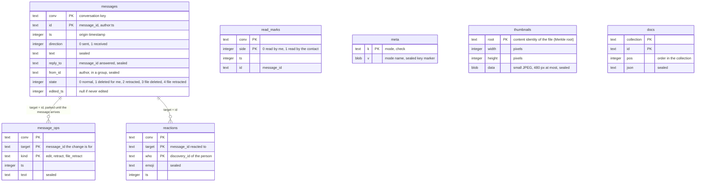

# Client database / Base de données du client

*English, then français. Table and column names are the ones of the code. / Les noms de tables et de colonnes sont ceux du code.*

## English

Each profile has one SQLite file, `freespeech.db`, a plain SQLite database whose content is encrypted field by field (ChaCha20-Poly1305, class `Vault`, key derived from the database key): the text, reply and author of a message, parked changes, reactions, thumbnails and every JSON document are stored sealed, bound to their row. Identifiers, timestamps and states stay readable, because queries and indexes need them. The table `meta` holds the mode (`sealed` or `plain`) and a sealed marker that checks the key at once. A file that is not a SQLite database is set aside as `freespeech.db.legacy` and a new database is created. The message history is stored as real rows so it can be read page by page, and the small pictures of the images (`thumbnails`, one per file content) are stored as blobs. Everything else (identity, contacts, groups, queue of letters to send, attachment records…) is stored as JSON documents in one generic table, `docs`, one `collection` per kind of object. The schema version is kept in `PRAGMA user_version` (currently 2). The key comes from the three phrases and is cached by the platform's secure storage. See [ARCHITECTURE.en.md](../../ARCHITECTURE.en.md).

## Français

Chaque profil a un seul fichier SQLite, `freespeech.db`, une base SQLite ordinaire dont le contenu est chiffré champ par champ (ChaCha20-Poly1305, classe `Vault`, clé dérivée de la clé de la base) : le texte, la réponse et l'auteur d'un message, les changements en attente, les réactions, les miniatures et chaque document JSON sont stockés scellés, liés à leur ligne. Les identifiants, horodatages et états restent lisibles, car les requêtes et les index en ont besoin. La table `meta` garde le mode (`sealed` ou `plain`) et un marqueur scellé qui vérifie la clé tout de suite. Un fichier qui n'est pas une base SQLite est mis de côté sous `freespeech.db.legacy`, une base neuve est créée. L'historique des messages est stocké en vraies lignes pour pouvoir être lu page par page, et les petites images des photos (`thumbnails`, une par contenu de fichier) sont stockées en blobs. Tout le reste (identité, contacts, groupes, file des lettres à envoyer, fiches de pièces jointes…) est stocké en documents JSON dans une table générique, `docs`, avec une `collection` par type d'objet. La version du schéma est gardée dans `PRAGMA user_version` (actuellement 2). La clé vient des trois phrases et est conservée par le coffre sécurisé de la plateforme. Voir [ARCHITECTURE.fr.md](../../ARCHITECTURE.fr.md).

## The collections of `docs` / Les collections de `docs`

| `collection` | Document | `id` |
|---|---|---|
| `identity` | `UserIdentity` | `me` |
| `contacts` | `Contact` | `discovery_id` |
| `archived_contacts` | `ArchivedContact` | `discovery_id` |
| `aliases` | `Alias` | name |
| `revocation_pins` | `Pin` | contact id |
| `otc_entries` | `OtcEntry` | the one-time code |
| `pending_contacts` | `PendingContact` | request id |
| `outbox` | `PendingMessage` | `message_id` |
| `attachments` | `AttachmentRecord` | `ref` |
| `groups` | `GroupRecord` | `group_id` |
| `group_invites` | `PendingGroupInvite` | `group_id` |
| `group_suggestions` | `GroupSuggestion` | key |
| `pending_wipe` | `PendingWipe` | `wipe` |
| `migration_notices` | `MigrationNotice` | old identifier |
| `migration_out` | `MigrationOut` | `out` |
