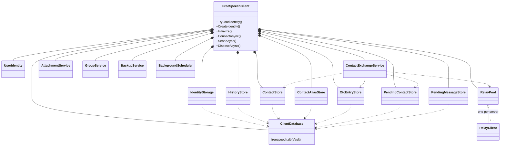

# Client library / Bibliothèque cliente

*English, then français. Class names are the ones of the code. / Les noms de classes sont ceux du code.*

## English

`FreeSpeechClient` is the one entry point of the library (`freespeech.client`): an application creates it, loads or creates an identity, then connects. It owns the stores, which keep their data in the profile's single encrypted database, and the services that implement the protocol. It has no user interface: the apps only call it and listen to its events. See [ARCHITECTURE.en.md](../../ARCHITECTURE.en.md).

## Français

`FreeSpeechClient` est l'unique point d'entrée de la bibliothèque (`freespeech.client`) : une application le crée, charge ou crée une identité, puis se connecte. Il possède les magasins, qui gardent leurs données dans la base chiffrée unique du profil, et les services qui mettent en œuvre le protocole. Il n'a aucune interface : les applications ne font que l'appeler et écouter ses événements. Voir [ARCHITECTURE.fr.md](../../ARCHITECTURE.fr.md).

