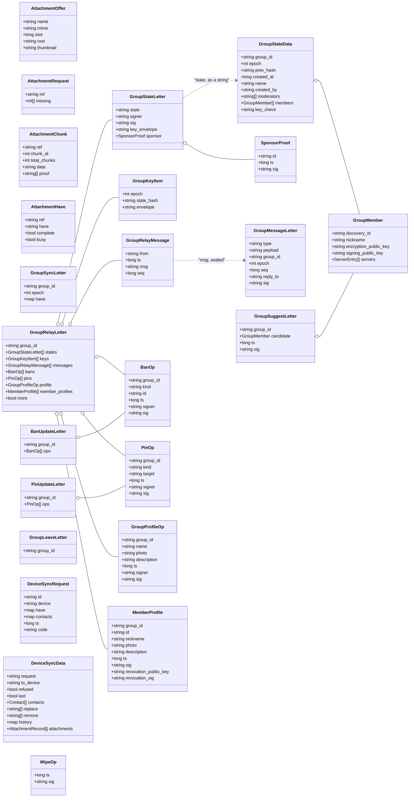

# Files, groups and devices / Fichiers, groupes et appareils

*English, then français. Class and field names are the ones of the code (field names are the JSON names). / Les noms de classes et de champs sont ceux du code (les noms de champs sont les noms JSON).*

## English

The payloads of the Letters about files (section 5 of [PROTOCOL_API.en.md](../../PROTOCOL_API.en.md)), groups (section 6) and several devices (section 8). A `group_state` Letter carries the state as a string; the state itself is a `GroupStateData`. A group message is a `GroupMessageLetter` sealed with the group key.

## Français

Les contenus des lettres sur les fichiers (section 5 de [PROTOCOL_API.fr.md](../../PROTOCOL_API.fr.md)), les groupes (section 6) et les appareils multiples (section 8). Une lettre `group_state` porte l'état sous forme de chaîne ; l'état lui-même est un `GroupStateData`. Un message de groupe est un `GroupMessageLetter` scellé avec la clé de groupe.

