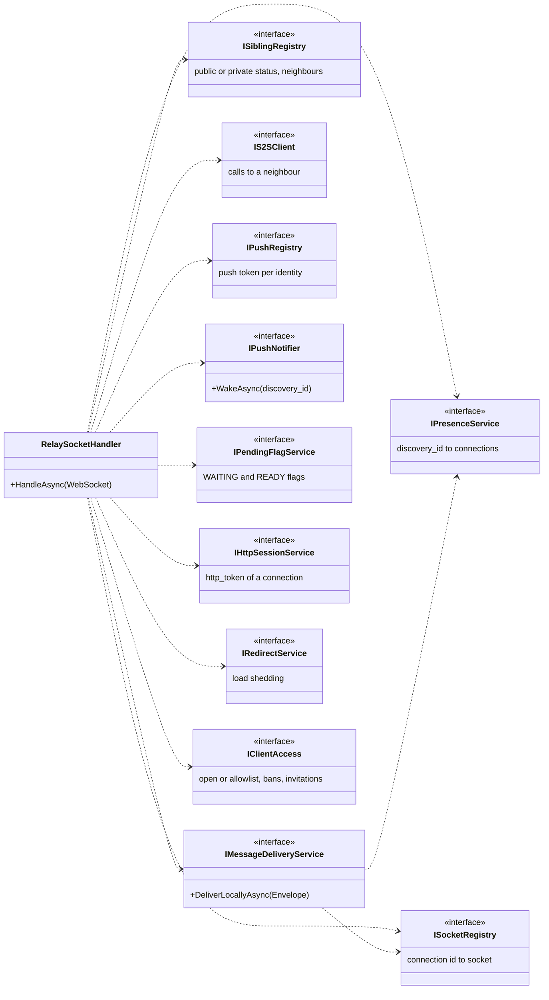

# Relay server / Serveur relais

*English, then français. Class and interface names are the ones of the code. / Les noms de classes et d'interfaces sont ceux du code.*

## English

What `RelaySocketHandler` uses to serve one WebSocket connection: who is connected (`IPresenceService`, `ISocketRegistry`), delivery to the recipient (`IMessageDeliveryService`), neighbouring servers (`ISiblingRegistry`, `IS2SClient`), push wake-ups (`IPushRegistry`, `IPushNotifier`), presence flags (`IPendingFlagService`, `IHttpSessionService`), load shedding (`IRedirectService`) and who may register (`IClientAccess`). The server stores no message. See [ARCHITECTURE.en.md](../../ARCHITECTURE.en.md).

## Français

Ce que `RelaySocketHandler` utilise pour servir une connexion WebSocket : qui est connecté (`IPresenceService`, `ISocketRegistry`), la livraison au destinataire (`IMessageDeliveryService`), les serveurs voisins (`ISiblingRegistry`, `IS2SClient`), les réveils push (`IPushRegistry`, `IPushNotifier`), les drapeaux de présence (`IPendingFlagService`, `IHttpSessionService`), le délestage (`IRedirectService`) et qui peut s'inscrire (`IClientAccess`). Le serveur ne stocke aucun message. Voir [ARCHITECTURE.fr.md](../../ARCHITECTURE.fr.md).

