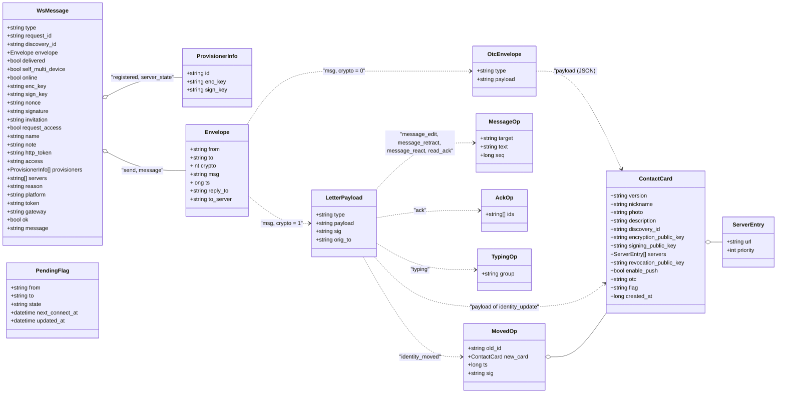

# Wire models / Modèles de messages

*English, then français. The diagram is the same in both languages: class and field names are the ones of the code. / Le diagramme est le même dans les deux langues : les noms de classes et de champs sont ceux du code.*

## English

What travels between a client and a relay, and what an envelope carries. Field names are the JSON names. An envelope carries a Letter (or a contact-exchange wrapper) in its encrypted `msg`; a Letter carries a JSON string in its `payload`. See [PROTOCOL_API.en.md](../../PROTOCOL_API.en.md).

## Français

Ce qui circule entre un client et un relais, et ce que porte une enveloppe. Les noms de champs sont les noms JSON. Une enveloppe porte une lettre (ou une enveloppe de transport d'échange de contact) dans son `msg` chiffré ; une lettre porte une chaîne JSON dans son `payload`. Voir [PROTOCOL_API.fr.md](../../PROTOCOL_API.fr.md).

`PendingFlag` is the body of the flag calls (`/api/flags`), not a frame. / `PendingFlag` est le corps des appels sur les drapeaux (`/api/flags`), pas une trame.
